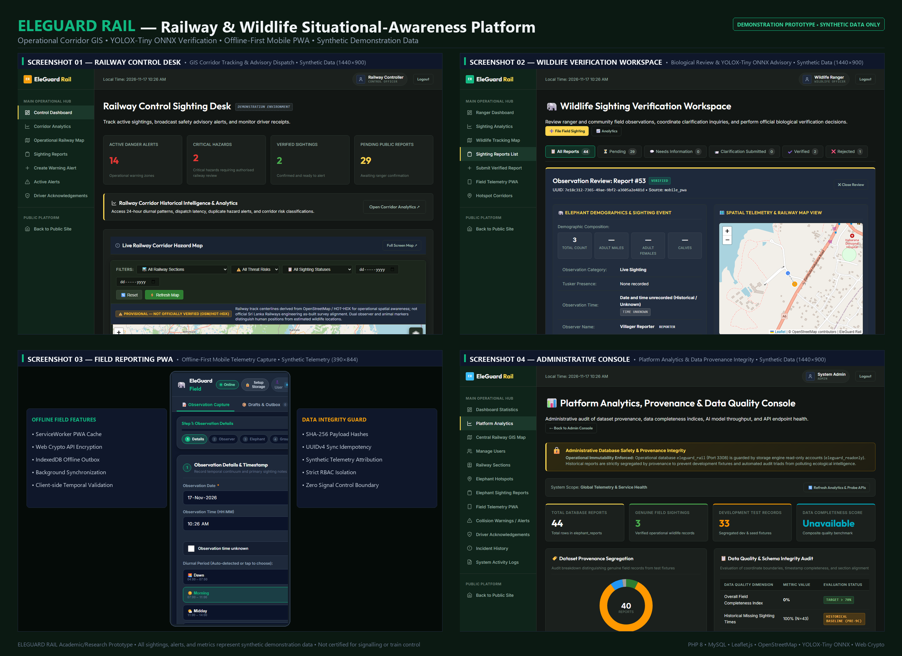
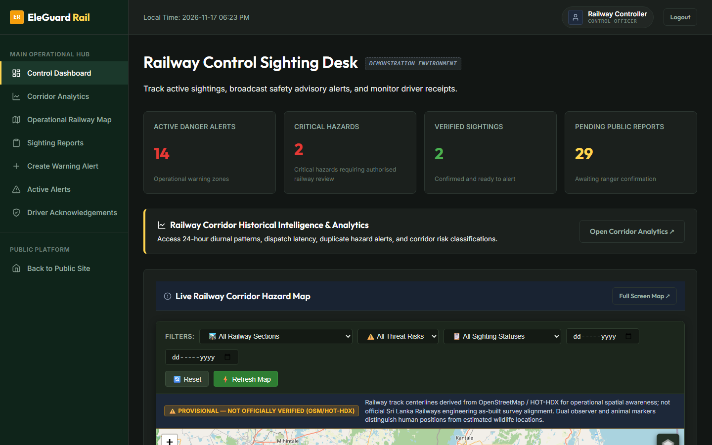
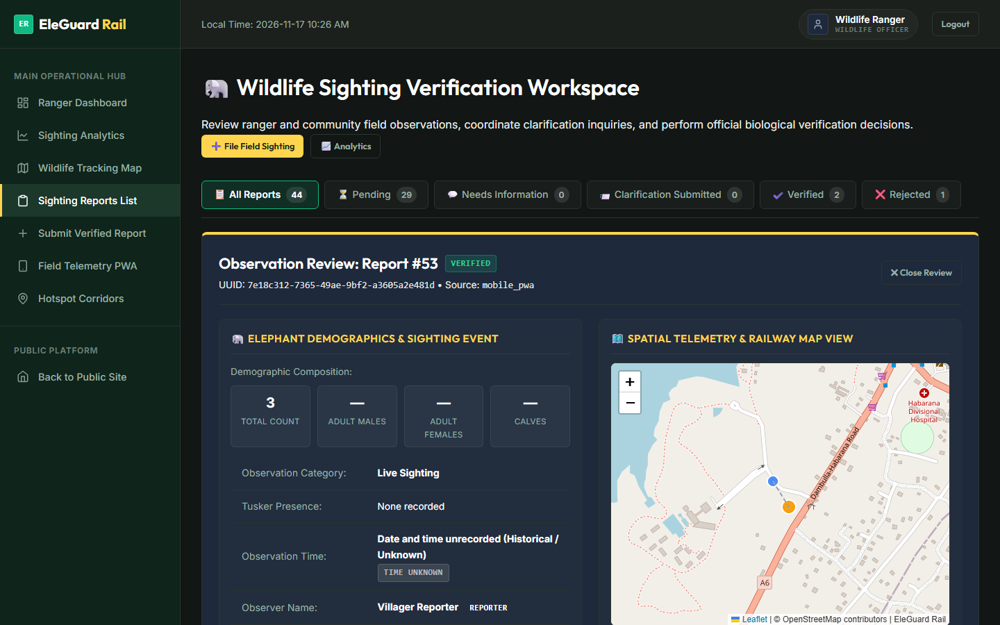
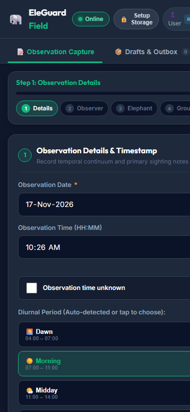
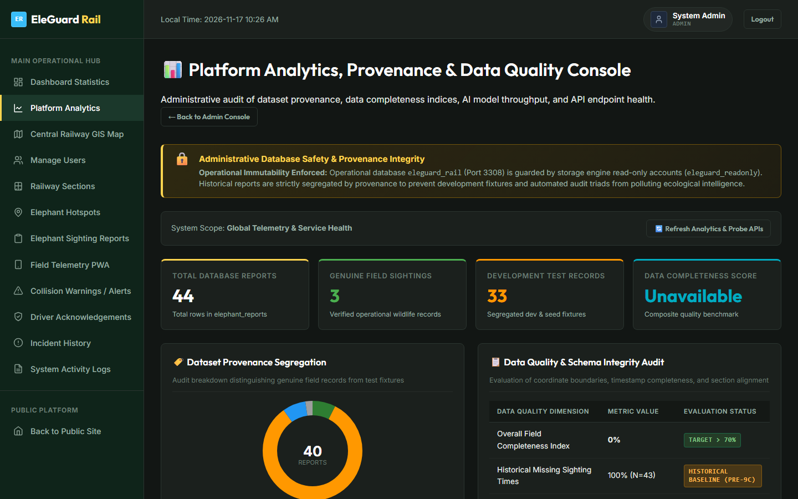

# ELEGUARD RAIL — Wildlife–Railway Collision Mitigation & Early Warning Platform

[](https://www.php.net/)
[](https://mariadb.org/)
[](https://developer.mozilla.org/en-US/docs/Web/Progressive_web_apps)
[](https://developer.mozilla.org/en-US/docs/Web/API/Web_Crypto_API)
[](tests/run_all_tests.php)
[](LICENSE)

**ELEGUARD RAIL** is an early-warning decision support platform and spatial telemetry system engineered to support the mitigation of wild elephant–locomotive collision hazards along critical railway corridors in Sri Lanka (Maho–Galgamuwa–Polonnaruwa lines).

The platform bridges community sighting reports, field ranger telemetry, biological verification by Department of Wildlife Conservation (DWC) officers, railway traffic control desk operations, and locomotive driver advisory interfaces.

---

> [!NOTE]
> ### ELEGUARD RAIL — DEVELOPMENT COMPLETED AND FROZEN
> Active engineering and formal milestone delivery for **ELEGUARD RAIL** have officially concluded.
> The repository is now frozen and published in a stable, verified, and documented state for academic, research, and independent development purposes under the [MIT License](LICENSE).
> The original project team is no longer actively developing or maintaining this project. External developers, researchers, and students are encouraged to independently fork, modify, and extend the platform.
>
> - 📄 **Project Status & Closure Record:** [PROJECT_STATUS.md](PROJECT_STATUS.md)
> - 🛠️ **Developer Handover & Setup Guide:** [FINAL_HANDOVER.md](FINAL_HANDOVER.md)
> - 🤝 **Contributing & Forking Guidelines:** [CONTRIBUTING.md](CONTRIBUTING.md)

---

> [!CAUTION]
> ### Mandatory Safety & Operational Disclaimer
>
> 1. **Demonstration Prototype Only:** ELEGUARD RAIL is an academic, research, and demonstration engineering prototype.
> 2. **Not Certified Railway Safety Software:** This platform is **NOT certified safety-critical railway software** under CENELEC EN 50126, EN 50128, EN 50129, or IEC 61508 (SIL 1–4).
> 3. **Zero Direct Locomotive Control:** The system **DOES NOT control trains, throttle, braking actuators, track interlocking, or railway signalling**. It operates strictly outside physical train protection boundaries.
> 4. **Advisory AI with Mandatory Human Verification:** All machine learning detections, automated hotspot scores, and AI advisory outputs are strictly preliminary decision-support aids that require authoritative human biological verification before operational dissemination.
> 5. **Absolute Precedence of Railway Operating Rules:** In all operational scenarios, **official Sri Lanka Railways (SLR) operating rules, Department of Railway General Rules, physical trackside signals, and authorized paper/radio Caution Orders (Form T.409 / T.410) take absolute legal and operational precedence.**
> 6. **Synthetic Demonstration Data:** All demonstration records, driver responses, incident histories, and elephant coordinates displayed in demonstration environments are synthetic and simulated for evaluation purposes.
> 7. **Unofficial GIS Track Geometry:** OpenStreetMap (OSM) track geometries, chainage approximations, and proximity boundaries are illustrative spatial approximations and **do not constitute an authoritative railway engineering survey.**

---

## 1. Problem Statement & Mission Impact

In Sri Lanka, wild elephant habitats intersect high-speed railway corridors across North-Western, North-Central, and Eastern provinces. Traditional notification channels rely on unstructured cellular calls, VHF chatter, or delayed manual handovers, often reaching locomotive crews too late.

**ELEGUARD RAIL** addresses this challenge through:
- **Offline-First Field Data Acquisition:** Enabling field rangers and community observers in remote jungle tracts without cellular coverage to capture sighting observations securely.
- **Geodesic Animal Position Offset:** Calculating precise animal coordinates from safe observer standoff distances (50–150 m) with mathematical uncertainty propagation.
- **Human-in-the-Loop Biological Triage:** Mandatory two-tier verification by Department of Wildlife Conservation (DWC) officers before warnings escalate to rail operations.
- **Stationary Locomotive Driver Advisories:** High-contrast cab HUD with regulatory enforcement ensuring drivers review advisories exclusively during stationary safety stops.

---

## 2. Key Architecture & Subsystem Features

```
+-----------------------------------------------------------------------------------+
|                            ELEGUARD RAIL SYSTEM ARCHITECTURE                      |
+-----------------------------------------------------------------------------------+
|  [Field Reporter PWA]             [Wildlife Officer Workspace]                    |
|  - Offline Service Worker Cache   - Two-Tier Biological Verification              |
|  - WebCrypto AES-GCM-256 Storage  - Structured Clarification Messaging            |
|  - Forward Geodesic Projection    - Uncertainty Radius Inspection (RSS Math)      |
+-------------------------+---------------------------------+-----------------------+
                          |                                 |
                          v                                 v
+-----------------------------------------------------------------------------------+
|                           RESTful API v2 & Core Services Layer                    |
|  - Client UUID Idempotency        - Multi-Factor Temporal Risk Engine             |
|  - Micro-batch Sync (HTTP 207)    - Spatial Proximity & Section Attribution       |
|  - Role-Based Access Control      - Fail-Closed Audit Logging                     |
+-------------------------+---------------------------------+-----------------------+
                          |                                 |
                          v                                 v
+-----------------------------------+   +-------------------------------------------+
|    [Railway Control GIS Desk]     |   |       [Locomotive Driver In-Cab HUD]      |
|  - Leaflet Vector Map Visualization|   |  - Stationary Review Compliance Banner   |
|  - Section Hazard Scoring         |   |  - Audio Chime Caution Notifications      |
|  - Simulated Advisory Review Log  |   |  - One-Tap Safety Acknowledgement         |
+-----------------------------------+   +-------------------------------------------+
```

### Core Subsystems:
1. **Field Reporter PWA (`public/field/`):**
   - Installable Progressive Web App (PWA) with offline application shell.
   - Encrypted local draft vault using Web Crypto API (`SubtleCrypto` AES-GCM-256 with PBKDF2-derived key).
   - Direct forward geodesic solver ($d \cos \theta, d \sin \theta$) projecting animal positions from observer coordinates.
   - Controlled micro-batch synchronization engine with client-generated RFC 4122 v4 UUID idempotency.
2. **Wildlife Officer Workspace (`public/wildlife/`):**
   - Comprehensive sighting triage state machine (`Pending` $\to$ `Verified` / `Needs Information` / `Rejected`).
   - Two-way clarification threads with field observers.
   - Forensic audit logging tracking transitions, officer ID, and biological verification method.
3. **Control Officer GIS Dashboard (`public/control/`):**
   - Interactive Leaflet.js corridor map rendering railway chainage, sections, and active hazard zones.
   - Temporal risk scoring evaluating sighting decay and environmental factors.
4. **Locomotive Driver Advisory HUD (`public/driver/`):**
   - High-contrast night-cab interface optimized for low light.
   - Strict stationary review compliance (`STATIONARY REVIEW USE ONLY`).
   - Simulated advisory alerts with demonstration cryptographic acknowledgement logs.
5. **System Administration & Analytics (`public/admin/`):**
   - User account lifecycle management and RBAC enforcement across 5 roles.
   - Read-only historical analytics and incident correlation.

---

## 3. Technology Stack

- **Backend Runtime:** PHP 8.2+ (Strict typing, PDO prepared statements, native password hashing).
- **Database Engine:** MariaDB 10.4+ / MySQL 8.0+ (InnoDB, strict foreign keys, composite geospatial indexes).
- **Client Frontend:** Vanilla ECMAScript 2022 (ES6+), Semantic HTML5, Modular CSS Design System.
- **Mapping & GIS:** Leaflet.js 1.9.4 with OpenStreetMap vector GeoJSON overlays.
- **Client Cryptography:** W3C Web Cryptography API (`SubtleCrypto`), AES-GCM-256, PBKDF2-HMAC-SHA256 (250,000 iterations).
- **Offline & Concurrency:** Service Worker API, CacheStorage, IndexedDB, W3C Web Locks API (`navigator.locks`).
- **Web Server:** Apache 2.4+ (`mod_rewrite`, `.htaccess` security hardening).

---

## 4. System Prerequisites & Installation

### Requirements
- **Web Server:** Apache 2.4+ (with `mod_rewrite` enabled).
- **PHP:** Version 8.2 or later (Extensions required: `pdo_mysql`, `openssl`, `json`, `mbstring`).
- **Database:** MariaDB 10.4+ or MySQL 8.0+ running on port `3306` (or `3308` under XAMPP).

### Installation Steps

1. **Clone the Repository:**
   ```bash
   git clone https://github.com/deatharoundthecorner/ELEGUARD-RAIL.git
   cd ELEGUARD-RAIL
   ```

2. **Web Server Placement:**
   - Copy or symlink the repository into your web server document root:
     * **XAMPP (Windows):** `C:\xampp\htdocs\eleguard-rail`
     * **Apache (Linux):** `/var/www/html/eleguard-rail`

3. **Configure Environment File:**
   - Copy `.env.example` to `.env`:
     ```bash
     cp .env.example .env
     ```
   - Configure your local database connection parameters:
     ```ini
     DB_HOST=127.0.0.1
     DB_PORT=3308
     DB_NAME=eleguard_rail
     DB_USER=root
     DB_PASS=
     ```

---

## 5. Local XAMPP Setup Instructions

1. **Start Apache and MySQL:**
   - Open the **XAMPP Control Panel**.
   - Start the **Apache** and **MySQL** services. Ensure MySQL is listening on the configured port (default `3306` or `3308`).

2. **Virtual Host / Subpath Configuration:**
   - The platform supports relocatable base paths. Access the application at:
     ```
     http://localhost/eleguard-rail/public/
     ```

3. **Verify Security Hardening:**
   - Direct access to backend directories is blocked by the root `.htaccess`. Confirm that accessing:
     * `http://localhost/eleguard-rail/app/`
     * `http://localhost/eleguard-rail/docs/`
     * `http://localhost/eleguard-rail/database/`
     * `http://localhost/eleguard-rail/.env`
   - Returns **HTTP 403 Forbidden**.

---

## 6. Fresh Database Setup & Migration Instructions

To initialize a clean database from scratch, execute the baseline schema followed by all sequential migrations:

```bash
# 1. Create the database
mysql -h 127.0.0.1 -P 3308 -u root -p -e "CREATE DATABASE eleguard_rail CHARACTER SET utf8mb4 COLLATE utf8mb4_unicode_ci;"

# 2. Apply baseline table definitions
mysql -h 127.0.0.1 -P 3308 -u root -p eleguard_rail < database/eleguard_rail.sql

# 3. Apply sequential migrations (01 through 06)
mysql -h 127.0.0.1 -P 3308 -u root -p eleguard_rail < database/migrations/01_add_gps_coordinates_to_elephant_reports.sql
mysql -h 127.0.0.1 -P 3308 -u root -p eleguard_rail < database/migrations/02_add_ai_detection_metadata_to_elephant_reports.sql
mysql -h 127.0.0.1 -P 3308 -u root -p eleguard_rail < database/migrations/03_add_temporal_intelligence_to_elephant_reports.sql
mysql -h 127.0.0.1 -P 3308 -u root -p eleguard_rail < database/migrations/04_add_field_reporting_v2_to_elephant_reports.sql
mysql -h 127.0.0.1 -P 3308 -u root -p eleguard_rail < database/migrations/05_add_verification_and_section_audits.sql
mysql -h 127.0.0.1 -P 3308 -u root -p eleguard_rail < database/migrations/06_add_payload_hash_to_elephant_reports.sql

# 4. Seed initial demonstration users and railway corridor geometry
php database/create_sample_users.php
```

---

## 7. Automated Testing & Verification Suite

ELEGUARD RAIL includes a comprehensive 35-suite automated regression test runner covering geodetic solvers, cryptographic primitives, API envelopes, and browser concurrency.

All tests utilize fail-closed ephemeral test databases (`eleguard_test_tmp_*`), guaranteeing zero modification to production or staging databases.

### Running the Test Suite:
```bash
# Run the complete master test runner
php tests/run_all_tests.php
```

### Test Suite Execution Output:
```
================================================================================
 EleGuard Rail - Master Unified Test Runner (Milestone 9C Stage 4D.1-H)
================================================================================
[STEP 1/3] Executing Environment Guard & Database Safety Pre-checks...
  => All 6 Database Permission Isolation checks PASSED.
[STEP 2/3] Discovering and Executing All Test Suites...
  [01/35] test_milestone_9c_stage4c2_security.php .................. PASS
  [02/35] test_milestone_9c_stage1_foundation.php .................. PASS
  ...
  [35/35] test_milestone_9c_stage_j_gps_validation.php ............. PASS
================================================================================
 TEST RUN SUMMARY: 35 / 35 SUITES PASSED (37.19 seconds total elapsed)
 VERDICT: [SUCCESS] ALL 35 TEST SUITES PASSED CLEANLY.
================================================================================
```

---

## 8. Role Interfaces & Screenshots

### 8.1 Official Project Showcase



> [!NOTE]
> **Notice on Demonstration Visuals & Operational Authority:** All sightings, GPS coordinates, alerts, telemetry, and metrics depicted in these showcase captures represent synthetic demonstration data within isolated prototype environments. ELEGUARD RAIL is an experimental decision-support prototype and **does not control train signalling, dispatch, speed restrictions, or locomotive movements**. Official Sri Lanka Railways (SLR) operating procedures, physical signals, and authorized railway personnel retain all operational command and authority at all times.

---

### 8.2 Primary Operational Interfaces

#### 1. Railway Control Desk
*Prototype situational-awareness and simulated advisory-review interface for monitoring railway corridor context and reviewing hazard advisories.*<br />
**Operational Scope:** Purely informational decision support. Does not broadcast enforceable speed restrictions, issue train movements, or execute railway dispatch. All train movements and operational decisions remain strictly under official Sri Lanka Railways procedures and authorized personnel.<br />
**Interface URL:** `/public/control/dashboard.php` (Desktop Viewport: 1440 × 900)



#### 2. Wildlife Verification Workspace
*Biological observation triage, spatial map telemetry, and simulated YOLOX-Tiny ONNX AI advisory review for authorized Wildlife Officers.*<br />
**Operational Scope:** Machine-learning detections and AI outputs are strictly advisory decision-support recommendations that remain subject to mandatory human verification by authorized Wildlife Officers before any status confirmation.<br />
**Interface URL:** `/public/wildlife/reports.php?id=53` (Desktop Viewport: 1440 × 900)



#### 3. Field Reporting Mobile PWA
*Offline-first guided field observation capture, Web Crypto AES-GCM encrypted local storage, and user-controlled batch synchronization with connectivity-aware status updates for Field Observers.*<br />
**Demonstration Scope:** Displayed GPS coordinates, sighting timestamps, and observer telemetry represent synthetic field test data for prototype evaluation.<br />
**Interface URL:** `/public/field/index.php` (Mobile Viewport: 390 × 844)

<p align="center">
  
</p>

#### 4. Platform Analytics & Governance Console
*System health audit, data quality benchmarks, and dataset provenance segregation for System Administrators.*<br />
**Demonstration Scope:** Displayed metrics, report distributions, and audit totals reflect synthetic development fixtures and baseline demonstration logs.<br />
**Interface URL:** `/public/admin/analytics.php` (Desktop Viewport: 1440 × 900)



---

### 8.3 Role Access & Reference Inventory

| Role / Feature | Primary Interface URL | Visual Evidence Reference | Description |
| :--- | :--- | :--- | :--- |
| **System Administration** | `/public/admin/dashboard.php` | `docs/final_handover/phase_c1_evidence/c1_01_admin_dashboard_desktop.png` | System health, user lifecycle, audit trail, server telemetry. |
| **Railway Control Desk** | `/public/control/dashboard.php` | `docs/final_handover/linkedin_showcase/01-control-desk.png` | Corridor situational awareness, simulated advisory-review interface (informational only; no dispatch or speed control). |
| **Wildlife Verification** | `/public/wildlife/reports.php` | `docs/final_handover/linkedin_showcase/02-wildlife-verification.png` | Sighting triage, YOLOX-Tiny ONNX advisory review (strictly subject to human verification). |
| **Locomotive Cab HUD** | `/public/driver/dashboard.php` | `docs/final_handover/phase_c1_evidence/c1_05_driver_dashboard.png` | High-contrast stationary review HUD, simulated corridor hazard advisories (stationary review only). |
| **Community Reporter** | `/public/reporter/dashboard.php` | `docs/final_handover/phase_c1_evidence/c1_06_reporter_dashboard.png` | Community observation submission, sighting status tracking. |
| **Field Telemetry PWA** | `/public/field/index.php` | `docs/final_handover/linkedin_showcase/03-field-pwa-mobile.png` | Offline field data capture, encrypted vault, geodesic projection (synthetic telemetry). |
| **Platform Analytics** | `/public/admin/analytics.php` | `docs/final_handover/linkedin_showcase/04-admin-analytics.png` | Provenance segregation, data quality audit, service health (synthetic metrics). |
| **Showcase Contact Sheet** | Consolidated Overview | `docs/final_handover/linkedin_showcase/05-project-showcase-contact-sheet.png` | 2×2 showcase overview across all core subsystems (synthetic demonstration data). |
| **Responsive Tablet** | All interfaces | `docs/final_handover/phase_c1_evidence/c1_07_responsive_tablet_view.png` | 768px tablet layout with adaptive navigation drawer and backdrop. |

---

## Project Presentation

A comprehensive 15-slide technical and stakeholder presentation prepared for inter-agency review (Department of Wildlife Conservation and Sri Lanka Railways Directorate) and academic evaluation is available in the repository:

- 📄 **[ELEGUARD RAIL Stakeholder Presentation (PDF)](docs/presentation/ELEGUARD_RAIL_Stakeholder_Presentation.pdf)** — View or download the complete 15-slide presentation covering the problem context, decoupled geodetic architecture, offline Web Crypto PWA, finite-state machine biological triage, stationary driver HUD, and safety boundary disclaimers.
- 📊 **[ELEGUARD RAIL Stakeholder Presentation (PowerPoint .pptx)](docs/presentation/ELEGUARD_RAIL_Stakeholder_Presentation.pptx)** — Download the editable presentation deck with slide layouts, architecture diagrams, and milestone closure metrics.

---

## 9. Engineering Records & Technical Documentation

Formal engineering deliverables and architectural audits compiled under the Master Development Directive:

- 🏁 **[Project Status & Closure Record](PROJECT_STATUS.md)** — Formal statement of project completion, frozen development baseline, and future engineering opportunities.
- 📘 **[Developer Handover Guide](FINAL_HANDOVER.md)** — Step-by-step instructions for cloning, configuring, running, testing, and independently extending the codebase.
- 🤝 **[Contributing Guidelines](CONTRIBUTING.md)** — Guidance for external developers, independent forks, safety boundaries, and vulnerability reporting.
- 📑 **[Final Release Report](docs/final_handover/FINAL_RELEASE_REPORT.md)** — Master release verification record and architectural audit trail.
- 📋 **[Master Development Audit](docs/development/master_development_audit.md)** — Comprehensive repository baseline, migration status, AI runtime assessment, and 9-stage engineering roadmap.
- 🗺️ **[Engineering Development Roadmap](docs/development/development_roadmap.md)** — Detailed milestone progression (Milestones 1–8, 9A/9B, 9C, Stage J, Stages A–I) and future engineering horizon.
- 🏛️ **[Architectural Decision Records (ADRs)](docs/development/architecture_decisions.md)** — Ten formal ADRs documenting three-database isolation, privilege separation, geodetic forward projection, 7-period diurnal continuum, UUID idempotency, Web Crypto AES-GCM vault, advisory YOLOX-Tiny ONNX pipeline, and RFC 9457 error standards.
- 🔒 **[Application Security Assessment](docs/development/security_assessment.md)** — OWASP Top 10 evaluation, anti-poaching coordinate masking, threat modeling, and engine-level privilege boundaries.
- 🧪 **[Quality Assurance & Testing Report](docs/development/testing_report.md)** — Detailed test execution report covering all 35 test suites, 1,647+ assertions, 100% pass rate, CDP timing remediation, and edge-case verification.

---

## 10. Documented Limitations & Technical Boundaries

As documented in `docs/final_handover/deployment_readiness_and_limitations.md`:
1. **Locomotive Telemetry Simulation (LIM-01):** Driver advisory interface does not connect directly to locomotive J1939 CAN bus or wheel tachometers. Driver review is restricted to stationary safety stops.
2. **Base Map Connectivity (LIM-02):** Initial Leaflet tile fetch requires internet connectivity; railway route GeoJSON vectors are bundled locally as fallback.
3. **Optical Standoff Range (LIM-03):** Ranger visual standoff distance (50–150 m) carries an assumed $\pm 20\%$ optical error, modeled via Root-Sum-Square (RSS) uncertainty ellipses.
4. **Device Security at Rest (LIM-04):** WebCrypto AES-GCM protects offline drafts at rest in IndexedDB; operating standard operating procedures mandate device-level PIN/biometric screen locks.
5. **Single-Browser Session Overwrite (LIM-05):** Multi-role demonstration within a single browser profile shares the session cookie; testers must use separate browser profiles or private windows.

---

## 11. Future Development Roadmap

- **Hardware Locomotive Interface:** Direct serial/CAN bus telemetry integration with locomotive GPS units and train radio modems.
- **Cowcatcher Edge AI Vision:** Deep-learning computer vision models running on edge compute with forward-facing infrared cameras.
- **Automated Corridor SMS Gateways:** Low-latency telecommunications broadcast to track maintenance gangs and forest range offices.
- **Offline Vector Spatial Tiling:** Dynamic vector tile packages stored in IndexedDB Blob caches for complete offline map rendering.

---

## 12. License

This project is licensed under the MIT License — see the [LICENSE](LICENSE) file for details.
