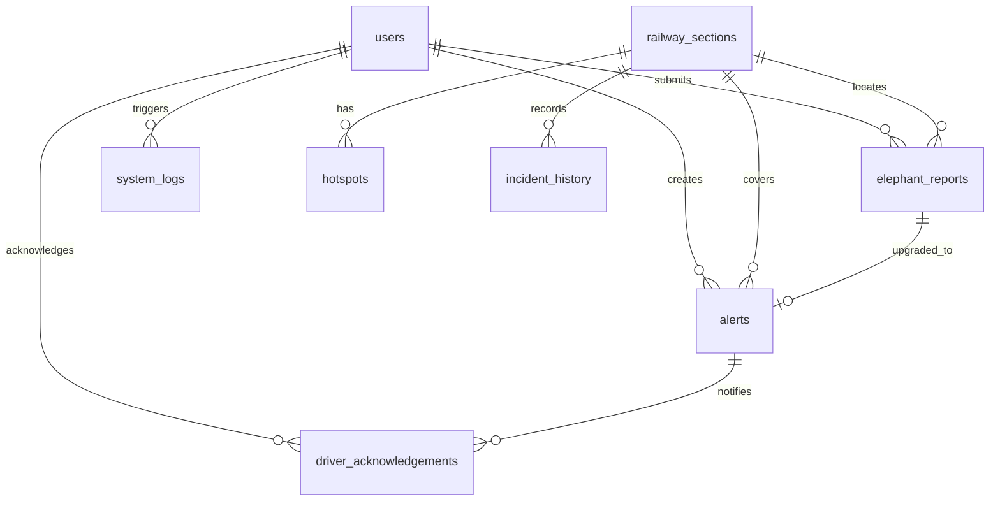

# Database Design & Schema Guide

This guide describes the MySQL database design for EleGuard Rail.

## 1. Entity Relationship Overview

The system uses a relational database schema centered around railway track sections. Sighting reports refer to sections, alerts refer to reports/sections, and driver responses reference active alerts.

## 2. Table Specifications

### users
Stores user accounts, secure passwords, roles, and status.
- `id` (INT Auto-Increment PK)
- `name` (VARCHAR 100)
- `email` (VARCHAR 100 Unique)
- `password` (VARCHAR 255 BCRYPT)
- `role` (ENUM: admin, control_officer, driver, wildlife_officer, reporter)
- `status` (ENUM: active, inactive)
- `created_at` (TIMESTAMP)

### railway_sections
Defines track segments and regional districts.
- `id` (INT Auto-Increment PK)
- `section_name` (VARCHAR 150)
- `district` (VARCHAR 100)
- `start_location` (VARCHAR 150)
- `end_location` (VARCHAR 150)
- `risk_level` (ENUM: Low, Medium, High, Critical)
- `description` (TEXT)

### hotspots
Maps historically active elephant crossing points.
- `id` (INT Auto-Increment PK)
- `section_id` (INT FK -> railway_sections)
- `hotspot_name` (VARCHAR 150)
- `latitude` / `longitude` (DECIMAL)
- `risk_level` (ENUM: Low, Medium, High, Critical)
- `reason` (TEXT)

### elephant_reports
Stores elephant sighting reports.
- `id` (INT Auto-Increment PK)
- `section_id` (INT FK -> railway_sections)
- `reported_by` (INT FK -> users)
- `elephant_count` (INT)
- `location_description` (VARCHAR 255)
- `urgency_level` (ENUM: Low, Medium, High, Critical)
- `risk_score` (ENUM: Low, Medium, High, Critical)
- `report_status` (ENUM: Pending, Verified, Rejected, Converted to Alert, Resolved)
- `description` (TEXT)
- `image_path` (VARCHAR 255)

### alerts
Stores broadcasted safety alerts.
- `id` (INT Auto-Increment PK)
- `report_id` (INT FK -> elephant_reports - Set Null on delete)
- `section_id` (INT FK -> railway_sections)
- `alert_level` (ENUM: Low, Medium, High, Critical)
- `alert_message` (TEXT)
- `alert_status` (ENUM: Active, Resolved, False Alert)
- `created_by` (INT FK -> users)

### driver_acknowledgements
Logs train driver responses to active alerts.
- `id` (INT Auto-Increment PK)
- `alert_id` (INT FK -> alerts)
- `driver_id` (INT FK -> users)
- `action_status` (ENUM: Acknowledged, Slowing Down, Stopped, False Alert)
- `note` (TEXT)
- `acknowledged_at` (TIMESTAMP)

### incident_history
Compiles historical collisions and near-misses.
- `id` (INT Auto-Increment PK)
- `section_id` (INT FK -> railway_sections)
- `incident_type` (VARCHAR 100)
- `description` (TEXT)
- `incident_date` (DATE)
- `severity` (ENUM: Low, Medium, High, Critical)

### system_logs
Auditable log of user and system actions.
- `id` (INT Auto-Increment PK)
- `user_id` (INT FK -> users - Set Null on delete)
- `action` (VARCHAR 255)
- `description` (TEXT)
- `created_at` (TIMESTAMP)
