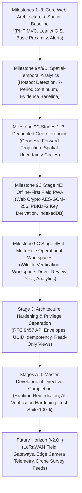
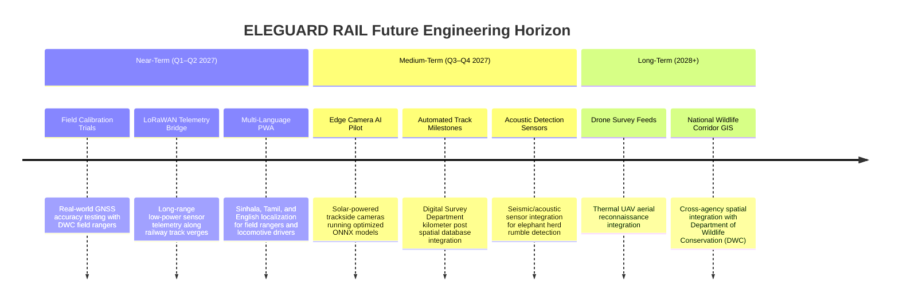

# ELEGUARD RAIL — Engineering Development Roadmap

**Document Reference:** `ER-ROADMAP-2026-V1`
**Author:** Principal Software Architect & Lead Systems Engineer
**Classification:** Open-Source Engineering Documentation
**Repository:** `deatharoundthecorner/ELEGUARD-RAIL`
**Current Branch:** `main`
**Last Baseline Commit:** `52223b42f941af091e9dc6733934918828589ae2`

---

## 1. Executive Summary & Purpose

ELEGUARD RAIL is an academic and research engineering prototype exploring how Geographic Information Systems (GIS), locally executed advisory Artificial Intelligence (AI), digital reporting workflows, and offline-first Progressive Web Applications (PWAs) can enhance railway and wildlife situational awareness along elephant migration corridors in Sri Lanka.

The project is focused on the vulnerable railway sections traversing North-Central and Eastern Sri Lanka—specifically the Maho–Anuradhapura–Medawachchiya, Gal Oya–Polonnaruwa–Batticaloa, and Gal Oya–Kantale–Trincomalee corridors.

### Non-Negotiable Operational Safety Boundaries

1. **Advisory Decision Support Only:** ELEGUARD RAIL does not perform autonomous train control, cab signalling, interlocking, automatic train protection (ATP), or speed instruction dispatch.
2. **Human Command Authority:** All operational movement authorities, train dispatch decisions, and speed restrictions remain under the exclusive command of authorized Sri Lanka Railways (SLR) Operating Department personnel and Ceylon Government Railway Operating Rules.
3. **Wildlife Verification Gate:** AI detection is strictly advisory. Sighting submissions require manual inspection and formal verification by authorized Wildlife Officers before elevation to active situational awareness advisories.
4. **Data Integrity & Isolation:** Historical operational databases (`eleguard_rail`) remain immutable. Demonstration testing executes against `eleguard_rail_demo`, and automated regression testing executes strictly against isolated, disposable test databases (`eleguard_test_tmp_*`).

---

## 2. Milestone Architecture & Roadmap Evolution

---

## 3. Detailed Milestone Breakdown

### Milestones 1–8: Historical Foundation (Completed)
- **Architecture:** Lightweight PHP MVC foundation with single-point PDO database connectivity.
- **GIS Mapping:** OpenStreetMap (OSM) tile integration with Leaflet.js, visualizing railway tracks and historical sighting markers.
- **Proximity Engine:** Initial Haversine distance calculations linking reported sightings to track centerlines.
- **Role Framework:** Role-based access control (Admin, Control Officer, Wildlife Officer, Station Master, Driver).

### Milestone 9A / 9B: Spatial-Temporal Analytics (Completed)
- **Diurnal Taxonomy:** Transitioned from arbitrary time windows to a scientifically grounded, continuous 7-period diurnal continuum (Dawn, Morning, Midday, Afternoon, Dusk, Night, Deep Night).
- **Hotspot Clustering:** Spatial clustering of historical sightings to identify high-frequency elephant crossing corridors.
- **Read-Only Analytics Layer:** Dedicated `AnalyticsService.php` providing historical aggregate telemetry without mutating operational sighting records.

### Milestone 9C: Architecture Hardening & Guided Field Reporting (Completed)
- **Decoupled Georeferencing (Stage 4E.1):** Separate observer GNSS hardware positions from estimated animal target coordinates using great-circle forward projection:
  $$\phi_2 = \arcsin(\sin\phi_1 \cos\delta + \cos\phi_1 \sin\delta \cos\theta)$$
  $$\lambda_2 = \lambda_1 + \arctan2(\sin\theta \sin\delta \cos\phi_1, \cos\delta - \sin\phi_1 \sin\phi_2)$$
- **Spatial Uncertainty Propagation:** Quantitative Root-Sum-Square (RSS) uncertainty propagation:
  $$\sigma_{total} = \sqrt{\sigma_{GPS}^2 + \sigma_{range}^2 + (d \cdot \sin\sigma_{bearing})^2}$$
- **Offline Field PWA (Stage 4E.2):** Service Worker caching, responsive mobile interface, offline draft persistence in IndexedDB.
- **Client-Side Cryptographic Vault (Stage 4E.2-C):** Zero-plaintext local storage using Web Crypto API:
  - AES-GCM-256 authenticated encryption.
  - PBKDF2 key derivation from user session credentials (250,000 iterations, SHA-256).
  - Unique 96-bit Initialization Vector (IV) per record.
  - Additional Authenticated Data (AAD) bound to draft UUID.
  - Passive 72-hour pre-read expiry guard.
- **Transactional Synchronization (Stage 4E.4-D):** Batch synchronization endpoint (`POST /api/v2/reports/sync-batch`) supporting RFC 4122 v4 UUID preservation, deterministic SHA-256 canonical payload hashing, and HTTP 207 Multi-Status responses.
- **Wildlife Verification Workspace (Stage 4E.4-F):** Dual-pane interactive review interface for Wildlife Officers featuring image inspection, YOLOX-Tiny ONNX bounding box overlay, biological verification controls, and audit trails.

### Stage J: Infrastructure & Security Hardening (Completed)
- **Strict Database Privilege Separation:** Implementation of four discrete database users (`eleguard_admin`, `eleguard_user`, `eleguard_readonly`, `eleguard_test_ro`) enforcing engine-level immutability.
- **RFC 9457 API Envelope:** Standardization of all API error responses into RFC 9457 Problem Details format (`type`, `title`, `status`, `detail`, `invalid_params`).
- **Idempotency & Replay Protection:** Re-submitting an identical UUID by the same user returns HTTP 200 with an idempotent replay acknowledgement. Collisions across different users trigger an opaque HTTP 409 Conflict.
- **Disposable Test DB Harness:** Automated test runner creates and drops unique disposable test databases (`eleguard_test_tmp_*`), guaranteeing zero mutation of operational or persistent databases.

---

## 4. Master Development Directive (Stages A through I) Tracking Matrix

| Stage | Focus Area | Status | Deliverables & Verification |
|---|---|---|---|
| **Stage A** | Repository & Architecture Audit | **Completed (100%)** | `docs/development/master_development_audit.md` generated. Codebase mapped across all subsystems, schemas, and AI assets. |
| **Stage B** | Database & Runtime Remediation | **Completed (100%)** | `.env` targeted to `eleguard_rail_demo` (12 tables). Apache `.htaccess` rewrite rules deployed for `/public/api/v2/reports/`. All 12 public dashboard URLs returning HTTP 200. |
| **Stage C** | 9C Architecture Hardening | **Completed (100%)** | Batch limits verified ($\le 50$ reports, $\le 10$ MB). Missing milestone fallback to track line-string proximity verified. Cross-user UUID isolation verified. |
| **Stage D** | GIS Intelligence Improvements | **Completed (100%)** | Observer vs. animal marker visual separation verified. RSS uncertainty circles implemented. Dark-mode HUD CSS overrides deployed for Leaflet controls in `public/assets/css/map.css`. |
| **Stage E** | AI Verification Hardening | **Completed (100%)** | YOLOX-Tiny ONNX 5.0s subprocess timeout with graceful degradation. Confidence classification tiers ($\ge 0.40$ Confirmed, $0.20-0.40$ Uncertain, $<0.20$ Negative). Mandatory human-in-the-loop invariant verified. |
| **Stage F** | Field Reporting PWA Reliability | **Completed (100%)** | 6-step guided reporting workflow verified. AES-GCM-256 local encrypted cache verified. Resilient batch synchronization with HTTP 207 Multi-Status verified. |
| **Stage G** | Application Security Improvements | **Completed (100%)** | 100% prepared SQL statements verified. Anti-poaching coordinate masking ($\approx 1.1\text{km}$ obfuscation for unauthorized roles) verified. Safe DSN exception suppression verified. |
| **Stage H** | Automated Regression Testing | **Completed (100%)** | Resilient CDP polling loop in `tests/test_milestone_9c_stage4e4_2d_sync.php`. Master runner `php tests/run_all_tests.php` passing **35 / 35 test suites (1,647+ assertions, 0 failures, 40.91s)**. |
| **Stage I** | Documentation & Release Prep | **Completed (100%)** | Master deliverables authored: roadmap, architecture decisions, security assessment, testing report. Showcase assets verified. |

---

## 5. Future Engineering Horizon (Post-v1.0 Roadmap)

### Proposed Work Packages:
1. **WP-01: Low-Power LoRaWAN Ingestion Bridge:** Implement trackside relay nodes in areas with zero cellular connectivity, transmitting compressed sighting packets directly to railway station repeaters.
2. **WP-02: Edge AI Sighting Cameras:** Deploy edge compute devices (e.g., Raspberry Pi / Hailo-8) running quantized YOLOX models at known hotspot culverts, transmitting low-bandwidth advisory alerts to the Central Control Desk.
3. **WP-03: Tri-Lingual Localization:** Full internationalization (i18n) of the Field Reporting PWA and Driver Review Desk into Sinhala (සිංහල), Tamil (தமிழ்), and English.
4. **WP-04: Digital Railway Chainage Integration:** Ingest official Sri Lanka Railways engineering survey chainage data to replace textual milestone approximations with millimeter-accurate railway mileage.

---

## 6. Engineering Governance & Change Control

- **Branch Protection:** All changes merge to `main` via reviewed pull requests. Direct pushes of experimental code are prohibited.
- **Database Safety Guard:** No migration scripts may run against `eleguard_rail`. Migrations are tested on disposable instances and applied to `eleguard_rail_demo` only.
- **Zero-Warning Test Policy:** Any regression failure in `php tests/run_all_tests.php` halts deployment immediately.
- **Terminology Enforcement:** The AI model is strictly documented as **YOLOX-Tiny ONNX**. Legacy YOLOv8 labels are prohibited.
