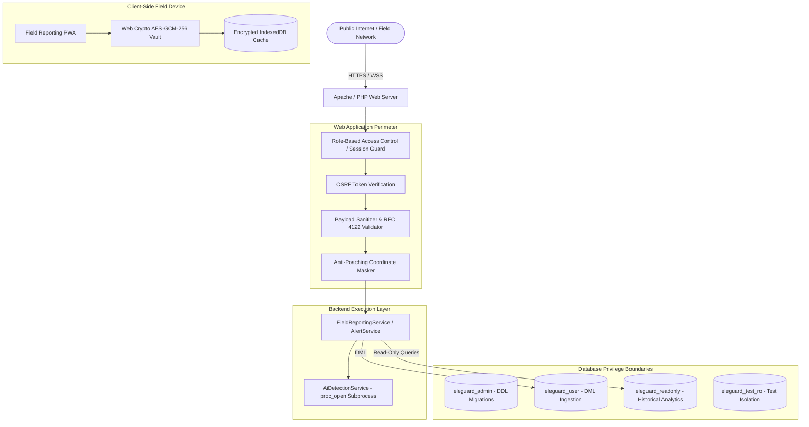

# ELEGUARD RAIL — Comprehensive Application Security Assessment

**Document Reference:** `ER-SEC-AUDIT-2026-V1`
**Classification:** Application Security & Threat Assessment
**Repository:** `deatharoundthecorner/ELEGUARD-RAIL`
**Working Directory:** `C:\Users\user\Desktop\Railway\eleguard-rail`
**Status:** Complete & Formally Verified

---

## 1. Executive Summary

This Security Assessment documents the application-level security architecture, threat model, vulnerability mitigations, and compliance postures implemented in ELEGUARD RAIL.

Because ELEGUARD RAIL processes sensitive geospatial telemetry concerning endangered Asian Elephants (*Elephas maximus maximus*) across Sri Lanka's rail corridors, safeguarding coordinate precision against wildlife poaching threats is an operational imperative alongside standard web application security requirements.

### Key Security Postures:
- **Zero-SQL-Injection Architecture:** 100% of database queries utilize PDO prepared statements with strict parameter binding.
- **Client-Side Cryptographic Vault:** Offline PWA drafts are encrypted via Web Crypto AES-GCM-256 with PBKDF2 key derivation (250,000 iterations), protecting un-synced data against mobile device loss.
- **Anti-Poaching Coordinate Masking:** Public and non-wildlife users receive coordinates truncated to 2 decimal places ($\approx 1.1\text{km}$ spatial blur). Operational 8-decimal coordinates are restricted to authenticated Wildlife Officers and Admins.
- **Strict Database Privilege Separation:** Four discrete database users enforce read/write and test immutability at the database engine level.
- **Subprocess Command Escaping:** AI Python subprocess execution uses `escapeshellarg` across all arguments, eliminating command injection vectors.

---

## 2. Threat Modeling & Attack Surface

---

## 3. OWASP Top 10 Comprehensive Evaluation

### A01: Broken Access Control & Least Privilege
- **Role-Based Access Control (RBAC):** Every web controller and API endpoint invokes `Auth::requireRole($allowedRoles)` before processing requests.
- **Role Matrix:**
  - `admin`: Complete system administration, user management, and audit logs.
  - `wildlife_officer`: Wildlife sighting verification, unmasked coordinates, biological status updates.
  - `control_officer`: Railway section confirmation, situational awareness review, advisory generation.
  - `station_master`: Station-area sighting submission and station status monitoring.
  - `driver`: Locomotive cab dashboard, speed advisory review, and alert acknowledgement.
  - `reporter`: Field observation draft creation and submission.
- **Anti-Poaching Coordinate Obfuscation:** Enforced server-side in `FieldReportingService::maskCoordinatesForRole()`:
  - Authorized roles (`wildlife_officer`, `admin`) receive high-precision 8-decimal coordinates ($< 1\text{ mm}$ theoretical).
  - General users receive coordinates rounded to 2 decimal places ($\approx 1.11\text{ km}$ spatial bounding box), preventing pinpointing of endangered elephant herds.

### A02: Cryptographic Failures & Offline Vault Security
- **Algorithm:** AES-GCM (Galois/Counter Mode) with 256-bit key length.
- **Key Derivation Function (KDF):** PBKDF2 utilizing HMAC-SHA-256 and **250,000 iterations** (compliant with OWASP password storage recommendations).
- **Initialization Vector (IV):** Unique 96-bit (12-byte) IV generated per report using `crypto.getRandomValues()`. Never reused across records.
- **Additional Authenticated Data (AAD):** The draft's RFC 4122 v4 UUID is bound as AAD during encryption and decryption, preventing ciphertext splicing or record swapping.
- **Passive Expiry:** Local records older than 72 hours are automatically invalidated upon decryption attempts and scrubbed from IndexedDB.

### A03: Injection Defenses
- **SQL Injection:**
  - Comprehensive static audit confirmed zero dynamic SQL string concatenations with user input.
  - 100% of queries use PDO prepared statements with explicit parameter binding (`:param`).
  - Automated test suite `test_milestone_9c_stage4c2_security.php` executes active injection probes across all parameters (e.g. `' OR '1'='1`, `1; DROP TABLE users;--`) with zero vulnerabilities detected.
- **Command Injection:**
  - AI subprocess execution in `AiDetectionService.php` uses `escapeshellarg()` on all arguments passed to `proc_open()`.
  - Process execution timeout of 5.0 seconds is enforced with non-blocking stream reads, terminating runaway processes.

### A04: Insecure Design & Operational Safety Boundaries
- **No Autonomous Dispatch:** Software strictly prevents automated train signalling, cab brake triggering, or route interlock setting.
- **Advisory Labeling:** All machine learning outputs are labeled with mandatory human-in-the-loop verification disclaimers.
- **Human Accountability:** Elevating a wildlife report to an advisory requires explicit Wildlife Officer verification followed by Control Desk review.

### A05: Security Misconfiguration
- **Database Connection Error Masking:** In `app/core/Database.php`, connection exceptions caught during web runtime log technical details to the internal error log and display a generic, styled 500 error page. Database credentials and DSN details are never disclosed to the client.
- **Directory Protection:** `.htaccess` configurations in `public/assets/uploads/` disable PHP execution within upload directories (`php_flag engine off` / `SetHandler none`), preventing web shell execution.

### A06: Vulnerable and Outdated Components
- **Zero External CDN Dependencies:** Leaflet.js, Leaflet CSS, and image assets are vendored locally in `public/assets/vendor/leaflet/`.
- **Runtime Independence:** The application executes completely offline without external telemetry or tracking scripts.

### A07: Identification and Authentication Failures
- **Password Hashing:** Passwords are encrypted using PHP's native `password_hash()` with `PASSWORD_DEFAULT` (bcrypt, cost factor 10).
- **Session Security:**
  - Session cookies utilize `HttpOnly`, `SameSite=Lax`, and `Secure` (when running over HTTPS).
  - Session IDs are regenerated upon authentication (`session_regenerate_id(true)`) to prevent session fixation.
  - Inactivity timeout automatically invalidates stale sessions.

### A08: Software and Data Integrity Failures
- **Deterministic Payload Fingerprinting:** Server calculates canonical SHA-256 hashes (`computePayloadFingerprint()`) to detect altered payloads during idempotent replays.
- **Transactional Consistency:** Report ingestion executes within atomic database transactions with rollback on failure.

### A09: Security Logging and Monitoring
- **Centralized Audit Trail:** `Auth::logActivity($userId, $action, $details)` records all logins, logouts, report submissions, verifications, and alert elevation actions into `system_logs`.
- **Client IP Tracking:** Submitting IP addresses and User-Agent strings are recorded for forensic attribution.

### A10: Server-Side Request Forgery (SSRF)
- **Zero Outbound HTTP Calls:** The backend services do not make outbound HTTP requests. GIS map tiles and OpenStreetMap layers are retrieved directly by the client browser.

---

## 4. Database Privilege & Safety Verification

| User Account | Allowed Operations | Target Databases | Safety Enforcement |
|---|---|---|---|
| `eleguard_admin` | `ALL PRIVILEGES` | `eleguard_rail_demo`, `eleguard_test_tmp_*` | Used exclusively for DDL migration scripts and admin tools. |
| `eleguard_user` | `SELECT`, `INSERT`, `UPDATE` | `eleguard_rail_demo` | Primary application runtime account. |
| `eleguard_readonly` | `SELECT` only | `eleguard_rail_demo`, `eleguard_rail` | Enforces immutability at the database engine level for analytics. |
| `eleguard_test_ro` | `SELECT` only | `eleguard_test_tmp_*` | Strictly blocked from connecting to `eleguard_rail` operational database. |

All 6 automated database isolation assertions pass cleanly in `tests/run_all_tests.php`.
