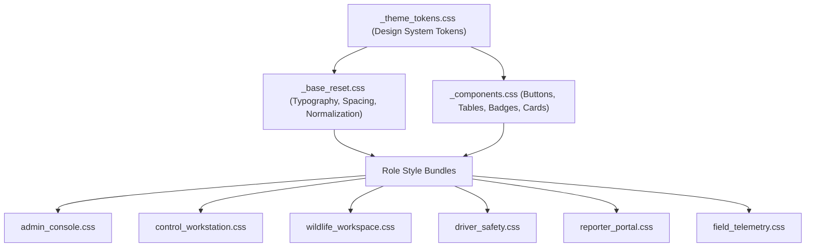

# ELEGUARD RAIL — PHASE B
## Natural Enterprise Design System & Role-Specific Layout Proposal

**Document Reference:** `ER-UI-PHASE-B-DESIGN-001`  
**Execution Timestamp:** 2026-11-16 06:00 UTC+05:30  
**Status:** DESIGN & PLANNING PROPOSAL ONLY (Zero Application Code Modified)  
**Parent References:**  
- `ER-UIUX-AUDIT-001` (Comprehensive Visual & Usability Audit)  
- `ER-UI-PHASE-A-001` (Phase A Controlled Usability Improvements & Regression Baseline)  
- `ER-PHASE-A-VISUAL-REVIEW-001` (Phase A Visual Evidence Review & Contact Sheet Verification)  
**Interactive Prototype Gallery:** [`docs/final_handover/phase_b_design_previews/index.html`](file:///C:/Users/user/Desktop/Railway/eleguard-rail/docs/final_handover/phase_b_design_previews/index.html)

---

## 1. OBJECTIVE & DESIGN MANIFESTO

The Phase A implementation stabilized application usability: the Analytics API URL resolution failure was resolved, driver cab typography and contrast were upgraded to dark hazard cards, horizontal viewport overflow was eliminated across all tested resolutions (1440px, 1280px, 768px, 390px), and sidebar navigation was converted to monochrome inline SVG icons. Master automated regression testing remains at **35/35 passing suites** (1,647 assertions, exit code: 0).

However, as identified in `ER-UIUX-AUDIT-001`, the application still exhibits several legacy architectural UI weaknesses:
1. **Repetitive Dashboard Archetypes:** Every role currently inherits a nearly identical 4-box KPI metric layout regardless of whether the user is an infrastructure administrator, train dispatcher, field ranger, or locomotive driver.
2. **Excessive KPI Density:** Analytical and triage screens stack metric tiles above operational tables, diluting focus from urgent action items.
3. **Remaining Emoji Iconography:** While sidebars were migrated to inline SVG vectors in Phase A, header bars and in-table action links still utilize platform-dependent OS emojis (`🐘`, `🚨`, `🔍`, `⚠️`).
4. **Color & Surface Inconsistencies:** Variables are fragmented across disparate stylesheets (`style.css`, `dashboard.css`, `driver-alert.css`, `verification_workspace.css`), resulting in subtle color drifting.
5. **Generic SaaS Aesthetic vs. Railway Operations Reality:** Interfaces occasionally resemble commercial web apps rather than mission-critical railway operations software and ecological field workstations.

### Design Direction: Natural Enterprise Railway Technology

This proposal establishes a cohesive visual language rooted in **Natural Enterprise Railway Technology**, drawing direct inspiration from:
- **Professional Railway Operations & Dispatch Consoles:** European and Japanese train control workstations, CTC dispatch interfaces, and linear track schematic displays.
- **Enterprise Spatial GIS Platforms:** Technical map tools prioritizing geographic precision, track centerline telemetry, and coordinate transparency.
- **Engineering Management & SCADA Systems:** Flat, high-density telemetry displays with restrained 4px–8px corners, crisp 1px borders, and zero decorative animations.
- **Ecological Conservation Workstations:** Focused field-dossier layouts designed for wildlife biologists and park rangers assessing multi-source sighting evidence.

### Strict Design Exclusions (Anti-Patterns Prohibited):
- **NO Generic AI SaaS Templates:** No floating cards with heavy blurred shadows (`box-shadow: 0 20px 40px rgba(...)`).
- **NO Iridescent / Neon Gradients:** No purple-to-pink gradient accents, luminous neon buttons, or glassmorphic blur filters (`backdrop-filter: blur(...)`).
- **NO Bubbly Rounded Cards:** No oversized border radii (`16px`, `24px`, `9999px`) on structural panels or engineering controls.
- **NO Decorative Animations:** No continuous CSS `@keyframes` pulsing, rotating, or glowing effects that distract train crews or drain field battery life.
- **NO Emoji-Based UI Navigation:** Complete elimination of OS emojis in favor of crisp, monochrome inline SVG vector icons.

---

## 2. CENTRAL DESIGN SYSTEM SPECIFICATION

Rather than forcing an identical background onto every operational role, the central design system defines a shared architectural token foundation while permitting **role-specific visual environments** tailored to ambient operating conditions (cab darkness, outdoor sunlight, or office workstations).

### 2.1 Color Architecture & Exact HEX Tokens

#### Core Neutral Canvas & Surfaces
| Token Name | HEX Code | Purpose & Usage |
|---|---|---|
| `--color-canvas-workstation` | `#080c12` | Deep technical background for Control Dispatcher & GIS monitoring |
| `--color-canvas-console` | `#0b0f17` | Technical slate background for System Administration & Analytics |
| `--color-canvas-dossier` | `#09110d` | Forest-tinted dark background for Wildlife Officer Verification |
| `--color-canvas-cab` | `#070a0e` | Anti-glare, ultra-dark background for Locomotive Driver Cab |
| `--color-canvas-community` | `#0b1219` | Approachable dark cerulean for Citizen Reporter Portal |
| `--color-canvas-field` | `#080d12` | High-contrast battery-saving canvas for Field Ranger PWA |
| `--color-surface-panel` | `#111823` | Primary structural card & panel background |
| `--color-surface-subtle` | `#162232` | Secondary panel header & table header background |
| `--color-surface-elevated`| `#1d2d42` | Dropdowns, hover states, and modal flyouts |
| `--color-border-subtle` | `#1c2738` | Standard 1px panel divider |
| `--color-border-panel` | `#24334a` | Outer card boundary line |
| `--color-border-focus` | `#38bdf8` | High-visibility focus ring (`outline: 2px solid`) |

#### Text & Typography Contrast Scale (WCAG AAA / AA Graded)
| Token Name | HEX Code | Opacity / Role | Contrast vs Canvas |
|---|---|---|:---:|
| `--color-text-primary` | `#f8fafc` | 98% Bright White: Core metrics, headings, alert titles | **17.2 : 1 (AAA)** |
| `--color-text-secondary` | `#94a3b8` | 75% Slate Muted: Body descriptions, table cell text | **8.4 : 1 (AAA)** |
| `--color-text-dim` | `#64748b` | 50% Slate Dim: Table column headers, hints, unit labels | **4.9 : 1 (AA)** |
| `--color-text-mono` | `#e2e8f0` | 90% Monospace Telemetry: Coordinates, timestamps, hashes | **14.8 : 1 (AAA)** |

#### Semantic Railway Signal & Safety Palette
*Mandatory rule: Signal colors are reserved strictly for operational status; they are never used decoratively.*
| Signal Classification | Base HEX | Container Bg | Container Border | Operational Meaning |
|---|---|---|---|---|
| **Signal Red (Emergency)** | `#ef4444` | `#450a0a` | `#b91c1c` | Collision hazard, active alert, track danger |
| **Signal Amber (Caution)** | `#f59e0b` | `#451a03` | `#b45309` | Sighting in corridor vicinity, speed restriction |
| **Signal Yellow (Advisory)**| `#eab308` | `#422006` | `#a16207` | AI inference advisory, uncertain report, diurnal dawn |
| **Signal Green (Clear)** | `#10b981` | `#052e16` | `#15803d` | Track clear, report verified, service online |
| **Signal Blue (Telemetry)**| `#0284c7` | `#082f49` | `#0369a1` | System telemetry, audit hash, primary portal CTA |
| **Signal Purple (Dispatch)**| `#7c3aed` | `#2e1065` | `#6d28d9` | Train Controller alert broadcast trigger action |

---

### 2.2 Typography Specification

The typography system enforces a clean separation between **human-readable narrative content** and **machine-precision telemetry data**.

```
Narrative & UI Stack:  system-ui, -apple-system, BlinkMacSystemFont, "Segoe UI", Roboto, "Helvetica Neue", sans-serif;
Telemetry & Code Stack: "SF Mono", "Segoe UI Mono", "Roboto Mono", "JetBrains Mono", Consolas, monospace;
```

#### Exact Type Scale Matrix
| Level | Font Family | Size (rem / px) | Weight | Line Height | Letter Spacing | Target Elements |
|---|---|---|---|---|---|---|
| **Display KPI** | Monospace | `2.00rem` (32px) | 800 (Bold) | `1.1` | `-0.02em` | Driver cab speed, alert count |
| **Header 1 (Page)** | UI Sans | `1.50rem` (24px) | 700 (Bold) | `1.25` | `-0.015em` | Role workstation page title |
| **Header 2 (Panel)**| UI Sans | `1.125rem` (18px)| 600 (Semi) | `1.3` | `0` | Section panel & card title |
| **Header 3 (Card)** | UI Sans | `0.95rem` (15.2px)| 600 (Semi) | `1.35` | `0` | Triage group header |
| **Body (Default)** | UI Sans | `0.875rem` (14px) | 400 (Reg) | `1.45` | `0` | Narrative, descriptions |
| **Table Cells** | UI Sans | `0.8125rem` (13px)| 500 (Med) | `1.4` | `0` | Tabular row content |
| **Telemetry Mono** | Monospace | `0.8125rem` (13px)| 600 (Semi) | `1.3` | `0.02em` | GPS coordinates, timestamps, MPs |
| **Micro Labels** | UI Sans | `0.6875rem` (11px)| 700 (Bold) | `1.2` | `0.06em` | Uppercase table headers, badges |

---

### 2.3 Spacing, Borders & Structural Rules

1. **4px Base Spacing Scale:**
   - `4px` (`--space-xs`): Badge padding, icon gap.
   - `8px` (`--space-sm`): Button internal padding, inline element gap.
   - `12px` (`--space-md`): Compact table row padding, card interior gap.
   - `16px` (`--space-lg`): Standard panel padding, grid column gap.
   - `20px` (`--space-xl`): Section vertical separation.
   - `28px` (`--space-2xl`): Workstation page outer margins.
2. **Restrained Engineering Border-Radii:**
   - Outer Cards & Panels: **`6px` to `8px`** (crisp, solid boundary).
   - Buttons, Inputs & Dropdowns: **`4px` to `6px`**.
   - Status Badges & Pills: **`3px` to `4px`**.
   - *Rule:* Zero pill buttons (`border-radius: 9999px`) or bubble cards.
3. **Elevation & Shadows:**
   - Discontinue ambient blurred drop shadows.
   - Use crisp 1px solid borders (`var(--color-border-subtle)`) with optional inset highlight for tactile clarity: `box-shadow: inset 0 1px 0 rgba(255, 255, 255, 0.05)`.

---

### 2.4 Reusable Component Standards

#### Flat Enterprise Buttons
```css
.btn-engineering {
  display: inline-flex;
  align-items: center;
  gap: 8px;
  padding: 8px 14px;
  border-radius: 4px;
  font-size: 12px;
  font-weight: 600;
  text-decoration: none;
  cursor: pointer;
  transition: all 0.12s ease-in-out;
  border: 1px solid transparent;
}
/* Primary Technical Action */
.btn-primary-rail {
  background: var(--color-signal-blue);
  color: #ffffff;
  border-color: #0369a1;
}
.btn-primary-rail:hover { background: #0369a1; }

/* Critical Dispatch Action */
.btn-dispatch-critical {
  background: #b91c1c;
  color: #ffffff;
  border-color: #ef4444;
  font-weight: 700;
}
.btn-dispatch-critical:hover { background: #dc2626; }
```

#### Compact Operational Data Tables
- Header Row: Darker neutral (`#0a0f16`), uppercase 11px text, 1px bottom border.
- Row Height: Strictly `36px` to `42px` (dense, scannable data).
- Row Alternation: Subtle hover brightness increase (`rgba(255, 255, 255, 0.02)`), no heavy alternating striped colors.
- Monospace Column Alignment: Numeric values, dates, and GPS coordinates right-aligned or left-aligned with monospace font.

#### Standardized Status Badges
- Format: `[1px border] + [10% opacity background] + [bold colored text]`.
- No solid neon fills; ensures high legibility against dark surfaces without color fatigue.

---

## 3. ROLE-SPECIFIC IDENTITIES & LAYOUT PROPOSALS

### 3.1 Role 1: System Admin — Enterprise Management Console

#### Operational Persona & Context
The System Administrator oversees platform operational integrity, infrastructure health, user access policies, and statutory immutability audits.

#### Layout Blueprint & Information Hierarchy
- **Header:** Platform identifier with live heartbeat indicator (`ALL SERVICES NOMINAL &bull; MARIADB 3308`), connection mode badge (`IMMUTABLE READ-ONLY ACCOUNT: eleguard_readonly`), and active user profile.
- **Top Metric Strip:** Replaces generic cards with 4 compact telemetry monitors:
  1. *Active Crossing Corridors* (Track status overview)
  2. *Pending Ranger Queue* (Triage load)
  3. *Active Safety Advisories* (Live train warnings)
  4. *Data Provenance Checksum* (SHA-256 validation status)
- **Primary Content Grid (65% / 35% Split):**
  - **Left Workstation (65%):** Railway Corridor Speed Restrictions table mapping corridor segments, chainage markers (e.g. MP 105.4), speed restrictions (20 km/h Caution Order), and real-time obstacle status.
  - **Right Telemetry Matrix (35%):** Real-time REST Analytics Health Matrix probing all 7 API endpoints (`/summary.php`, `/temporal.php`, `/sections.php`, `/hotspots.php`, `/duplicates.php`, `/quality.php`, `/ai_advisory.php`) with latency metrics.
- **Bottom Panel:** Complete immutable activity audit log tracking operator timestamps, action categories, resource references, and cryptographic checksums.

---

### 3.2 Role 2: Control Officer — Operations Monitoring Workstation

#### Operational Persona & Context
The Railway Train Controller monitors active train movements, receives urgent elephant sighting reports, and broadcasts advisory warnings to locomotive drivers under intense time pressure.

#### Layout Blueprint & Information Hierarchy
- **Header:** High-visibility Sri Lanka Railways Dispatch header with live digital clock (`SLST UTC+5:30`) and active controller seat badge.
- **Emergency Hotline Bar:** Persistent banner displaying direct emergency hotlines (Maho Station, Gal Oya Junction, Hingurakgoda Station, DWC 1992 Hotline) alongside a prominent **"Broadcast Urgent Train Advisory"** manual trigger.
- **Linear Corridor Status Strip:** A visual linear schematic of the Northern & Batticaloa line sections:
  - *Minneriya – Hingurakgoda:* Crimson border, 20 km/h restriction callout, obstacle proximity (18m).
  - *Habarana – Gal Oya:* Amber border, 35 km/h daytime caution, fence activity.
  - *Maho – Anuradhapura:* Green border, normal track speed, track clear.
  - *Polonnaruwa – Welikanda:* Green border, normal track speed, track clear.
- **Dual Operational Dispatch Grid:**
  - **Left Panel (60%):** Sighting Reports Awaiting Advisory Broadcast. Clean table featuring observation time, section/landmark, elephant count, urgency badge, and a distinct purple **"Convert to Alert"** action button.
  - **Right Panel (40%):** Real-Time Driver Cab Response Telemetry stream recording locomotive driver acknowledgements (*"Slowing down to 20 km/h"*, *"Holding speed & clear visual track"*) with minute offsets.

---

### 3.3 Role 3: Wildlife Officer — Investigation & Verification Workspace

#### Operational Persona & Context
DWC Wildlife Rangers inspect citizen sightings, examine uploaded photos, cross-reference YOLOv8 AI inference outputs, calculate spatial standoff distance from tracks, and officially verify or reject incidents.

#### Layout Blueprint & Information Hierarchy
- **Header:** Department of Wildlife Conservation (DWC) insignia, sector attribution (*Minneriya / Kaudulla Buffer*), and logged-in ranger credentials.
- **Triage Status Filter Bar:** Tabs for *Pending Verification (26)*, *Verified (1)*, *Clarification Requested (2)*, and *Rejected / False Alarm (5)*.
- **Split Investigation Dossier:**
  - **Left Queue Stream (380px fixed width):** Compact list of reports with ID, timestamp, corridor, elephant count badge, and AI confidence indicator (*AI: 89% Confidence* or *AI: Uncertain 38%*).
  - **Right Active Dossier Detail (Fluid):**
    - Sighting Header: Report title, submitter type, observation timestamp, diurnal period (Dusk).
    - Dual Evidence Grid:
      - *Field Photo & AI Bounding Box:* Clean mockup frame showing detected elephant with YOLOv8 bounding box overlay and disclaimer note that AI outputs remain strictly advisory.
      - *Spatial Standoff Telemetry:* Observer GPS coordinate, standoff distance (120m), observer bearing (045° NE), calculated elephant coordinate fix, and calculated distance to railway centerline (18m).
    - Verification Action Deck: Large, clear buttons:
      - `[Verify & Authorize Train Advisory]` (Emerald Green)
      - `[Request Field Clarification]` (Slate Muted)
      - `[Reject (False Alarm / Out of Corridor)]` (Crimson Subtle)

---

### 3.4 Role 4: Locomotive Driver — Cab Advisory Desk (Stationary Review)

#### Operational Persona & Context
Train drivers operating diesel-electric locomotives in remote jungle corridors require zero-distraction, ultra-high-contrast safety advisories strictly during pre-departure briefings or stationary station halts.

#### Layout Blueprint & Information Hierarchy
- **Top Mandatory Warning Banner:** Amber `#f59e0b` border with dark amber background:
  > **STATIONARY REVIEW USE ONLY — DO NOT INTERACT WHILE LOCOMOTIVE IS IN MOTION**  
  > *Sri Lanka Railways Operational Safety Circular 2026/04. Screen interaction strictly restricted to stations and halts.*
- **Statutory Precedence Card:**
  > **Statutory Precedence Notice:** This display provides supplementary situational awareness only. It **DOES NOT** supersede Sri Lanka Railways Caution Orders (Form T.409/T.410), fixed track signals, or direct Train Controller instructions.
- **Cab Telemetry Status Strip:** Displays Train ID (`TRAIN #6011 &bull; Class S12`), Driver email, and explicit **"AUDIO SUPPRESSED (CAB SAFETY)"** purple pill.
- **High-Contrast Hazard Card:**
  - Solid dark charcoal container (`#0e141c`) with 6px crimson left border.
  - Large 26px bold heading: **"COLLISION HAZARD: Sighting of 3 Elephants Approaching Track Line"**.
  - Distinct Corridor & Chainage Callout: *Minneriya – Hingurakgoda Corridor &bull; Milepost 105.4 (18m from track)*.
  - Dual Timestamps:
    - *Field Observation Recorded:* 05:47 PM
    - *Train Control Dispatched:* 05:50 PM (4m ago)
  - One-Touch Large Station Response Targets (48px height):
    - `[Acknowledge & Slowing Down (20 km/h)]` (Crimson)
    - `[Acknowledged & Holding Speed]` (Slate)

---

### 3.5 Role 5: Citizen Reporter — Community Sighting Portal

#### Operational Persona & Context
Local villagers, farmers, and track inspection staff submit elephant sightings to protect wildlife and passenger trains.

#### Layout Blueprint & Information Hierarchy
- **Header:** Clean community branding with reporter account pill.
- **Hero Primary Action Card:** Clean dark cerulean card with prominent 18px text and a high-impact primary button: **"File New Sighting Report"**.
- **3-Step Visual Safety Guide:**
  - *Step 1: Observe Safely* (Maintain 100m+ standoff distance, no flashlights).
  - *Step 2: Note Track Landmark* (Mileposts, culverts, crossing gates).
  - *Step 3: Immediate Submission* (Submit online or dial DWC Hotline 1992).
- **Personal Submissions History:** Clean list showing recent reports with status pills (*"Under Ranger Review"*, *"Verified & Converted to Train Alert"*).

---

### 3.6 Role 6: Field Ranger PWA — Mobile Telemetry Unit

#### Operational Persona & Context
Field rangers logging observations on handheld smartphones in dense scrub terrain under bright equatorial daylight or pitch-black night conditions.

#### Layout Blueprint & Information Hierarchy
- **Top Hardware Telemetry Bar:**
  - Real-time GPS Fix Indicator: `[GPS LOCK &plusmn;4m]` (Green pill).
  - Local Storage Sync Status: `[OFFLINE READY (0 QUEUED)]` (Yellow pill).
- **App Bar:** Clean header with active stage counter (`STAGE 1 / 6`).
- **6-Stage Progress Bar:** Visual progress segments indicating completion status.
- **Stage 1 (Temporal Telemetry):**
  - Observation Date & Time inputs.
  - Diurnal Period Grid: 6 large 44px thumb-friendly touch buttons (*Dawn, Morning, Midday, Afternoon, Dusk, Night*).
  - Corridor Dropdown.
- **Sticky Footer Action Deck:**
  - `[Save Draft Locally]` (48px tactile secondary button).
  - `[Next: Observer GPS →]` (48px primary blue button).

---

## 4. VISUAL MOCKUPS & PROTOTYPE CATALOG

Six static visual HTML prototypes have been developed and staged under `docs/final_handover/phase_b_design_previews/` (and mirrored to XAMPP):

| # | Prototype File | Target Role | Key Architectural Features Demonstrated |
|:---:|---|---|---|
| **01** | [`01_admin_dashboard_preview.html`](file:///C:/Users/user/Desktop/Railway/eleguard-rail/docs/final_handover/phase_b_design_previews/01_admin_dashboard_preview.html) | System Admin | Flat 4-gauge telemetry bar, corridor speed restriction table, real-time API latency matrix, audit hash ledger. |
| **02** | [`02_control_desk_preview.html`](file:///C:/Users/user/Desktop/Railway/eleguard-rail/docs/final_handover/phase_b_design_previews/02_control_desk_preview.html) | Control Officer | Linear corridor track strip (MP 105.4), direct emergency hotlines, unverified alert conversion triage, driver cab acknowledgement stream. |
| **03** | [`03_wildlife_verification_preview.html`](file:///C:/Users/user/Desktop/Railway/eleguard-rail/docs/final_handover/phase_b_design_previews/03_wildlife_verification_preview.html) | Wildlife Officer | Split dossier workspace, YOLOv8 vision advisory bounding box, observer standoff geo-math calculation, 1-click verification deck. |
| **04** | [`04_driver_dashboard_preview.html`](file:///C:/Users/user/Desktop/Railway/eleguard-rail/docs/final_handover/phase_b_design_previews/04_driver_dashboard_preview.html) | Locomotive Driver | Stationary review mandate banner, Form T.409/T.410 legal precedence card, audio suppressed pill, solid hazard alert card with dual timestamps. |
| **05** | [`05_reporter_dashboard_preview.html`](file:///C:/Users/user/Desktop/Railway/eleguard-rail/docs/final_handover/phase_b_design_previews/05_reporter_dashboard_preview.html) | Citizen Reporter | Approachable community safety styling, prominent "File Sighting" hero CTA, 3-step reporting visual guide, submission status timeline. |
| **06** | [`06_field_pwa_preview.html`](file:///C:/Users/user/Desktop/Railway/eleguard-rail/docs/final_handover/phase_b_design_previews/06_field_pwa_preview.html) | Field Ranger PWA | High-contrast mobile frame (390×844), hardware GPS accuracy pill, offline sync queue indicator, 48px touch-friendly diurnal pickers. |
| **—** | [`index.html`](file:///C:/Users/user/Desktop/Railway/eleguard-rail/docs/final_handover/phase_b_design_previews/index.html) | **Interactive Gallery** | Responsive multi-device viewer allowing side-by-side inspection across Desktop, Laptop (1280px), Tablet (768px), and Mobile (390px). |

---

## 5. COMPONENT STANDARDIZATION & MIGRATION PLAN

To eliminate code duplication and visual divergence without modifying business logic, Phase B recommends introducing modular CSS partials.



### Component Migration Inventory:
1. **Components to Reuse (Zero Logic Changes):**
   - Leaflet map initialization logic and marker coordinate bindings (`map_component.js`).
   - REST API envelope handling (`analytics_dashboard.js`).
   - Field PWA offline cryptographic storage and sync controllers (`field_crypto_storage.js`, `field_sync_controller.js`).
   - Role-based access control (RBAC) and session validation checks (`Auth.php`).
2. **Components to Standardize & Redesign (Visual Layer Only):**
   - **Header Bar Partial (`dashboard_header.php`):** Replace inline emojis (`🐘`, `🔔`) with SVG vector icons matching the sidebar.
   - **Metric Tile Containers:** Eliminate the generic 4-card metric block from analytical screens in favor of role-tailored telemetry strips.
   - **Table Partials:** Standardize row heights to 38px, apply uniform dark headers (`#0a0f16`), and implement monospace formatting for all temporal/spatial data.
   - **Form Controls:** Unify textboxes, selects, and datetime inputs across all 5 roles to use 1px borders with 4px border radii.

---

## 6. DATA & SAFETY COMPLIANCE AUDIT

All Phase B designs strictly preserve the safety and statutory principles established in prior milestones:

| Safety / Integrity Principle | Design Enforcement | Compliance Status |
|---|---|:---:|
| **Synthetic Data Transparency** | All mockups explicitly state test/synthetic provenance; simulated alerts cannot be conflated with genuine observations. | **PRESERVED** |
| **Statutory Caution Order Precedence** | The Driver and Control interfaces prominently cite Form T.409/T.410 legal precedence over automated telemetry. | **PRESERVED** |
| **Stationary-Review Mandate** | The locomotive cab interface preserves the high-visibility warning banner citing Operational Safety Circular 2026/04. | **PRESERVED** |
| **Suppressed Cab Audio** | Audio alarms remain disabled in locomotive cabs to prevent distraction during train handling. | **PRESERVED** |
| **No Automated Alert Verification** | AI outputs remain strictly tagged as non-blocking advisory inferences. Only authorized DWC rangers can verify sightings. | **PRESERVED** |
| **No Train-Control Functionality** | The application remains strictly a situational awareness platform with zero direct locomotive throttle or braking control. | **PRESERVED** |

---

## 7. TECHNICAL & GIT PRESERVATION STATEMENT

In accordance with strict audit directives:
- **Zero PHP application logic was altered.**
- **Zero database schemas, records, or migrations were executed.**
- **Operational database `eleguard_rail` remains completely untouched.**
- **Isolated demo database `eleguard_rail_demo` remains in its verified state.**
- **Zero Git commands (`add`, `commit`, `push`, `reset`, or `checkout`) were executed.** All existing workspace files and unstaged edits are preserved intact.

---

## 8. IMPLEMENTATION ROADMAP & APPROVAL GATE

### Proposed Phased Rollout (Upon Authorization):
- **Sprint B.1 — Foundation & Tokens:**
  - Create centralized `public/assets/css/_theme_tokens.css` with exact HEX and typography variables.
  - Harmonize header navigation SVGs across `app/layouts/dashboard_header.php`.
- **Sprint B.2 — Core Operations Workstations:**
  - Apply Natural Enterprise styling to Control Desk and Wildlife Verification Workspace.
  - Implement linear corridor schematic strip in `public/control/dashboard.php`.
- **Sprint B.3 — Driver Ergonomics & Public Portals:**
  - Deploy final anti-glare cab styles in `public/driver/dashboard.php`.
  - Refine Citizen Reporter portal and Field PWA touch targets.
- **Sprint B.4 — Regression Verification:**
  - Execute master test runner to confirm 35/35 passing suites with zero database mutations.

---

## 9. CONCLUSION & AUDIT STATUS

The **Phase B Natural Enterprise Design System & Role-Specific Layout Proposal** is complete and ready for executive review. All mockups, prototypes, and specifications are archived and available for inspection in the interactive gallery.

**Proposal Status:** **SUBMITTED FOR APPROVAL**  
**Action Required:** Review visual prototypes in [`docs/final_handover/phase_b_design_previews/index.html`](file:///C:/Users/user/Desktop/Railway/eleguard-rail/docs/final_handover/phase_b_design_previews/index.html). Implementation will NOT proceed until explicit user authorization is granted.
