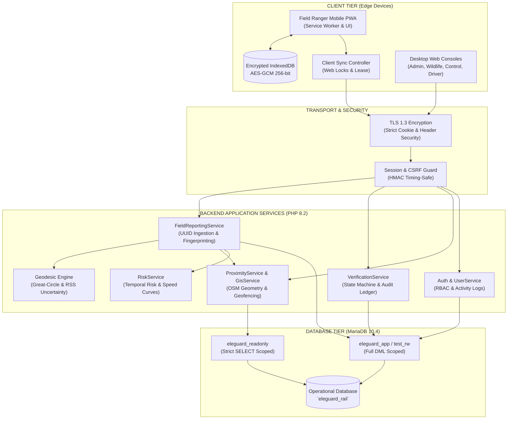
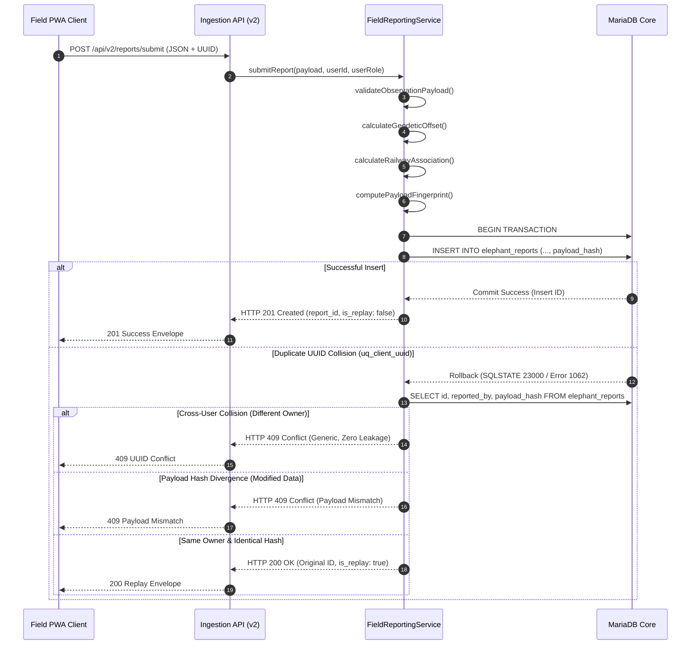
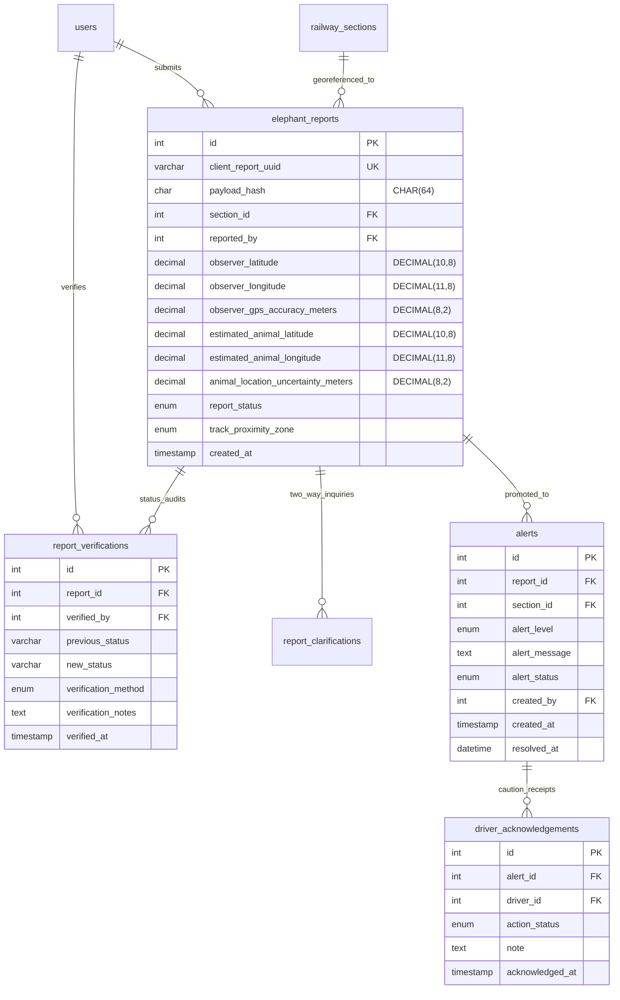

# ELEGUARD RAIL — TECHNICAL ARCHITECTURE DOCUMENT

**Document Reference:** `docs/final_handover/technical_architecture.md`  
**Change Reference:** `ER-FINAL-HANDOVER-001`  
**Milestone:** 9C (Stage J Technical Closure)  
**Date:** November 13, 2026  
**System Version:** Release Candidate 1.0  

---

## 1. HIGH-LEVEL SYSTEM TOPOLOGY

ELEGUARD RAIL is structured as a decoupled, multi-tiered architecture designed for high availability, offline survivability in forest corridors, and strict role segregation:



---

## 2. FRONTEND ARCHITECTURE & OFFLINE PWA

### 2.1 Progressive Web Application Architecture
- **Service Worker (`public/sw.js`):** Implements a cache-first strategy for static core assets (HTML, CSS, Leaflet JS, icons) and network-first for dynamic API endpoints, guaranteeing instantaneous app shell rendering even in complete cellular dead-zones.
- **Client Web Application (`public/assets/js/field_pwa.js`):** Modular event-driven vanilla JavaScript architecture avoiding third-party framework overhead and vulnerabilities.
- **Client Synchronization Controller (`public/assets/js/field_sync_controller.js`):**
  - Acquires browser concurrency locks via the standard Web Locks API (`navigator.locks.request`) with fallback to cooperative localStorage leases (`eleguard_sync_lease_v2`).
  - Chunks offline draft submissions into manageable payload batches ($\le 50$ items, $\le 10\text{MB}$).
  - Strictly preserves rejected and uncertain records in local storage for officer review; purges drafts **only** upon receiving verified `synced` or `replayed` acknowledgments from the backend.

### 2.2 Client-Side Cryptographic Storage
- **Component:** `public/assets/js/field_crypto_storage.js`
- **Specification:** Web Cryptography API (`window.crypto.subtle`).
- **Key Derivation:** PBKDF2 with SHA-256, 100,000 iterations, 16-byte cryptographically secure salt.
- **Payload Encryption:** AES-GCM with a 256-bit key and random 12-byte initialization vector (IV) per record.
- **Protection:** Draft coordinates and observer notes stored in IndexedDB remain encrypted at rest on the mobile hardware, preventing data extraction in the event of lost or stolen field devices.

---

## 3. BACKEND SERVICE ARCHITECTURE & DATA FLOW

### 3.1 Field Reporting Service (`app/services/FieldReportingService.php`)
Acts as the central transaction boundary for wildlife observations:
1. **Validation & Normalization:** Validates geodetic coordinates within Sri Lanka bounds ($5.5^\circ\text{--}10.0^\circ\text{ N}, 79.5^\circ\text{--}82.5^\circ\text{ E}$), diurnal period continua, herd demographics, and RFC 4122 v4 UUID format.
2. **Canonical Payload Fingerprinting:**
   - Normalizes text via Unicode Normalizer (`FORM_C`).
   - Extracts 21 approved observation fields (ignoring dynamic server fields such as timestamps and primary keys).
   - Formats floating-point numbers (`%.8f` for coordinates, `%.2f` for distances).
   - Sorts associative keys alphabetically (`ksort`) and hashes using SHA-256 to generate `payload_hash`.
3. **Collision & Idempotency Resolution:**
   - Evaluates engine duplicate key errors (`SQLSTATE 23000` on `uq_client_uuid`).
   - If submitting user matches existing author and `payload_hash` matches: returns HTTP 200 Replay.
   - If submitting user differs: returns generic HTTP 409 Conflict with zero metadata disclosure.
   - If payload diverges: returns HTTP 409 Conflict (`payload-mismatch`).



### 3.2 Geodesic Calculation Engine
Implements the forward Great-Circle direct geodetic equations:
$$\delta = \frac{d}{R_{\text{Earth}}}, \quad \phi_2 = \arcsin\left(\sin\phi_1 \cos\delta + \cos\phi_1 \sin\delta \cos\theta\right)$$
$$\lambda_2 = \lambda_1 + \operatorname{atan2}\left(\sin\theta \sin\delta \cos\phi_1, \; \cos\delta - \sin\phi_1 \sin\phi_2\right)$$
Spatial uncertainty is combined via Root-Sum-Square (RSS):
$$\sigma_{\text{pos}} = \sqrt{\sigma_{\text{gps}}^2 + \max(5.0, 0.20 \times d)^2 + (d \times \sin(10.0^\circ))^2}$$
If hardware GPS accuracy is missing, zero, or negative, $\sigma_{\text{pos}}$ strictly remains `NULL` to prevent accuracy fabrication.

---

## 4. DATABASE SCHEMA & PRIVILEGE ARCHITECTURE

### 4.1 Core Entity Relational Diagram



> [!NOTE]
> **Schema Baseline vs Migrations:** The baseline operational database `eleguard_rail` contains the core entities (`users`, `elephant_reports`, `railway_sections`, `alerts`, `driver_acknowledgements`, `hotspots`, `system_logs`, `incident_history`). The extended governance tables (`report_verifications`, `report_clarifications`, `report_section_assignment_history`) are defined in Migrations 04–06, validated in automated test environments (`eleguard_test_tmp_*`), and slated for production execution during a scheduled DBA maintenance window.

### 4.2 Database Privilege Separation
- **`eleguard_app` (Application Writer):** Has `SELECT`, `INSERT`, `UPDATE` on operational tables; strictly lacks `DROP DATABASE`, `GRANT OPTION`, or administrative privileges.
- **`eleguard_readonly` (Analytics Engine):** Granted strictly `SELECT` on `eleguard_rail`.*; completely barred from executing `INSERT`, `UPDATE`, `DELETE`, or DDL statements.
- **`eleguard_test_rw` (Automated Test Runner):** Granted full DDL and DML privileges **scoped exclusively to `eleguard_test_tmp_%`.*.** Mathematically blocked by MariaDB grant engine from accessing or altering `eleguard_rail` or `eleguard_rail_test`.

---

## 5. API ARCHITECTURE & CONTRACT SPECIFICATION

All endpoints adhere to standardized Composite Envelopes and RFC 9457 Problem Details:

### Standard Ingestion Success Envelope (HTTP 201 Created)
```json
{
  "success": true,
  "status": 201,
  "data": {
    "report_id": 842,
    "client_report_uuid": "f47ac10b-58cc-4372-a567-0e02b2c3d479",
    "report_status": "Pending",
    "is_replay": false,
    "created_at": "2026-11-13 14:30:00",
    "observer_location": { "latitude": 8.03450000, "longitude": 80.28500000 },
    "estimated_animal_location": {
      "coordinates": { "latitude": 8.03478900, "longitude": 80.28543200 },
      "uncertainty_meters": 18.42,
      "method": "triangulated_offset"
    },
    "railway_association": {
      "section_id": 2,
      "distance_to_track_meters": 45.20,
      "track_proximity_zone": "Zone 1"
    }
  }
}
```

### Standard RFC 9457 Error Envelope (HTTP 409 Conflict)
```json
{
  "success": false,
  "type": "https://eleguard.rail.gov.lk/errors/uuid-conflict",
  "title": "UUID Conflict",
  "status": 409,
  "detail": "The provided client_report_uuid conflicts with an existing submission."
}
```

---

## 6. EXTERNAL DEPENDENCIES & RUNTIME PREREQUISITES

| Dependency | Required Version | Purpose / Constraint |
|---|---|---|
| **PHP Runtime** | 8.2.0+ (Tested 8.2.12) | Required for typed properties, `Normalizer` (NFC Unicode), OpenSSL 3.0, PDO. |
| **MariaDB Server** | 10.4.32+ (or MySQL 8.0+) | InnoDB transactional engine with composite index optimizations. |
| **Web Server** | Apache 2.4+ / Nginx 1.22+ | Must support URL rewriting and custom RFC 9457 Content-Type headers. |
| **OpenStreetMap Tiles** | Standard Web Mercator | Cartographic background mapping for GIS visualization. |
| **Modern Web Browser** | Chromium 90+, Firefox 90+, Safari 15+ | Required for Web Cryptography API (`crypto.subtle`), Service Worker, and IndexedDB. |

---

## 7. DRIVER INTERFACE TECHNICAL REALITY & DEPLOYMENT BOUNDARIES

### 7.1 Locomotive Telemetry & Speed Interlock Status
- **Telemetry Integration:** **None.** The platform does not interface with locomotive speedometers, axle tachometers, wheel-speed sensors, or onboard train communication buses (WTB/MVB). Locomotive speed data is completely unavailable in the application software.
- **Stationary Acknowledgement Mechanism:** The requirement for locomotive drivers to review and acknowledge alerts only while stationary is strictly an **operational safety policy and procedural rule**. It is reinforced in the UI via high-visibility stationary-use warning banners (`STATIONARY REVIEW USE ONLY — DO NOT INTERACT WHILE IN MOTION`) and driver instructions, **not by an automated software or hardware speed-based lockout**.
- **No In-Cab Automation:** The system does not actuate locomotive brakes, alter traction control, or manipulate physical in-cab instrumentation.

### 7.2 Formal Deployment & Approval Status
- **Technical Maturity:** Stages J.1 through J.6 are technically complete and verified across 35 automated test suites.
- **Production Authorization:** **NOT AUTHORIZED.** Production deployment and live network hosting are not authorized under this reference.
- **Field Trial Evidence:** Live field trials on operational trains or in active railway corridors have **not** been completed.
- **Inter-Agency Governance:** Formal administrative and operating approvals from the Department of Wildlife Conservation (DWC) and Sri Lanka Railways (SLR) remain pending.
- **Safety Certification:** No operational safety certification (e.g. CENELEC or IEC railway safety standards) is claimed.
