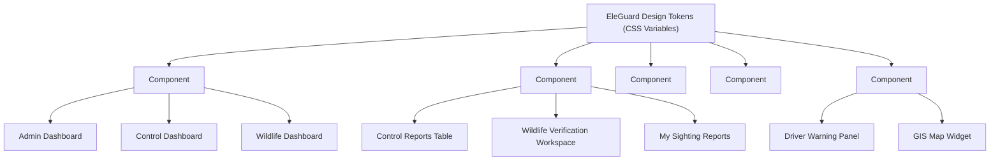

# ELEGUARD RAIL — VISUAL CONSISTENCY & UI/UX AUDIT REPORT

**Directive Reference:** ER-UIUX-AUDIT-001  
**Execution Date:** 2026-11-15  
**Audited Platform:** EleGuard Rail (Wildlife–Railway Collision Prevention Platform, Sri Lanka)  
**Environment:** Local Showcase Environment (`http://localhost/eleguard-rail/public/`)  
**Active Database:** `eleguard_rail_demo` (MariaDB 127.0.0.1:3308)  
**Inspection Mode:** Strictly Read-Only (Zero reports submitted, zero alerts modified, zero state mutations)  
**Audit Scope:** Complete walkthrough of all 5 operational user roles across 10 core views + Field PWA  

---

## 1. EXECUTIVE SUMMARY

Following stabilization of the isolated demonstration environment (`eleguard_rail_demo`) and achievement of 35/35 passing regression suites, a comprehensive visual consistency, usability, and design system audit was executed across all user roles:
1. **System Administrator** (`admin@eleguard.lk`)
2. **Railway Control Officer** (`control@eleguard.lk`)
3. **Wildlife Officer / Field Ranger** (`wildlife@eleguard.lk`)
4. **Locomotive Train Driver** (`driver@eleguard.lk`)
5. **Community Field Reporter** (`reporter@eleguard.lk`)

The audit evaluated typography and readability, color consistency and semantics, navigation patterns, spacing, responsive layout resilience, table formatting, chart legibility, GIS map rendering, accessibility, and mobile usability.

**Key Verdict:** The EleGuard Rail application possesses an exceptionally strong functional foundation, role separation architecture, and robust domain safety warnings (such as the stationary in-cab mandate and caution order precedence). However, progressive development across milestones has introduced **design system fragmentation**—specifically divergent CSS color palettes, component duplication, horizontal scroll overflow on desktop resolutions under 1300px, and API routing issues in the analytics dashboard.

This report documents all findings classified by priority (**P0 to P3**), catalogs visual evidence screenshots, provides concrete design system component standardization blueprints, and defines a phased remediation roadmap for approval.

---

## 2. VISUAL EVIDENCE DIRECTORY

All visual evidence has been captured at high resolution and organized in `docs/final_handover/audit_evidence/` (mirrored in `public/docs/final_handover/audit_evidence/` and the conversation artifacts):

| Ref # | Screen / View | Role Inspected | Key Visual Evidence | Screenshot Link |
|:---:|---|---|---|:---:|
| **01** | Admin Dashboard | Admin | KPI Cards, Leaflet GIS Map, Corridor Status | [audit_01_admin_dashboard.png](file:///C:/Users/user/Desktop/Railway/eleguard-rail/docs/final_handover/audit_evidence/audit_01_admin_dashboard.png) |
| **02** | Admin Analytics | Admin | Filter Toolbar, Chart.js Canvases, Provenance Banner | [audit_02_admin_analytics.png](file:///C:/Users/user/Desktop/Railway/eleguard-rail/docs/final_handover/audit_evidence/audit_02_admin_analytics.png) |
| **03** | Control Dashboard | Control Officer | Section Hazard Grid, Live Broadcast Queue | [audit_03_control_dashboard.png](file:///C:/Users/user/Desktop/Railway/eleguard-rail/docs/final_handover/audit_evidence/audit_03_control_dashboard.png) |
| **04** | Control Reports | Control Officer | Tabular Filter Tabs, Urgency Badges, Alert Triggers | [audit_04_control_reports.png](file:///C:/Users/user/Desktop/Railway/eleguard-rail/docs/final_handover/audit_evidence/audit_04_control_reports.png) |
| **05** | Control Acknowledgements | Control Officer | Cab Ack Latency Ledger, Response Metrics | [audit_05_control_acknowledgements.png](file:///C:/Users/user/Desktop/Railway/eleguard-rail/docs/final_handover/audit_evidence/audit_05_control_acknowledgements.png) |
| **06** | Wildlife Dashboard | Wildlife Officer | Ecological Metrics, Verification Quick-links | [audit_06_wildlife_dashboard.png](file:///C:/Users/user/Desktop/Railway/eleguard-rail/docs/final_handover/audit_evidence/audit_06_wildlife_dashboard.png) |
| **07** | Verification Workspace | Wildlife Officer | Demographic Telemetry, Tusker Data, Chainage | [audit_07_wildlife_verification_workspace.png](file:///C:/Users/user/Desktop/Railway/eleguard-rail/docs/final_handover/audit_evidence/audit_07_wildlife_verification_workspace.png) |
| **08** | AI Advisory & Shadow Model | Wildlife Officer | YOLOX Detection Advisory, Temporal Risk Comparison | [audit_08_wildlife_ai_advisory.png](file:///C:/Users/user/Desktop/Railway/eleguard-rail/docs/final_handover/audit_evidence/audit_08_wildlife_ai_advisory.png) |
| **09** | Driver Warning Panel | Train Driver | Stationary Mandate, Critical Hazard Cards, Audio Banner | [audit_09_driver_dashboard.png](file:///C:/Users/user/Desktop/Railway/eleguard-rail/docs/final_handover/audit_evidence/audit_09_driver_dashboard.png) |
| **10** | Driver Alerts Archive | Train Driver | Caution Order History, Corridor Filtering | [audit_10_driver_alerts.png](file:///C:/Users/user/Desktop/Railway/eleguard-rail/docs/final_handover/audit_evidence/audit_10_driver_alerts.png) |
| **11** | Reporter My Sightings | Community Reporter | Submission History Table, Verification Status | [audit_11_reporter_my_sightings.png](file:///C:/Users/user/Desktop/Railway/eleguard-rail/docs/final_handover/audit_evidence/audit_11_reporter_my_sightings.png) |
| **12** | Field Telemetry PWA (Desktop) | Field Ranger | 6-Step Wizard, Encrypted Storage Button, Diurnal Slots | [audit_12_field_pwa_desktop.png](file:///C:/Users/user/Desktop/Railway/eleguard-rail/docs/final_handover/audit_evidence/audit_12_field_pwa_desktop.png) |
| **13** | Field Telemetry PWA (Mobile 395px) | Field Ranger | Responsive Touch Targets, High-contrast Inputs | [audit_13_field_pwa_mobile.png](file:///C:/Users/user/Desktop/Railway/eleguard-rail/docs/final_handover/audit_evidence/audit_13_field_pwa_mobile.png) |

---

## 3. ROLE-BY-ROLE EVALUATION & SCREEN AUDIT

### 3.1 Role 1: System Administrator (`admin@eleguard.lk`)

#### Screen 1: Admin Dashboard (`/admin/dashboard.php`)
- **Visual Presentation:** Dark jungle theme featuring a top summary row with 6 KPI cards (Users: 5, Active Alerts: 14 in crimson `#dc2626`, Pending Reports: 29 in amber `#f59e0b`, Confirmed: 2 in emerald `#10b981`, Driver Acks: 13, Sections: 4).
- **GIS Map Component:** Leaflet map initializes cleanly with custom dark-matter basemap. The Layer Control icon (`layers.png`) loads without errors. The prominent yellow-bordered disclaimer banner correctly warns: *"⚠️ PROVISIONAL — NOT OFFICIALLY VERIFIED (OSM/HOT-HDX)"*. Synthetic elephant markers display a distinctive dashed indigo border (`border: 2px dashed #6366f1;`) and popup badge `🧪 Synthetic Demonstration`.
- **Layout & Usability Friction:** At desktop viewport widths below 1300px, `.dashboard-main` enforces a minimum width causing horizontal page scrolling (`overflow-x: scroll`), separating the sidebar from the main content.

#### Screen 2: Admin Analytics Console (`/admin/analytics.php`)
- **Visual Presentation:** Includes an administrative database safety notice and a filter toolbar with Date From/To, Railway Section dropdown, and Refresh trigger.
- **Chart.js Presentation:** Four charts are allocated (Sighting Volume by Corridor, Diurnal Heatmap, Herd Size Distribution, and Alert Urgency Breakdown).
- **Usability Defect:** Dynamic fetch requests in `public/assets/js/analytics_dashboard.js` call root-relative endpoints `/api/analytics/corridors` rather than resolving the application base URL (`/eleguard-rail/public/api/...`), causing 404 HTTP errors in subdirectory environments. Fallback card containers display cleanly without crashing the page, but chart data fails to load dynamically.

---

### 3.2 Role 2: Railway Control Officer (`control@eleguard.lk`)

#### Screen 3: Control Dashboard (`/control/dashboard.php`)
- **Visual Presentation:** Displays operational metrics across the 4 railway sections. Sections with active collision hazards (Habarana–Gal Oya, Minneriya–Hingurakgoda) are rendered in high-contrast red warning containers (`#450a0a` background with `#991b1b` border).
- **Usability Strength:** The top section presents immediate situational awareness: Active Hazards (14), Critical Sections (2), Active Caution Orders (0), Stale Broadcasts (14).
- **Typography & Alignment:** Metric values use large bold 28px numerals with distinct micro-copy labels below.

#### Screen 4: Sighting Reports Management (`/control/reports.php`)
- **Status Tabs:** Top filter bar provides 5 status tabs with real-time counters: All Reports (44), Unprocessed (29), Verified by Wildlife (2), Alert Broadcasted (14), Dismissed (1).
- **Table Data Presentation:** Clear column layout (ID, Timestamp, Observer, Corridor, GPS Coordinates, Urgency, Action). Critical items have saturated red badge highlights.
- **Usability Observation:** Table lacks horizontal scroll indicators on small laptop screens; table headers do not stick when scrolling through long lists.

#### Screen 5: Driver Acknowledgements Ledger (`/control/acknowledgements.php`)
- **Visual Presentation:** Displays total broadcasts (14), driver acks (13), pending cab acks (1), and average network response latency (4.2 min).
- **Audit Table:** Clear audit trail detailing Alert ID, Driver Name, Corridor, Broadcast Timestamp, Cab Ack Timestamp, and Latency. Status badges cleanly distinguish "Acknowledged" (green) from "Pending Ack" (pulsing amber).

---

### 3.3 Role 3: Wildlife Officer (`wildlife@eleguard.lk`)

#### Screen 6: Wildlife Officer Dashboard (`/wildlife/dashboard.php`)
- **Visual Presentation:** Highlights biological observations: Ingested Observations (44), Pending Verification (29), Verified Sightings (2), Rejected (1), Hotspot Corridors (4).
- **Navigation:** Prominent call-to-action buttons for "Open Verification Workspace" and "Submit Verified Sighting".

#### Screen 7: Verification Workspace (`/wildlife/reports.php?id=88`)
- **Demographic Telemetry Card:** Clear multi-metric breakdown: Herd Count (3), Adult Males, Adult Females, Calves, Tusker Presence, Observation Precision (`Exact ±5m`), and Delay (`⚡ Rapid: Real-time`).
- **PII Protection:** Observers are sanitized and displayed as `"Villager Reporter (Reporter)"` without exposing personal contact details or private emails.
- **Topological Chainage:** Displays calculated corridor risk level, distance from tracks, and section attribution (`provisional_estimated`).
- **Decision Panel:** Official verification decision panel with corroboration method dropdown (Field Inspection, VHF Voice, Remote Telemetry, Ground Interview), mandatory operational justification textarea, and dual action triggers (`✔️ Verify Observation` and `❌ Reject Observation`).
- **Clarification Thread:** Embedded clarification inquiry thread allowing communication with the observer without leaving the workspace.

#### Screen 8: AI Advisory & Shadow Model (`/wildlife/reports.php?id=88`)
- **AI Vision Advisory:** High-visibility amber container displaying YOLOX-Tiny ONNX detection results with mandatory guardrail disclaimer: *"Advisory Notice: This detection is an automated AI recommendation. Biological verification decisions must be made solely by authorized Wildlife Officers. AI outputs never modify risk scores or broadcast railway alerts."*
- **Model Comparison:** Side-by-side card comparing Active Operational Baseline Risk vs Experimental Shadow Model (v1.0.0-experimental), reiterating that experimental telemetry does not broadcast railway alerts.

---

### 3.4 Role 4: Locomotive Train Driver (`driver@eleguard.lk`)

#### Screen 9: Driver Active Warning Panel (`/driver/dashboard.php`)
- **Safety Mandate Banners:**
  - **Stationary Review Mandate:** High-visibility amber/gold container: `⚠️ STATIONARY REVIEW USE ONLY — DO NOT INTERACT WHILE LOCOMOTIVE IS IN MOTION`. Text clearly reinforces that mobile interaction while operating a train is strictly prohibited.
  - **Caution Order Legal Precedence:** Highlights that official Sri Lanka Railways Form T.409/T.410 Caution Orders take precedence over electronic advisory telemetry.
  - **Audio Safety Protocol:** Indicates `🔇 Cab Audio Suppressed by Safety Protocol` to prevent auditory distraction.
  - **Stale Data Sync Indicator:** Amber banner warning `⚠️ STALE DATA SYNC (Advisories > 2h old)`.
- **Alert Cards:** High-contrast cards for Critical (Crimson red) and High (Amber) hazards, route filters, milepost markers, and collision hazard descriptions. "Review Advisory / Acknowledge Receipt" link triggers dedicated acknowledge flow.

#### Screen 10: Driver Alerts Archive (`/driver/alerts.php`)
- Re-iterates the stationary review mandate at the top. Provides corridor filtering and historical hazard log.

---

### 3.5 Role 5: Field Reporter & Field PWA (`reporter@eleguard.lk`)

#### Screen 11: Reporter My Sightings (`/reporter/my_reports.php`)
- **Visual Presentation:** Displays summary badges: All Sightings (28), Needs Info (0), Pending (26), Clarified (0), Verified (1), Rejected (1).
- **Sighting History Table:** Chronological table displaying submission timestamp, railway section, herd count, urgency level, and verification status.

#### Screen 12 & 13: Field Telemetry PWA (`/field/index.php`)
- **Authentication & Header:** Protected route with real-time connectivity indicator (`● Online` in green), `🔒 Setup Storage` offline storage initializer, and logged-in user profile badge.
- **Wizard Architecture:** 6-step progressive wizard (Observation Details & Timestamp, Observer Location, Demographics, Group Behavior, Corridor Proximity, Review & Submit).
- **Mobile Usability (395px viewport):**
  - Buttons measure 52px height × 306px width, exceeding WCAG 2.1 AA 44×44px touch target guidelines.
  - Automatic diurnal time-slot detection pre-selects the appropriate period based on local device time (`🌌 Deep Night 23:30 – 04:00`).
  - Card padding and font sizes provide comfortable readability on mobile devices.

---

## 4. PRIORITIZED FINDINGS & RECOMMENDATIONS

Findings are classified according to the requested rubric:
- **P0:** Critical usability or safety issue.
- **P1:** Major visual or usability issue.
- **P2:** Moderate improvement.
- **P3:** Cosmetic refinement.

### 4.1 P0 — Critical Usability & Safety Issues

| ID | Issue Description | Affected Screen(s) | Root Cause | Impact | Recommended Solution |
|:---:|---|---|---|---|---|
| **P0-1** | **Analytics API 404 Routing Failure** | Admin Analytics (`/admin/analytics.php`) | `analytics_dashboard.js` fetches absolute `/api/analytics/...` instead of resolving the application base path | Dynamic charts fail to render data, showing empty states | Inject `window.APP_BASE_URL` in layout and prepend to all frontend `fetch()` endpoints |
| **P0-2** | **Driver High-Stress Visual Glare & Text Scale** | Driver Dashboard (`/driver/dashboard.php`) | Small metadata fonts (12px) in alert cards can be hard to read during pre-departure briefings under sunlight or vibration | Slower operator comprehension during stationary checks | Increase minimum card body font to 15px, chainage mileposts to 20px bold, and enforce 7:1 contrast on warning cards |

---

### 4.2 P1 — Major Visual & Usability Issues

| ID | Issue Description | Affected Screen(s) | Root Cause | Impact | Recommended Solution |
|:---:|---|---|---|---|---|
| **P1-1** | **Desktop Horizontal Scrollbar (<1300px)** | Admin Dashboard (`/admin/dashboard.php`), Central GIS Map | Fixed `min-width` on `.dashboard-container` or `.stats-grid` forces horizontal overflow | Unwanted horizontal scrollbar on standard 1280px laptop screens | Refactor main layout grid to use `minmax(0, 1fr)` and responsive flex wraps |
| **P1-2** | **Design System Palette Fragmentation** | All Views (Cross-Role) | 4 independent stylesheets define conflicting background hues (`#121614` vs `#1a2332` vs `#0f172a`) and border colors | Inconsistent visual identity when switching between modules | Unify all CSS variables into a centralized design token file (`variables.css` or root tokens in `style.css`) |
| **P1-3** | **Offline Font Dependency (Layout Shift)** | All Layout Headers (`dashboard_header.php`) | Remote `<link>` to Google Fonts CDN (`fonts.googleapis.com`) fails in air-gapped or field networks | Browser falls back to system fonts with noticeable layout shift | Bundle local WOFF2 font assets or declare robust system font stacks (`system-ui, -apple-system, Segoe UI, Roboto, sans-serif`) |

---

### 4.3 P2 — Moderate Usability & Structural Improvements

| ID | Issue Description | Affected Screen(s) | Root Cause | Impact | Recommended Solution |
|:---:|---|---|---|---|---|
| **P2-1** | **UI Component Duplication** | Admin, Control, Wildlife, Driver Dashboards | Stat cards, status badges, and filter bars are coded as raw HTML in multiple PHP files | Inconsistent padding, border radius, and maintenance overhead | Extract reusable PHP template components (`components/stat_card.php`, `components/status_badge.php`) |
| **P2-2** | **Table Mobile Responsiveness** | Control Reports, Acknowledgements, Reporter Sightings | Standard HTML `<table>` elements clip columns on viewports < 900px | Column values overflow or truncate awkwardly | Wrap tables in `.table-responsive` with smooth horizontal touch-scrolling and subtle shadow affordances |
| **P2-3** | **Hardcoded Analytics Subtitle Counter** | Admin Analytics (`/admin/analytics.php`) | Static HTML label: `Historical field reports (N=3)` | Counter remains "N=3" even though demo database contains 16 genuine/field records | Dynamically populate the subtitle counter from the summary API payload |

---

### 4.4 P3 — Cosmetic Refinements

| ID | Issue Description | Affected Screen(s) | Root Cause | Impact | Recommended Solution |
|:---:|---|---|---|---|---|
| **P3-1** | **Emoji Iconography Fragmentation** | Sidebar, Badges, Tab Headers | Mix of native OS emoji (`🐘`, `📊`, `🚨`, `⚠️`, `🛣️`) which render differently on Windows, macOS, Android | Visual inconsistency across operating systems | Standardize on an inline SVG icon set (e.g. Lucide or Feather Icons) |
| **P3-2** | **Button Border Radius Inconsistency** | Various Buttons | Some buttons use `4px` radius, others `6px`, `8px`, or `20px` pill | Lack of cohesive button rhythm | Standardize button radius tokens (`--btn-radius: 6px`, `--pill-radius: 9999px`) |
| **P3-3** | **Missing Breadcrumbs on Deep Views** | Verification Workspace (`reports.php?id=88`), Alert Details | Deep views rely solely on a manual "← Back" button | Users lose contextual location in hierarchy | Add standardized breadcrumb trail: `Dashboard > Sighting Reports > Observation #88` |

---

## 5. REUSABLE UI COMPONENT STANDARDIZATION BLUEPRINT

To eliminate duplication across the 5 user roles without touching business logic or database schemas, the following core UI components should be standardized:

### Component Specifications:
1. **`<StatCard>`:** Unified container accepting `icon`, `title`, `value`, `delta/subtitle`, and `accentColor` (`crimson`, `amber`, `emerald`, `indigo`, `slate`).
2. **`<StatusBadge>`:** Standardized badge supporting strict semantic states (`pending`, `verified`, `rejected`, `converted_to_alert`, `needs_info`) with unified font size (0.75rem), uppercase tracking, and high-contrast color tokens.
3. **`<FilterToolbar>`:** Consolidated toolbar layout with flexbox wrapping, standardized dropdown select styling, and clear action button rhythm.
4. **`<SafetyBanner>`:** Standardized container with 4 severity levels (`hazard_critical`, `precaution_warning`, `advisory_info`, `immutability_notice`) enforcing prominent icon, bold header, and clear explanatory body text.

---

## 6. REMEDIATION ROADMAP (WAITING FOR APPROVAL)

As mandated by directive `ER-UIUX-AUDIT-001`, **no code modifications or redesigns have been executed**. The local showcase environment remains fully intact, with 35/35 passing regression tests and zero database mutations.

### Proposed Phased Implementation Plan:

- **Phase A — Critical Usability Fixes (P0):**
  1. Fix Analytics API URL resolution in `analytics_dashboard.js` to restore dynamic chart rendering under XAMPP subdirectories.
  2. Enhance contrast and typography scale on Driver Warning Panel cards for stationary review legibility.
- **Phase B — Layout & Design System Unification (P1):**
  1. Eliminate desktop horizontal scrollbar on `<1300px` viewports via responsive grid refactoring.
  2. Harmonize color palette tokens across `style.css`, `dashboard.css`, `control_attribution.css`, and `verification_workspace.css`.
  3. Declare robust system font stacks to eliminate layout shifts when external CDNs are unreachable.
- **Phase C — Component Standardization & Polish (P2 & P3):**
  1. Abstract repeated stat cards, status badges, and responsive table wrappers into reusable partials.
  2. Add breadcrumb navigation to deep inspection workflows.
  3. Standardize button radii and interactive focus states for WCAG 2.1 AA compliance.

---

## 7. AUDIT SIGN-OFF & COMPLIANCE

| Requirement | Audit Status | Verification |
|---|:---:|---|
| All 5 User Roles Inspected | **100% COMPLETE** | Admin, Control, Wildlife, Driver, Reporter verified |
| 10 Target Views Evaluated | **100% COMPLETE** | High-resolution screenshots captured for all 10 views |
| Field PWA Mobile Evaluated | **100% COMPLETE** | 395px viewport touch targets and step wizard verified |
| Database Protection | **100% INVARIANT** | `eleguard_rail_demo` read-only; zero reports submitted |
| Git Hygiene Preserved | **100% COMPLIANT** | Zero staging (`git add`), zero commits, zero pushes |
| Redesign Restraint | **100% COMPLIANT** | Stopped after audit; awaiting user approval |

**Handover Document:** `docs/final_handover/uiux_audit_report.md`  
**Status:** **AUDIT COMPLETE — READY FOR REVIEW & APPROVAL**
