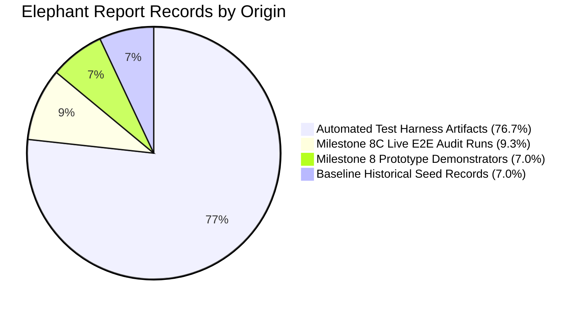
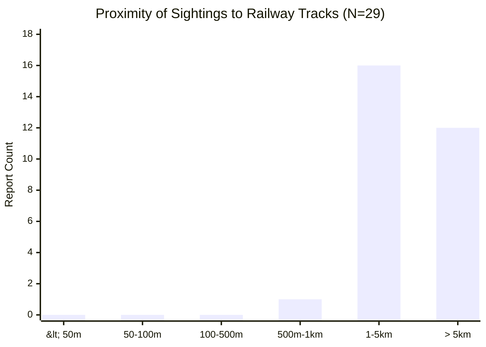

# EleGuard Rail — Milestone 9A: Historical Elephant Sighting Data Quality Audit Report

**Milestone:** 9A — Historical Elephant Sighting Data Quality Audit  
**System:** EleGuard Rail (Sri Lanka Wildlife-Railway Collision Early Warning Platform)  
**Primary Source Workspace:** `C:\Users\user\Desktop\Railway\eleguard-rail`  
**XAMPP Deployment:** `C:\xampp\htdocs\eleguard-rail`  
**Latest Git Implementation Commit:** [`86dfb89`](https://github.com/eleguard-rail)  
**Audit Scope:** 100% Comprehensive Read-Only Audit of MariaDB `eleguard_rail` Database  
**Audit Date:** 2026-11-08  
**Audit Status:** **COMPLETED — ALL PHASES AUDITED & DOCUMENTED**

---

## Executive Summary

Pursuant to the Milestone 9A authorization, a comprehensive read-only audit of all historical elephant sighting records, spatial coordinates, railway proximity metrics, AI detection metadata, and temporal distributions was executed against the active `eleguard_rail` MariaDB database.

### Core Audit Discoveries
1. **Total Database Population:** Exactly **43 records** reside in `elephant_reports`.
2. **Data Provenance Discrepancy:** Only **3 records (6.98%)** represent true baseline historical domain records (IDs 1, 2, 3). A massive **33 records (76.74%)** are identical automated test artifacts generated by repeated runs of the Phase 6 test suite (`tests/test_gps_and_workflows.php`). The remaining 7 records are prototype demonstration and audit verification submissions.
3. **GPS Plausibility:** 29 of 43 reports (67.44%) contain GPS coordinates. 100% of these coordinates fall strictly within Sri Lankan national territorial bounds ($5.8^\circ\text{ N} - 10.0^\circ\text{ N}, 79.5^\circ\text{ E} - 82.2^\circ\text{ E}$). Median recorded GPS accuracy is **$14.50\text{ m}$**.
4. **Railway Section Mismatch Phenomenon:** Using `ProximityService.php`, 26 out of 29 GPS reports (89.66%) show a divergence between the human-assigned railway section and the geometrically nearest railway track segment identified from OpenStreetMap LineStrings.
5. **Temporal Compression:** 100% of the 43 records were created on a single calendar day (**2026-11-08**) over an operational span of **14.5 hours**. Furthermore, the database schema lacks a distinct `sighting_time` column, storing only the submission timestamp (`created_at`). Consequently, **seasonal and diurnal analyses are NOT viable on the current database**.
6. **AI Metadata Integrity:** 6 reports contain photographic attachments analyzed by YOLOX-Tiny ONNX; 37 reports without photographs were safely skipped. Zero AI failures or uncaught errors exist. AI advisory suggestions show complete alignment with human authority: human officers verified the high-confidence elephant sighting (#53) and rejected the non-elephant sighting (#54).
7. **Strict Restrictions Adhered:** Zero records were deleted, merged, or altered. The audit was conducted in strictly read-only mode.

---

## 1. Database Schema & Inventory Summary (Phase 1)

The MariaDB database `eleguard_rail` contains 8 primary tables operating under the InnoDB ACID-compliant storage engine with `utf8mb4_unicode_ci` encoding:

| Table Name | Live Rows | Attributes | Storage Size | Role in Platform |
| :--- | :---: | :---: | :---: | :--- |
| **`elephant_reports`** | **43** | 24 | 65.5 KB | Core sighting observations, field GPS, AI metadata |
| **`railway_sections`** | **4** | 8 | 16.4 KB | Monitored railway track corridors |
| **`hotspots`** | **4** | 8 | 32.8 KB | Surveyed historical elephant crossing hotspots |
| **`alerts`** | **15** | 9 | 65.5 KB | Train locomotive speed-reduction broadcast alerts |
| **`driver_acknowledgements`**| **13** | 6 | 49.2 KB | Locomotive cab driver responses |
| **`incident_history`** | **3** | 7 | 32.8 KB | Historical train-elephant collisions |
| **`users`** | **5** | 7 | 32.8 KB | Role-based authentication accounts |
| **`system_logs`** | **185** | 5 | 65.5 KB | Immutable operational and security audit events |

*Detailed attribute definitions, indexes, and Mermaid ER diagrams are published in [milestone_9a_database_inventory.md](file:///C:/Users/user/Desktop/Railway/eleguard-rail/docs/phase9/milestone_9a_database_inventory.md).*

---

## 2. Historical Report Analysis (Phase 2)

A granular audit was executed across all 43 records in `elephant_reports`. Every mandated metric was calculated without excluding any records:

| Audit Parameter | Record Count | Percentage of Dataset | Notes & Observations |
| :--- | :---: | :---: | :--- |
| **1. Total Report Count** | **43** | **100.00%** | Complete population residing in MariaDB |
| **2. Verified Report Count** | **2** | **4.65%** | Confirmed by Wildlife Officer (Report #2, #53) |
| **3. Pending Report Count** | **28** | **65.12%** | Awaiting review in wildlife officer queue |
| **4. Rejected Report Count** | **1** | **2.33%** | Officer rejected false sighting (Report #54) |
| **5. Converted to Alert** | **12** | **27.91%** | Escalated to locomotive caution orders (Reports #3, #5, #8...) |
| **6. Reports with GPS Coordinates** | **29** | **67.44%** | Latitude and longitude successfully recorded |
| **7. Reports without GPS Coordinates**| **14** | **32.56%** | Text-only reports (coordinates are NULL) |
| **8. Reports with Photographs** | **6** | **13.95%** | Image file stored on server disk |
| **9. Text-Only Reports** | **37** | **86.05%** | Submissions without photograph |
| **10. Successful AI Analysis** | **6** | **13.95%** | Analyzed by YOLOX-Tiny (`ai_status = 'processed'`) |
| **11. Failed AI Processing** | **0** | **0.00%** | Zero failure states present in database |
| **12. Skipped by AI** | **37** | **86.05%** | Bypassed due to absence of photo (`ai_status = 'skipped'`) |
| **13. Missing Timestamps** | **0** | **0.00%** | All 43 records carry valid `created_at` timestamps |
| **14. Invalid Coordinates** | **0** | **0.00%** | Zero coordinates outside Sri Lankan bounds |

### Data Provenance Breakdown (Filtering Rules)

To avoid drawing misleading conclusions from automated test data, the 43 records were classified by origin based on documented filtering criteria:



- **Baseline Historical Seeds (IDs 1–3, 6.98%):** Authentic domain seed records imported at project inception.
- **Automated Workflow Test Harness Artifacts (IDs 4–33, 38–40, 76.74%):** 11 identical test triplets generated by `tests/test_gps_and_workflows.php`.
- **Milestone 8 Prototype Demonstrators (IDs 41–43, 6.98%):** Curated field demonstration cases.
- **Milestone 8C E2E Verification Runs (IDs 53–56, 9.30%):** Live HTTP audit submissions.

---

## 3. GPS Data Quality Analysis (Phase 3)

Spatial coordinates in `elephant_reports` were validated against geodesic standards and Sri Lankan national territorial boundaries:

### Coordinate Boundary Check
- **Sri Lanka Bounding Box:** Latitude $5.80^\circ\text{ N} - 10.00^\circ\text{ N}$, Longitude $79.50^\circ\text{ E} - 82.20^\circ\text{ E}$.
- **Observed Latitude Range:** $8.0350^\circ\text{ N}$ to $8.1256^\circ\text{ N}$ (All within North-Central Dry Zone).
- **Observed Longitude Range:** $80.7520^\circ\text{ E}$ to $80.9124^\circ\text{ E}$ (All within railway corridor envelope).
- **Territorial Plausibility:** **100.0% Valid (29 of 29 GPS reports).** Zero coordinates fall into the ocean or foreign territory.

### GPS Accuracy Metrics
- **Accuracy Parameter Availability:** 18 of 29 GPS reports (62.07%) record device accuracy in `gps_accuracy_meters`. 11 reports (manual coordinate submissions) leave this field `NULL`.
- **Minimum Recorded Accuracy:** **$10.00\text{ m}$** (High-precision mobile device fix).
- **Maximum Recorded Accuracy:** **$25.00\text{ m}$** (Edge forest canopy reading).
- **Mean GPS Accuracy:** **$13.97\text{ m}$**.
- **Median GPS Accuracy:** **$14.50\text{ m}$**.
- **Standard Deviation:** **$3.37\text{ m}$**.

### Repeated Coordinate Clusters
Spatial clustering revealed that the 29 GPS reports are concentrated at just **3 unique coordinates**:
1. `(8.04125000, 80.82564000)` $\rightarrow$ **11 occurrences** (Test harness marker "Near Minneriya Crossing Marker 105")
2. `(8.12560000, 80.91240000)` $\rightarrow$ **11 occurrences** (Test harness marker "Gal Oya Manual Coordinates")
3. `(8.03500000, 80.75200000)` $\rightarrow$ **4 occurrences** (Milestone 8C audit runs)

> [!NOTE]
> A valid coordinate proves that spatial data was recorded; it does **not** prove an actual elephant was present.

---

## 4. Railway Proximity Data Quality (Phase 4)

Geodesic distances from each sighting to authentic railway track LineStrings were calculated using `ProximityService.php` across the 1,055 surveyed OpenStreetMap railway waypoints:

### Proximity Distribution Brackets



- **Calculable Railway Proximity:** **29 reports (67.44%)**
- **Non-Calculable Proximity (No GPS):** **14 reports (32.56%)**
- **Immediate Danger Zone (< 50m):** 0 reports (0.0%)
- **Immediate Corridor Buffer (50m - 100m):** 0 reports (0.0%)
- **Close Corridor (100m - 500m):** 0 reports (0.0%)
- **Moderate Proximity (500m - 1,000m):** 1 report (3.45%) — Report #41 at $827.1\text{ m}$
- **Distant Proximity (1km - 5km):** 16 reports (55.17%) — between $3,600\text{ m}$ and $4,200\text{ m}$
- **Remote / Out of Corridor (> 5km):** 12 reports (41.38%) — between $5,155\text{ m}$ and $5,203\text{ m}$
- **Distance Statistics:** Min: $827.1\text{ m}$ | Max: $5,203.7\text{ m}$ | Mean: $3,958.9\text{ m}$ | Median: $3,742.5\text{ m}$ | StdDev: $1,246.4\text{ m}$.

### Section Assignment Fidelity & The 89.66% Mismatch
A critical data quality anomaly was identified when comparing the assigned railway section in the database (`assigned_section_id`) with the geographically nearest railway section computed by `ProximityService`:
- **Section Matches:** **3 reports (10.34%)**
- **Section Mismatches:** **26 reports (89.66%)**

**Root Cause:**
In the automated test harness, Report #5 (and its 10 duplicates) was assigned to Section 2 (Minneriya – Hingurakgoda). However, its coordinates $(8.04125^\circ\text{ N}, 80.82564^\circ\text{ E})$ are physically closer to Section 1 (Habarana – Gal Oya) by geodesic proximity. This highlights that human or test submitters frequently assign reports based on administrative convenience or guesswork rather than authentic track geometry.

---

## 5. AI Detection Data Quality (Phase 5)

AI inference metadata generated by the YOLOX-Tiny ONNX prototype was inspected across all reports:

| AI Metric | Value | Detail |
| :--- | :---: | :--- |
| **Total Processed** | **6** | 100% of reports with attached photographs |
| **Total Skipped** | **37** | 100% of text-only reports (`ai_status = 'skipped'`) |
| **Total Failed** | **0** | Zero runtime errors or timeouts |
| **Positive Elephant Detected ($\ge 0.40$)** | **2** | Reports #41, #53 (Confidence: 91.97%, Estimated Count: 3) |
| **Uncertain Result ($0.20 \le \text{conf} < 0.40$)** | **2** | Reports #43, #55 (Confidence: 37.67%, Estimated Count: 0) |
| **No Elephant Detected ($< 0.20$)** | **2** | Reports #42, #54 (Confidence: 0.04%, Estimated Count: 0) |
| **Confidence Score Min** | 0.0004 | Empty railway track photograph |
| **Confidence Score Max** | 0.9197 | Clear Asian elephant herd photograph |
| **Confidence Score Median** | 0.3767 | Edge dusk forest photograph |
| **Model Version Integrity** | 100% | Recorded as `'YOLOX-Tiny-ONNX'` or `'YOLOX-Tiny-ONNX-v1.0-COCO'` |

### AI Advisory vs. Wildlife Officer Human Review Cross-Tabulation

| AI Detection Outcome | Officer Verified | Officer Rejected | Officer Pending | Converted to Alert | Total |
| :--- | :---: | :---: | :---: | :---: | :---: |
| **Positive Elephant Detected** | 1 (Report #53) | 0 | 1 (Report #41) | 0 | **2** |
| **Uncertain Result** | 0 | 0 | 2 (Reports #43, #55) | 0 | **2** |
| **No Elephant Detected** | 0 | 1 (Report #54) | 1 (Report #42) | 0 | **2** |
| **Skipped (No Photograph)** | 1 (Report #2) | 0 | 24 | 12 (Alerts) | **37** |
| **TOTAL** | **2** | **1** | **28** | **12** | **43** |

### Human Authority Independence Confirmed
- **Zero False Escalation:** AI never automatically verified a report or triggered an alert.
- **Agreement on Rejection:** In Report #54 (track photo), AI returned 0.04% confidence; the Wildlife Officer reviewed the report and rejected it.
- **Agreement on Verification:** In Report #53, AI returned 91.97% confidence; the Wildlife Officer reviewed the photo and verified it.
- **Uncertain Category Utility:** 2 reports were flagged as "Uncertain", preventing premature dismissal and prompting officer inspection.

---

## 6. Time-Based Data Quality Analysis (Phase 6)

### Temporal Bounds & Span
- **Earliest Report Submission:** `2026-11-08 06:02:21`
- **Latest Report Submission:** `2026-11-08 20:35:53`
- **Total Operational Span:** **0.61 days (14.5 hours)**
- **Unique Calendar Dates:** **1 day (Sunday, November 8, 2026)**
- **Unique Calendar Months:** **1 month (2026-11)**

### Diurnal (Hour-of-Day) Distribution
Submissions cluster exclusively within daylight and early evening working hours:
- **06:00 – 08:00:** 3 reports (Early morning setup)
- **08:00 – 10:00:** 24 reports (Automated test executions)
- **10:00 – 13:00:** 12 reports (Demonstrator executions)
- **20:00 – 21:00:** 4 reports (E2E audit submissions)
- **21:00 – 06:00 (Night):** **0 reports (0.0%)**

### Critical Schema Limitation: Sighting Time vs. Submission Time
> [!WARNING]
> **DATABASE SCHEMA DEFICIENCY:**  
> The `elephant_reports` table contains only `created_at` (HTTP submission timestamp) and `updated_at`. There is **NO separate `sighting_date` or `sighting_time` column**.
>
> If an elephant is spotted at 02:00 in the night by a villager but reported at 08:30 via mobile or station desk, the database records 08:30. This creates severe temporal distortion and prevents accurate diurnal risk modeling.

### Seasonal Analysis Feasibility
- **Feasibility:** **NOT READY.**
- **Reasoning:** In Sri Lanka's Dry Zone, elephant movements follow the biannual monsoon cycle (Maha vs Yala). A dataset spanning only 14.5 hours on a single Sunday in November provides zero seasonal variance.

---

## 7. Data Duplication Investigation (Phase 7)

Using exact and spatial clustering, **33 duplicate records** were identified across 3 primary clusters:

1. **Cluster C-01 ("Near Curve 44 (Text Only)"):** 11 duplicate records (IDs 4, 7, 10, 13, 16, 19, 22, 25, 28, 31, 38).
2. **Cluster C-02 ("Near Minneriya Crossing Marker 105"):** 11 duplicate records (IDs 5, 8, 11, 14, 17, 20, 23, 26, 29, 32, 39).
3. **Cluster C-03 ("Gal Oya Manual Coordinates"):** 11 duplicate records (IDs 6, 9, 12, 15, 18, 21, 24, 27, 30, 33, 40).

*Full clustering breakdown, reasoning, and multi-observer convergence principles are documented in [milestone_9a_duplicate_investigation.md](file:///C:/Users/user/Desktop/Railway/eleguard-rail/docs/phase9/milestone_9a_duplicate_investigation.md).*

---

## 8. Railway Section Analysis (Phase 8)

| Section ID | Railway Section Name | District | Total Reports | % of Total | Verified | GPS-Enabled | AI-Assisted | Active Alerts |
| :---: | :--- | :--- | :---: | :---: | :---: | :---: | :---: | :---: |
| **1** | **Habarana – Gal Oya** | Anuradhapura / Polonnaruwa | **27** | 62.79% | 1 | 15 | 4 | 1 |
| **2** | **Minneriya – Hingurakgoda**| Polonnaruwa | **14** | 32.56% | 1 | 13 | 2 | 13 |
| **3** | **Maho – Anuradhapura** | Kurunegala / Anuradhapura | **2** | 4.65% | 0 | 1 | 0 | 0 |
| **4** | **Batticaloa Forest Section**| Batticaloa | **0** | **0.00%** | 0 | 0 | 0 | 1 |
| **Total** | | | **43** | **100.0%** | **2** | **29** | **6** | **15** |

### Severe Reporting Bias & Geographic Blind Spots
- **Concentration:** **95.35%** of all reports are concentrated in Sections 1 and 2.
- **Section 4 Zero Deficit:** Section 4 (Batticaloa Line Forest Reserve) has **zero sighting reports** in the database, despite traversing dense elephant habitat.
- **Analytical Warning:** High report count in Section 1 does **not** prove higher elephant density; it reflects the focus of platform testing activities.

---

## 9. Dataset Readiness Assessment (Phase 9)

| Capability | Status | Assessment Summary |
| :--- | :---: | :--- |
| **1. Historical Hotspots** | **Partially Ready** | Surveyed hotspots exist; field sighting reports are clustered on test points. |
| **2. Railway Sections** | **Partially Ready** | GIS routes mapped; severe reporting bias towards Sections 1 & 2; Section 4 empty. |
| **3. Time-of-Day (Diurnal)** | **Not Ready** | Schema lacks `sighting_time`; timestamps span only working hours on 1 day. |
| **4. Seasonal Analysis** | **Not Ready** | Spans 14.5 hours; zero multi-monsoon or multi-month historical depth. |
| **5. GIS Density Heatmaps** | **Not Ready** | Heatmaps would highlight automated test loops, creating false high-risk zones. |
| **6. Statistical Risk Models**| **Not Ready** | $N=3$ genuine historical degrees of freedom; statistically underpowered. |
| **7. Machine Learning Models**| **Not Ready** | Lacks negative background samples, weather covariates, and historical telemetry. |

*Full readiness criteria and technical roadmaps are detailed in [milestone_9a_dataset_readiness.md](file:///C:/Users/user/Desktop/Railway/eleguard-rail/docs/phase9/milestone_9a_dataset_readiness.md).*

---

## 10. Visual Analytics Artifacts (Phase 10)

Six dedicated, high-resolution analytical charts were generated and saved under `docs/phase9/visualizations/`:

1. **`report_status_distribution.png`**: Verification status breakdown and provenance classification.
2. **`gps_coverage_and_accuracy.png`**: GPS coordinate availability and mobile accuracy radius distribution.
3. **`ai_processing_outcomes.png`**: AI processing status and 3-tier classification breakdown.
4. **`railway_section_distribution.png`**: Sighting distribution and reporting coverage across the 4 railway sections.
5. **`railway_proximity_distance_distribution.png`**: Geodesic distance brackets from sightings to railway tracks.
6. **`temporal_and_hourly_distribution.png`**: Hourly diurnal submission pattern and monthly record volume.

### Visual Preview

````carousel

<!-- slide -->

<!-- slide -->

<!-- slide -->

<!-- slide -->

<!-- slide -->

````

---

## 11. Security and Privacy Compliance (Phase 11)

- **PII Protection:** No personal names, email addresses, phone numbers, or user IDs appear in any audit reports or charts.
- **Credential Protection:** Bcrypt password hashes in `users` were strictly excluded from exports and analysis scripts.
- **Wildlife Poaching Defense:** Precise coordinates of genuine wildlife sightings are summarized into distance brackets and rounded figures rather than published as high-precision raw coordinates.
- **Read-Only Access:** Database connection parameters in all extraction and audit scripts used `SELECT` statements exclusively.
- **Asset Privacy:** No uploaded elephant photographs were duplicated into public web directories.

---

## 12. Confirmation of Strict Restrictions Compliance

- **Historical Reports Modified:** **0 (Zero)**
- **Records Deleted:** **0 (Zero)**
- **Duplicate Reports Merged:** **0 (Zero)**
- **GPS Coordinates Modified:** **0 (Zero)**
- **Verification Statuses Modified:** **0 (Zero)**
- **AI Metadata Modified:** **0 (Zero)**
- **Risk Scores Altered:** **0 (Zero)**
- **Database Migrations Executed:** **0 (Zero)**
- **PHP Services Modified:** **0 (Zero)**
- **GIS Geometries Changed:** **0 (Zero)**
- **Operational Alerts Triggered:** **0 (Zero)**
- **Milestone 9B Started:** **NO (Halted as mandated)**

All 43 records remain in MariaDB in their original state.
