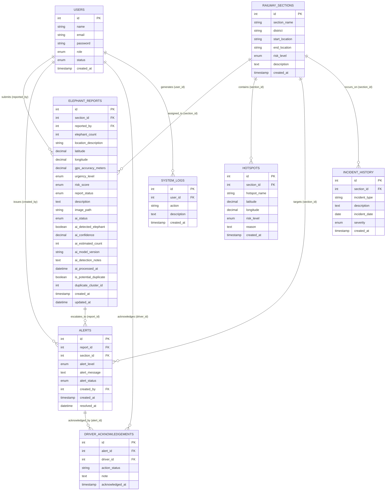

# EleGuard Rail — Database Schema & Architecture Inventory

**Milestone:** 9A — Historical Elephant Sighting Data Quality Audit  
**Database Name:** `eleguard_rail`  
**Database Management System:** MariaDB 10.4+ (XAMPP / MySQL compatible)  
**Character Set & Collation:** `utf8mb4` / `utf8mb4_unicode_ci`  
**Storage Engine:** InnoDB (ACID compliant, foreign keys enforced)  
**Extraction Mode:** Read-Only Schema Inspection  
**Audit Date:** 2026-11-08  

---

## 1. Executive Database Summary

The `eleguard_rail` database serves as the centralized persistence layer for the Sri Lanka Wildlife-Railway Collision Early Warning Platform. It models the end-to-end lifecycle of elephant sightings, GIS railway corridors, collision hotspots, operational safety alerts, driver locomotive acknowledgements, AI advisory detections, and administrative audit trails.

### Global Table Inventory

| Table Name | Storage Engine | Live Row Count | Columns | Foreign Keys | Data Size (Bytes) | Index Size (Bytes) | Primary Purpose |
| :--- | :---: | :---: | :---: | :---: | :---: | :---: | :--- |
| **`elephant_reports`** | InnoDB | **43** | 24 | 2 | 16,384 | 49,152 | Sighting reports, field GPS, photos, AI advisory inference |
| **`railway_sections`** | InnoDB | **4** | 8 | 0 | 16,384 | 0 | Monitored railway track segments and corridor metadata |
| **`hotspots`** | InnoDB | **4** | 8 | 1 | 16,384 | 16,384 | Historical elephant crossing zones with GPS coordinates |
| **`alerts`** | InnoDB | **15** | 9 | 3 | 16,384 | 49,152 | Active and historical speed-reduction alerts broadcast to trains |
| **`incident_history`** | InnoDB | **3** | 7 | 1 | 16,384 | 16,384 | Historical train-elephant collisions and near-misses |
| **`driver_acknowledgements`**| InnoDB | **13** | 6 | 2 | 16,384 | 32,768 | Train driver cab acknowledgements and speed actions |
| **`users`** | InnoDB | **5** | 7 | 0 | 16,384 | 16,384 | Role-based accounts (Admin, Control, Wildlife, Driver, Reporter) |
| **`system_logs`** | InnoDB | **185** | 5 | 1 | 49,152 | 16,384 | Immutable security and operational audit trail |

---

## 2. Entity-Relationship Architecture

---

## 3. Comprehensive Table Specifications

### 3.1 `elephant_reports` (Core Audit Target)
Stores all elephant sighting submissions, field observations, GPS coordinates, human verification statuses, and YOLOX-Tiny AI detection advisory outputs.

- **Total Columns:** 24
- **Primary Key:** `id` (`int(11) AUTO_INCREMENT`)
- **Foreign Keys:**
  - `section_id` $\rightarrow$ `railway_sections(id)` (ON UPDATE RESTRICT, ON DELETE RESTRICT)
  - `reported_by` $\rightarrow$ `users(id)` (ON UPDATE RESTRICT, ON DELETE RESTRICT)

| Column Name | Data Type | Nullable | Default | Description |
| :--- | :--- | :---: | :---: | :--- |
| `id` | `int(11)` | NO | *AUTO* | Unique report identifier (Primary Key) |
| `section_id` | `int(11)` | NO | NULL | Foreign key referencing assigned railway section |
| `reported_by` | `int(11)` | NO | NULL | Foreign key referencing the reporting user |
| `elephant_count` | `int(11)` | NO | NULL | Number of elephants observed by field reporter |
| `location_description` | `varchar(255)` | NO | NULL | Human-readable landmark or kilometer post description |
| `latitude` | `decimal(10,8)` | YES | NULL | WGS-84 Latitude in decimal degrees (e.g. `8.03840000`) |
| `longitude` | `decimal(11,8)` | YES | NULL | WGS-84 Longitude in decimal degrees (e.g. `80.75520000`) |
| `gps_accuracy_meters` | `decimal(8,2)` | YES | NULL | Mobile device GPS accuracy radius in metres |
| `urgency_level` | `enum('Low','Medium','High','Critical')` | NO | NULL | Reporter-submitted urgency assessment |
| `risk_score` | `enum('Low','Medium','High','Critical')` | YES | `'Low'` | System/Officer computed collision risk classification |
| `report_status` | `enum('Pending','Verified','Rejected','Converted to Alert','Resolved')` | YES | `'Pending'` | Operational lifecycle status governed by Wildlife Officers |
| `description` | `text` | YES | NULL | Narrative details, herd behavior, and environmental conditions |
| `image_path` | `varchar(255)` | YES | NULL | Relative storage path to uploaded photograph |
| `ai_status` | `enum('pending','processed','skipped','failed')` | YES | `'pending'` | AI detection processing lifecycle status |
| `ai_detected_elephant` | `tinyint(1)` | YES | NULL | Boolean flag: 1 = Elephant detected, 0 = No elephant detected |
| `ai_confidence` | `decimal(5,4)` | YES | NULL | Highest detection confidence score ($0.0000$ to $1.0000$) |
| `ai_estimated_count` | `int(11)` | YES | NULL | Bounding-box count of detected elephants |
| `ai_model_version` | `varchar(50)` | YES | NULL | AI model identification (e.g. `YOLOX-Tiny-ONNX`) |
| `ai_detection_notes` | `text` | YES | NULL | Advisory summary, bounding-box metadata, or error trace |
| `ai_processed_at` | `datetime` | YES | NULL | Timestamp of AI inference execution |
| `is_potential_duplicate` | `tinyint(1)` | YES | `0` | Flag indicating suspected spatial-temporal duplicate |
| `duplicate_cluster_id` | `int(11)` | YES | NULL | Identifier grouping clustered duplicate submissions |
| `created_at` | `timestamp` | NO | `current_timestamp()` | System timestamp of report submission |
| `updated_at` | `datetime` | YES | NULL | Timestamp of status change or administrative review |

**Active Indexes on `elephant_reports`:**
1. `PRIMARY` (`id`) — Unique B-tree index.
2. `idx_elephant_reports_section_id` (`section_id`) — Foreign key join index.
3. `idx_elephant_reports_reported_by` (`reported_by`) — Foreign key user join index.
4. `idx_elephant_reports_latitude` (`latitude`) — Spatial indexing support.
5. `idx_elephant_reports_ai_status` (`ai_status`) — Advisory queue filter index.
6. `idx_elephant_reports_is_potential_duplicate` (`is_potential_duplicate`) — De-duplication filter index.

---

### 3.2 `railway_sections`
Defines the monitored railway corridors across Sri Lanka Railways Northern and Eastern lines.

| Column Name | Data Type | Nullable | Default | Description |
| :--- | :--- | :---: | :---: | :--- |
| `id` | `int(11)` | NO | *AUTO* | Section ID (1=Habarana-Gal Oya, 2=Minneriya-Hingurakgoda, 3=Maho-Anuradhapura, 4=Batticaloa Forest) |
| `section_name` | `varchar(100)` | NO | NULL | Official naming of the railway segment |
| `district` | `varchar(100)` | NO | NULL | Administrative district(s) traversed |
| `start_location` | `varchar(100)` | NO | NULL | Initial railway station or milepost |
| `end_location` | `varchar(100)` | NO | NULL | Terminal railway station or milepost |
| `risk_level` | `enum('Low','Medium','High','Critical')` | NO | `'Medium'` | Baseline seasonal collision risk level |
| `description` | `text` | YES | NULL | Ecological context, terrain, vegetation, and elephant corridors |
| `created_at` | `timestamp` | NO | `current_timestamp()` | Registration timestamp |

---

### 3.3 `hotspots`
Contains surveyed historical elephant crossings along the railway alignment.

| Column Name | Data Type | Nullable | Default | Description |
| :--- | :--- | :---: | :---: | :--- |
| `id` | `int(11)` | NO | *AUTO* | Hotspot ID |
| `section_id` | `int(11)` | NO | NULL | Foreign key referencing `railway_sections(id)` |
| `hotspot_name` | `varchar(100)` | NO | NULL | Named historical crossing location |
| `latitude` | `decimal(10,8)` | NO | NULL | WGS-84 Latitude of hotspot center |
| `longitude` | `decimal(11,8)` | NO | NULL | WGS-84 Longitude of hotspot center |
| `risk_level` | `enum('Low','Medium','High','Critical')` | NO | `'High'` | Historical risk level |
| `reason` | `text` | YES | NULL | Ecological reasoning (e.g. water reservoir access, seasonal migration) |
| `created_at` | `timestamp` | NO | `current_timestamp()` | Registration timestamp |

---

### 3.4 `alerts`
Tracks active locomotive caution and speed reduction orders broadcast by Railway Control.

| Column Name | Data Type | Nullable | Default | Description |
| :--- | :--- | :---: | :---: | :--- |
| `id` | `int(11)` | NO | *AUTO* | Alert ID |
| `report_id` | `int(11)` | YES | NULL | Originating verified sighting report FK |
| `section_id` | `int(11)` | NO | NULL | Target railway section FK |
| `alert_level` | `enum('Caution','Warning','Danger')` | NO | `'Warning'` | Alert severity tier |
| `alert_message` | `text` | NO | NULL | Instruction broadcast to locomotive drivers |
| `alert_status` | `enum('Active','Resolved','Cancelled')` | YES | `'Active'` | Real-time broadcast status |
| `created_by` | `int(11)` | NO | NULL | Controller user ID FK |
| `created_at` | `timestamp` | NO | `current_timestamp()` | Broadcast timestamp |
| `resolved_at` | `datetime` | YES | NULL | Resolution/cancellation timestamp |

---

### 3.5 `driver_acknowledgements`
Audits locomotive drivers' compliance with broadcast alerts from their in-cab dashboard.

| Column Name | Data Type | Nullable | Default | Description |
| :--- | :--- | :---: | :---: | :--- |
| `id` | `int(11)` | NO | *AUTO* | Acknowledgement ID |
| `alert_id` | `int(11)` | NO | NULL | Foreign key referencing `alerts(id)` |
| `driver_id` | `int(11)` | NO | NULL | Driver user ID referencing `users(id)` |
| `action_status` | `varchar(50)` | NO | NULL | Action taken (e.g. `'Slowing Down'`, `'Stop Train'`, `'Section Cleared'`) |
| `note` | `text` | YES | NULL | Driver operational remarks |
| `acknowledged_at` | `timestamp` | NO | `current_timestamp()` | Timestamp of driver acknowledgement |

---

### 3.6 `incident_history`
Documents historical collisions and near-misses for spatial-temporal validation.

| Column Name | Data Type | Nullable | Default | Description |
| :--- | :--- | :---: | :---: | :--- |
| `id` | `int(11)` | NO | *AUTO* | Incident record ID |
| `section_id` | `int(11)` | NO | NULL | Railway section FK |
| `incident_type` | `varchar(50)` | NO | NULL | Event type (e.g. `'Collision'`, `'Near Miss'`) |
| `description` | `text` | YES | NULL | Official incident report |
| `incident_date` | `date` | NO | NULL | Historical date of event occurrence |
| `severity` | `enum('Minor','Moderate','Severe','Fatal')` | NO | `'Moderate'` | Severity impact |
| `created_at` | `timestamp` | NO | `current_timestamp()` | Database registration timestamp |

---

### 3.7 `users`
Defines authentication credentials and role authorization across 5 operational roles.

| Column Name | Data Type | Nullable | Default | Description |
| :--- | :--- | :---: | :---: | :--- |
| `id` | `int(11)` | NO | *AUTO* | User ID |
| `name` | `varchar(100)` | NO | NULL | Full user name |
| `email` | `varchar(100)` | NO | NULL | Unique login email address |
| `password` | `varchar(255)` | NO | NULL | Bcrypt hashed password |
| `role` | `enum('admin','control_officer','driver','wildlife_officer','reporter')` | NO | `'reporter'` | System authorization role |
| `status` | `enum('active','inactive')` | YES | `'active'` | Account status |
| `created_at` | `timestamp` | NO | `current_timestamp()` | Registration timestamp |

---

### 3.8 `system_logs`
Append-only tamper-evident security and operational audit trail.

| Column Name | Data Type | Nullable | Default | Description |
| :--- | :--- | :---: | :---: | :--- |
| `id` | `int(11)` | NO | *AUTO* | Log event ID |
| `user_id` | `int(11)` | YES | NULL | User who triggered event |
| `action` | `varchar(100)` | NO | NULL | Action code (e.g. `'AUTH_LOGIN'`, `'REPORT_VERIFIED'`) |
| `description` | `text` | YES | NULL | Human-readable log details |
| `created_at` | `timestamp` | NO | `current_timestamp()` | Exact event timestamp |

---

## 4. Key Architectural Observations

1. **Temporal Modeling Limitation:** In `elephant_reports`, only `created_at` and `updated_at` exist. There is **no separate `sighting_date` or `sighting_time` column**. Any latency between field sighting and report filing is lost in the current schema.
2. **Coordinate Precision:** WGS-84 coordinates are stored with `decimal(10,8)` (Latitude) and `decimal(11,8)` (Longitude), giving sub-millimetre theoretical resolution—far exceeding mobile GPS accuracy (~10–25m).
3. **AI Metadata Independence:** AI fields (`ai_status`, `ai_detected_elephant`, `ai_confidence`, `ai_estimated_count`, `ai_model_version`, `ai_detection_notes`, `ai_processed_at`) are completely decoupled from human operational columns (`report_status`, `risk_score`). This strictly guarantees human-in-the-loop governance.
4. **Relational Integrity:** Foreign keys are properly established across all operational relationships, preventing orphaned reports or alerts.
