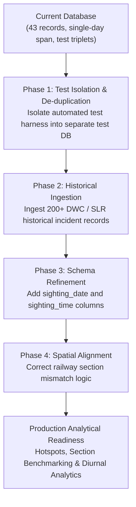

# EleGuard Rail — Milestone 9A: Historical Dataset Analytical Readiness Assessment

**Milestone:** 9A — Historical Elephant Sighting Data Quality Audit  
**Dataset Evaluated:** `eleguard_rail` MariaDB historical data (N = 43 records)  
**Evaluation Scope:** Geospatial, Temporal, Statistical, and Machine-Learning Analytical Viability  
**Audit Date:** 2026-11-08  

---

## 1. Executive Readiness Matrix

| Analytical Capability | Readiness Status | Current Data Basis | Core Blockers & Vulnerabilities | Minimum Data Requirements for Production |
| :--- | :---: | :---: | :--- | :--- |
| **1. Historical Hotspot Analysis** | **Partially Ready** | 4 surveyed hotspots; 29 GPS reports | 26 of 29 GPS reports clustered around 2 static test points; only 3 genuine historical points | $\ge 150$ verified field sightings distributed along actual track geometry |
| **2. Railway-Section Comparison** | **Partially Ready** | 4 railway sections registered | 95.3% of reports in Sections 1 & 2; Section 4 has 0 reports; severe reporting bias | $\ge 30$ verified sightings per section across all 4 monitored corridors |
| **3. Time-of-Day (Diurnal) Analysis** | **Not Ready** | 43 submissions | Sighting timestamp is not recorded (only submission `created_at`); spans 14.5 hours | Schema update to capture field `sighting_time`; $\ge 300$ reports across 24h |
| **4. Seasonal Analysis** | **Not Ready** | 43 submissions | 100% of records submitted on a single date (2026-11-08); zero multi-month data | $\ge 24$ months of continuous historical data capturing Yala/Maha monsoons |
| **5. GIS Density Heatmaps** | **Not Ready** | 29 GPS coordinates | Generating KDE heatmaps from 11-fold repeated test coordinates would produce severely distorted artifacts | Spatial de-duplication; $\ge 100$ independent spatial sightings |
| **6. Statistical Risk Modelling** | **Not Ready** | 3 genuine seeds | Sample size insufficient ($N=3$ true historical reports); high variance; zero statistical power | $\ge 250$ verified incidents and sightings with train frequency parameters |
| **7. Machine Learning Risk Prediction**| **Not Ready** | N/A | Extreme class imbalance; lack of negative samples; lack of exogenous environmental covariates | $\ge 1,000$ telemetry rows, weather, train schedules, water proximity |

---

## 2. In-Depth Capability Assessments

### 2.1 Historical Hotspot Analysis
- **Status:** **PARTIALLY READY**
- **Current Data Basis:**
  - The `hotspots` table contains 4 well-defined, surveyed railway hotspots:
    1. *Habarana Tank Elephant Crossing* ($8.0325^\circ\text{ N}, 80.7480^\circ\text{ E}$, Section 1, Critical)
    2. *Minneriya Sanctuary Railway Corridor* ($8.0410^\circ\text{ N}, 80.8260^\circ\text{ E}$, Section 2, Critical)
    3. *Maho Forest Reserve Crossing* ($7.8210^\circ\text{ N}, 80.2850^\circ\text{ E}$, Section 3, High)
    4. *Valaichchenai Jungle Edge* ($7.9150^\circ\text{ N}, 81.5240^\circ\text{ E}$, Section 4, High)
  - `ProximityService.php` successfully calculates point-to-LineString geodesic distances against 1,055 OSM track nodes.
- **Why Not Fully Ready:**
  - In `elephant_reports`, 22 of the 29 GPS reports are concentrated at just two test coordinates: $(8.04125, 80.82564)$ and $(8.12560, 80.91240)$.
  - Only 3 genuine baseline historical records exist. Analyzing sighting concentration against hotspots with the current dataset would merely reflect automated test execution frequency, not biological elephant migration.
- **Minimum Requirements to Achieve "Ready":**
  - Ingestion of at least 150 authenticated historical sightings from Department of Wildlife Conservation (DWC) or Sri Lanka Railways (SLR) historical incident logs.

---

### 2.2 Railway-Section Comparison
- **Status:** **PARTIALLY READY**
- **Current Data Basis:**
  - All 4 railway sections are formally established with district metadata and GIS route LineStrings in `railway_routes.geojson`.
- **Why Not Fully Ready:**
  - **Severe Spatial Imbalance:**
    - Section 1 (Habarana – Gal Oya): 27 reports (62.79%)
    - Section 2 (Minneriya – Hingurakgoda): 14 reports (32.56%)
    - Section 3 (Maho – Anuradhapura): 2 reports (4.65%)
    - Section 4 (Batticaloa Line Forest Section): 0 reports (0.00%)
  - Section 4 has zero reporting activity despite traversing high-risk forest reserves.
  - Comparing section risk based on report count would falsely conclude that Section 4 has zero elephant collision risk, which is factually false and hazardous for railway operations.
- **Minimum Requirements to Achieve "Ready":**
  - Minimum of 30 verified sighting reports per section across all four operational corridors.

---

### 2.3 Time-of-Day (Diurnal) Analysis
- **Status:** **NOT READY**
- **Current Data Basis:**
  - Timestamps exist in `created_at` column.
- **Core Structural Blocker:**
  - **Missing Field:** The `elephant_reports` schema lacks a dedicated `sighting_time` column. It only stores the HTTP submission timestamp (`created_at`).
  - If a ranger spots an elephant at 02:00 (peak locomotive collision risk) but submits the report at 08:15 from a ranger station, the system records 08:15.
  - Furthermore, all 43 submissions occurred within daytime/evening hours on a single calendar day (06:02 to 20:35).
- **Minimum Requirements to Achieve "Ready":**
  - Database migration to add `sighting_date (date)` and `sighting_time (time)` fields to `elephant_reports`.
  - Capture of at least 300 reports distributed across morning, afternoon, twilight, and nocturnal periods.

---

### 2.4 Seasonal Analysis
- **Status:** **NOT READY**
- **Current Data Basis:**
  - All 43 records carry the identical calendar month: `2026-11` (November 2026).
  - Timespan of the entire database is **14.5 hours** (0.61 days).
- **Ecological Context in Sri Lanka:**
  - Asian elephant (*Elephas maximus maximus*) movements in the North-Central Dry Zone are heavily dictated by monsoon seasons:
    - **Maha Monsoon (October – January):** Heavy rains; herds disperse into scrublands and tank beds.
    - **Inter-monsoon Dry Season (June – September):** "The Gathering" at Minneriya and Kaudulla reservoirs, where hundreds of elephants congregate near the railway line seeking water and fodder.
  - Attempting seasonal decomposition on data from a single day is mathematically impossible.
- **Minimum Requirements to Achieve "Ready":**
  - Continuous historical sightings spanning at least 2 full annual cycles (24 months), with minimum 15–20 reports per month.

---

### 2.5 GIS Density Heatmaps
- **Status:** **NOT READY**
- **Current Data Basis:**
  - Leaflet.js interactive map is operational (`public/wildlife/map.php`).
- **Why Not Ready:**
  - Kernel Density Estimation (KDE) on the current dataset would generate a localized intense "red spot" at $(8.04125, 80.82564)$ simply because the test harness script ran 11 times.
  - Publishing such a heatmap would mislead wildlife rangers and locomotive drivers into believing that a specific field coordinate is an extreme collision cluster.
- **Minimum Requirements to Achieve "Ready":**
  - De-duplication filter excluding automated test rows; minimum 100 geographically distinct field observations.

---

### 2.6 Statistical Risk Modelling
- **Status:** **NOT READY**
- **Current Data Basis:**
  - 43 reports (of which only 3 are baseline historical records, and 2 are officer-verified).
- **Why Not Ready:**
  - Fitting parametric or non-parametric statistical distributions (e.g. Poisson or Negative Binomial regression of sightings vs track distance) with $N=3$ degrees of freedom produces unbounded confidence intervals and zero predictive validity.
- **Minimum Requirements to Achieve "Ready":**
  - Clean analytical dataset of $\ge 250$ verified field observations combined with railway timetable data (train speed, frequency, locomotive headlights).

---

### 2.7 Machine-Learning Collision Risk Prediction
- **Status:** **NOT READY**
- **Current Data Basis:**
  - Binary classification / regression labels are not defined.
- **Why Not Ready:**
  - Predictive modeling (e.g. Random Forest, XGBoost, or Spatial Point Process models) requires:
    1. Positive instances (elephant present near track).
    2. Negative background samples (locations/times where no elephants were observed).
    3. Exogenous environmental covariates (distance to water bodies, normalized difference vegetation index [NDVI], lunar phase, precipitation, ambient temperature).
  - None of these feature sets are currently ingested or preprocessed.
- **Minimum Requirements to Achieve "Ready":**
  - Feature engineering pipeline ingesting OpenStreetMap water layers, weather API data, train movement telemetry, and $\ge 1,000$ labeled spatial-temporal training points.

---

## 3. Road Map for Transitioning to Production Analytical Readiness

1. **Immediate Step:** Isolate automated test runs (`test_gps_and_workflows.php`) so regression tests do not write into production tables.
2. **Schema Update:** Introduce `sighting_date` and `sighting_time` to decouple field observation time from report filing timestamp.
3. **Historical Data Partnership:** Ingest official historical accident and sighting records from the Sri Lanka Railways Motive Power Sub-Department and Department of Wildlife Conservation.
