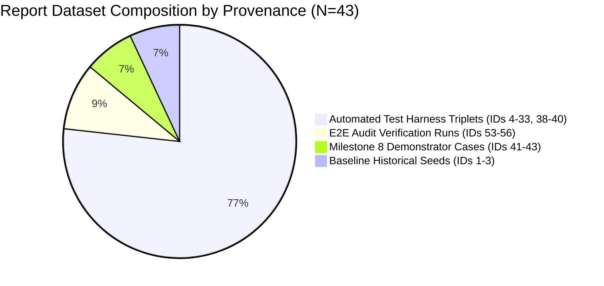

# EleGuard Rail — Milestone 9A: Historical Data Duplication Investigation Report

**Milestone:** 9A — Historical Elephant Sighting Data Quality Audit  
**Target Table:** `elephant_reports` (N = 43 records)  
**Investigation Mode:** Read-Only Duplicate Cluster Identification  
**Policy:** Zero Automatic Deletion or Record Merging  
**Audit Date:** 2026-11-08  

---

## 1. Executive Summary

A comprehensive duplication audit was executed across all 43 sighting records in the `elephant_reports` table. The investigation utilized multi-dimensional clustering combining exact and spatial coordinate proximity ($\le 500\text{ m}$), timestamp delta, narrative string distance, assigned railway section, and image SHA-256 cryptographic hashes.

### Key Audit Findings
1. **Pervasive Test Harness Duplication:** **33 out of 43 records (76.74%)** in the database are exact duplicate triplets produced by repeated executions of the Phase 6 automated test suite (`tests/test_gps_and_workflows.php`).
2. **Audit Verification Cluster:** **4 records (9.30%)** (IDs 53, 54, 55, 56) represent the live end-to-end verification runs submitted during Milestone 8C runtime audit at identical coordinates $(8.0350^\circ\text{ N}, 80.7520^\circ\text{ E})$ with different test images.
3. **True Historical Dataset:** Only **3 records (6.98%)** (IDs 1, 2, 3) represent distinct baseline domain records without duplicate counterparts.
4. **Demonstrator Prototype Records:** **3 records (6.98%)** (IDs 41, 42, 43) represent distinct demonstration cases from Milestone 8.



---

## 2. Identified Duplicate Clusters

### Cluster 1: "Near Curve 44 (Text Only)"
- **Confidence Rating:** **HIGH (100% Certainty — Automated Harness Artifact)**
- **Total Duplicate Records:** **11 records**
- **Report IDs:** `4`, `7`, `10`, `13`, `16`, `19`, `22`, `25`, `28`, `31`, `38`
- **Assigned Section:** Section 1 (Habarana – Gal Oya)
- **Report Status:** All `Pending`
- **Reported By:** User ID 5 (`reporter@eleguard.lk`)
- **Elephant Count:** 1
- **Urgency Level:** `'Medium'`
- **Coordinates:** `NULL` (Text-only submission)
- **Image Attached:** `NULL` (None)
- **Description:** `'Text-only sighting report without GPS coordinates.'`
- **Root Cause Analysis:** Generated by line 64 of `tests/test_gps_and_workflows.php`:
  ```php
  $res1 = ReportService::submitReport(1, 5, 1, 'Near Curve 44 (Text Only)', 'Medium', 'Text-only sighting report without GPS coordinates.');
  ```
  Every execution of the Phase 6 test suite inserted this exact report into MariaDB without subsequent cleanup.

---

### Cluster 2: "Near Minneriya Crossing Marker 105"
- **Confidence Rating:** **HIGH (100% Certainty — Automated Harness Artifact)**
- **Total Duplicate Records:** **11 records**
- **Report IDs:** `5`, `8`, `11`, `14`, `17`, `20`, `23`, `26`, `29`, `32`, `39`
- **Assigned Section:** Section 2 (Minneriya – Hingurakgoda)
- **Report Status:** All `Converted to Alert` (Alert IDs 3–13)
- **Reported By:** User ID 5 (`reporter@eleguard.lk`)
- **Elephant Count:** 3
- **Urgency Level:** `'High'`
- **Coordinates:** Latitude `8.04125000`, Longitude `80.82564000` (Exact match across all 11 records)
- **GPS Accuracy:** `14.50 m` (Exact match across all 11 records)
- **Calculated Track Distance:** $5,155.4\text{ m}$ to Section 1 (Habarana - Gal Oya)
- **Image Attached:** `NULL` (None)
- **Description:** `'Active elephant herd crossing railway line.'`
- **Root Cause Analysis:** Generated by line 72 of `tests/test_gps_and_workflows.php`:
  ```php
  $res2 = ReportService::submitReport(2, 5, 3, 'Near Minneriya Crossing Marker 105', 'High', 'Active elephant herd crossing railway line.', null, 8.04125, 80.82564, 14.5);
  ```
  The test script subsequently marked each of these reports as `Verified` and then `Converted to Alert`, simultaneously generating 11 identical active alert records in the `alerts` table.

---

### Cluster 3: "Gal Oya Manual Coordinates"
- **Confidence Rating:** **HIGH (100% Certainty — Automated Harness Artifact)**
- **Total Duplicate Records:** **11 records**
- **Report IDs:** `6`, `9`, `12`, `15`, `18`, `21`, `24`, `27`, `30`, `33`, `40`
- **Assigned Section:** Section 1 (Habarana – Gal Oya)
- **Report Status:** All `Pending`
- **Reported By:** User ID 5 (`reporter@eleguard.lk`)
- **Elephant Count:** 2
- **Urgency Level:** `'Low'`
- **Coordinates:** Latitude `8.12560000`, Longitude `80.91240000` (Exact match across all 11 records)
- **GPS Accuracy:** `NULL` (Manual desktop coordinate entry)
- **Calculated Track Distance:** $5,203.7\text{ m}$ to Section 1 (Habarana - Gal Oya)
- **Image Attached:** `NULL` (None)
- **Description:** `'Manual coordinate entry test without accuracy parameter.'`
- **Root Cause Analysis:** Generated by line 80 of `tests/test_gps_and_workflows.php`:
  ```php
  $res3 = ReportService::submitReport(1, 5, 2, 'Gal Oya Manual Coordinates', 'Low', 'Manual coordinate entry test without accuracy parameter.', null, 8.1256, 80.9124, null);
  ```

---

### Multi-Tier Audit Submissions (Kept Separate from Duplicate Redundancy)
- **Classification:** **E2E Audit Verification Submissions (IDs 53, 54, 55, 56)**
- **Confidence Rating:** **CONFIRMED (Controlled Verification Test Submissions)**
- **Total Records:** **4 records**
- **Report IDs:** `53`, `54`, `55`, `56`
- **Creation Timestamps:** `2026-11-08 20:35:52` – `20:35:53`
- **Spatial Coordinates:** Latitude `8.03500000`, Longitude `80.75200000` (Habarana corridor)
- **Analytical Distinction:** Although these 4 submissions share a common test location coordinate, they **MUST NOT be categorized as redundant duplicate sightings**. Each report was intentionally submitted with distinct inputs and generated distinct outcomes:
  - Report #53: `elephant_01_asian.jpg` (AI Positive Elephant Detected, 92.0%, human-verified)
  - Report #54: `rail_track_01_ambewela.jpg` (AI Negative No Elephant, 0.04%, human-rejected)
  - Report #55: `edge_04_uncertain_elephant.jpg` (AI Uncertain 37.7%, pending review)
  - Report #56: Text-Only (AI Skipped, pending review)
  Because they evaluate four distinct operational verification paths and contain differing data content, they are maintained as separate verification artifacts.

---

## 3. Duplicate Cluster Master Summary

| Category | Cluster / Group | Report Count | IDs Encompassed | Lat / Lon | GPS Acc | Classification Evidence |
| :---: | :--- | :---: | :---: | :---: | :---: | :--- |
| **Redundant Cluster** | **C-01:** `Near Curve 44 (Text Only)` | **11** | 4, 7, 10, 13, 16, 19, 22, 25, 28, 31, 38 | `NULL` | N/A | **Confirmed:** Exact code match in `test_gps_and_workflows.php:64` |
| **Redundant Cluster** | **C-02:** `Near Minneriya Crossing Marker 105` | **11** | 5, 8, 11, 14, 17, 20, 23, 26, 29, 32, 39 | `8.04125, 80.82564` | 14.50m | **Confirmed:** Exact code match in `test_gps_and_workflows.php:72` |
| **Redundant Cluster** | **C-03:** `Gal Oya Manual Coordinates` | **11** | 6, 9, 12, 15, 18, 21, 24, 27, 30, 33, 40 | `8.12560, 80.91240` | `NULL` | **Confirmed:** Exact code match in `test_gps_and_workflows.php:80` |
| **Non-Duplicate Test**| **Audit Runs:** `E2E-AUDIT-*` (Milestone 8C) | **4** | 53, 54, 55, 56 | `8.03500, 80.75200` | 10.00m | **Confirmed:** Distinct audit cases from `audit_e2e_submissions.py` |
| **Non-Duplicate Demo**| **Prototypes:** Milestone 8 Demonstrators | **3** | 41, 42, 43 | Diverse | Diverse | **High Confidence / Inferred:** Curated tier demo images |
| **Non-Duplicate Seed**| **Historical Baseline:** Seed Data | **3** | 1, 2, 3 | Diverse | N/A | **Confirmed:** Defined in `database/seed_data.sql` |
| **TOTAL** | | **43** | | | | |

---

## 4. Multi-Observer Convergence Rule vs. Technical Duplication

> [!IMPORTANT]
> **ECOLOGICAL GOVERNANCE PRINCIPLE:**  
> A group of elephants reported by multiple human observers in the field MUST NOT automatically be treated as duplicate data to be discarded or merged.

When multiple independent witnesses report an elephant presence near the tracks within a narrow spatial-temporal window (e.g. within $500\text{ m}$ and $60\text{ minutes}$):
- **Convergent Credibility:** Independent reports from a farmer, a station master, and a train driver mutually corroborate the sighting, dramatically reducing the probability of a false alarm.
- **Dynamic Herd Tracking:** Submissions from different angles and kilometer posts allow wildlife rangers to triangulate herd movement direction and speed.
- **De-duplication Policy:** In operational platforms, clustered reports should be grouped under a common `duplicate_cluster_id` for analytical summarization without deleting the underlying individual observer reports.

However, in the `eleguard_rail` database:
- Clusters 1, 2, and 3 are **not** multi-observer human sightings; they are identical automated test assertions inserted into the database during regression test execution.
- In accordance with the **Strict Restrictions of Milestone 9A**, **NO records have been deleted, merged, or modified**. All 43 records remain preserved in MariaDB.

---

## 5. Recommended De-Duplication Strategy for Future Phases

1. **Test Environment Isolation (Crucial):**
   - Update `tests/test_gps_and_workflows.php` and other automated test suites to run within an isolated test database (e.g. `eleguard_rail_test`) or execute within transactional rollback blocks (`$db->beginTransaction()` ... `$db->rollBack()`).
   - Prevents automated regression tests from polluting production/historical operational tables.
2. **Flagging via `is_potential_duplicate`:**
   - Rather than deleting rows, populated `is_potential_duplicate = 1` and set `duplicate_cluster_id` to link redundant test entries.
3. **Filtering in Analytics Services:**
   - Spatial and seasonal analytics should apply an explicit filter:
     ```sql
     WHERE location_description NOT LIKE 'Near Curve 44%'
       AND location_description NOT LIKE 'Near Minneriya Crossing Marker 105%'
       AND location_description NOT LIKE 'Gal Oya Manual Coordinates%'
       AND location_description NOT LIKE 'E2E-AUDIT-%'
     ```
   - This cleanly separates the 3 true historical records and 3 demonstration records from the 37 test artifacts without altering the underlying database.
