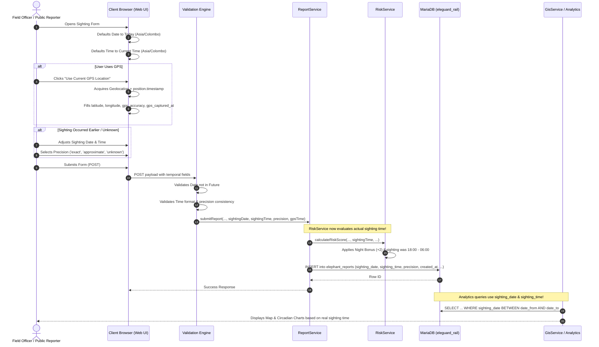

# EleGuard Rail — Milestone 9C: Temporal & Seasonal Intelligence Architecture

**Document:** `docs/phase9/milestone_9c_architecture.md`  
**Phase:** 9 — Historical Elephant Sighting Intelligence  
**Milestone:** 9C — Temporal & Seasonal Intelligence (Technical Design & Migration Strategy)  
**Status:** DESIGN-ONLY (Strict Read-Only Inspection; No Code or Database Modifications)  
**Target Environments:**
- Development Repository: `C:\Users\user\Desktop\Railway\eleguard-rail`
- Production / XAMPP Deployment: `C:\xampp\htdocs\eleguard-rail`
- Reference Timezone: `Asia/Colombo` (UTC+05:30)

---

## 1. Executive Summary & Problem Formulation

The EleGuard Rail platform was engineered as a real-time early warning system to protect wild Asian elephants (*Elephas maximus maximus*) and passenger locomotives from catastrophic collisions across Sri Lanka's railway network.

While previous milestones successfully integrated GPS spatial geometry (Milestones 6 & 7), Edge AI computer vision detection (Milestones 8A–8C), and spatial hotspot analytics (Milestones 9A & 9B), **the platform currently lacks an authentic temporal data model for wildlife observations**.

### The Temporal Conflation Problem
In the current architecture, sighting records conflate two fundamentally different events into a single timestamp:
1. **The Physical Ecological Event:** When an elephant or herd was physically observed near or traversing the railway line.
2. **The System Ingestion Event:** When the reporter or ranger gained cellular/internet connectivity and submitted the HTTP POST request into the database (`created_at`).

```
ACTUAL FIELD REALITY:
[ Elephant Sighting ] --------------------> [ Connectivity Gained ] --------> [ System Ingestion ]
    02:30 AM (Night)                             08:15 AM (Morning)                 08:30 AM (Morning)
 (High Ecological Risk)                       (Travel to Range Office)          (Saved to Database)

CURRENT SYSTEM ASSUMPTION:
Record Created: 08:30 AM  ===>  Assumes Sighting Occurred at 08:30 AM (Daytime)!
Misses +2 Night Risk Score! Distorts Hourly Activity Distributions!
```

### Impact on Risk Scoring & Ecological Intelligence
- **Operational Risk Distortion:** `RiskService::calculateRiskScore` applies a critical **+2 score bonus for nocturnal sightings** (18:00 to 06:00). Because it evaluates `created_at`, a night sighting submitted the next morning is erroneously categorized as a daytime sighting, forfeiting the night hazard bonus. Conversely, a daylight sighting submitted at night is falsely penalized as a nocturnal hazard.
- **Temporal & Circadian Invalidation:** Analytics evaluating peak elephant crossing hours (e.g., crepuscular and nocturnal peaks) currently measure when people submit forms, rather than when elephants move.
- **Seasonal & Monsoonal Obfuscation:** Retrospective historical reports or paper field records entered in batch receive the creation timestamp of the batch run, completely obliterating seasonal correlation with Sri Lanka's **Yala** (dry season) and **Maha** (monsoonal wet season) agro-ecological cycles.

---

## 2. Existing Architecture Audit

A comprehensive read-only audit of the existing application was conducted across the codebase and database:

### 2.1 Database Schema (`elephant_reports`)
Inspection of `elephant_reports` in `eleguard_rail` reveals the following time-related fields:
- `created_at` (`DATETIME NOT NULL DEFAULT CURRENT_TIMESTAMP`): Captures the server time of database row insertion.
- `updated_at` (`DATETIME NULL ON UPDATE CURRENT_TIMESTAMP`): Captures subsequent status updates by wildlife officers or administrators.
- `ai_processed_at` (`DATETIME NULL`): Captures the exact timestamp when the YOLOX-Tiny computer vision inference was executed on the sighting photograph.
- **Zero fields exist for actual sighting date, actual sighting time, sighting time uncertainty, or GPS fix timestamp.**

### 2.2 Report Submission Workflow (`ReportService::submitReport`)
Inspection of `app/services/ReportService.php` (lines 30–78):
```php
$reportTime = date('Y-m-d H:i:s');
$calculatedRisk = RiskService::calculateRiskScore(
    $sectionRisk, 
    $urgencyLevel, 
    $elephantCount, 
    $reportTime, 
    $hasActiveAlert
);
// ...
$stmt = $db->prepare("
    INSERT INTO elephant_reports (
        section_id, reported_by, elephant_count, location_description, 
        latitude, longitude, gps_accuracy_meters,
        urgency_level, risk_score, report_status, description, image_path,
        ai_status, ai_detection_notes, created_at
    ) VALUES (...)
");
```
- `$reportTime` is generated via PHP's `date('Y-m-d H:i:s')` at the exact instant of function execution.
- This single variable is passed to `RiskService` and persisted as `created_at`.
- Neither `ReportService::submitReport` nor its database callers support caller-provided sighting timestamps.

### 2.3 Reporter and Ranger Web Forms
Inspection of `public/reporter/submit_report.php` and `public/wildlife/submit_report.php`:
- Both forms collect: `section_id`, `elephant_count`, `urgency_level`, `location_description`, `latitude`, `longitude`, `gps_accuracy`, `description`, and `image`.
- **Neither form contains any input fields for date, time of day, or time precision.**
- Reporters cannot indicate that a sighting took place 3 hours ago, yesterday evening, or at dusk.

### 2.4 Geolocation JavaScript Implementation
Inspection of `public/reporter/submit_report.php` (lines 348–365):
```javascript
navigator.geolocation.getCurrentPosition(function(position) {
    const lat = position.coords.latitude.toFixed(6);
    const lng = position.coords.longitude.toFixed(6);
    const acc = position.coords.accuracy ? Math.round(position.coords.accuracy) : null;
    // position.timestamp is completely discarded!
});
```
- The W3C Geolocation API provides `position.timestamp` (DOMTimeStamp representing the exact millisecond when the satellite fix was acquired by hardware).
- Currently, this value is discarded by the client script, forfeiting a zero-cost source of device-authenticated temporal ground truth.

### 2.5 Wildlife Review Interface (`public/wildlife/reports.php`)
Inspection of lines 90–92:
```php
<tr>
    <td style="color:var(--text-secondary);">Date / Time:</td>
    <td><?php echo format_date($selectedReport['created_at']); ?></td>
</tr>
```
- Wildlife officers verifying or rejecting reports are presented solely with `format_date($selectedReport['created_at'])`.
- An officer reviewing a report has no means of verifying whether the sighting is fresh (10 minutes ago) or historical (submitted hours or days later).

### 2.6 GIS & Analytics Query Filtering (`GisService::getElephantReports`)
Inspection of `app/services/GisService.php` (lines 137–144):
```php
if (!empty($filters['date_from'])) {
    $query .= " AND DATE(r.created_at) >= :date_from";
}
if (!empty($filters['date_to'])) {
    $query .= " AND DATE(r.created_at) <= :date_to";
}
```
- Geospatial map queries and time filters operate on `DATE(r.created_at)`.
- Temporal GIS queries currently reflect server ingestion dates rather than the biological presence of elephants on the landscape.

---

## 3. The Dual-Timeline Architecture Paradigm

Milestone 9C introduces a formal **Dual-Timeline Architecture** that untangles operational telematics from ecological observations:

```
+---------------------------------------------------------------------------------------------------+
|                                   ELEGUARD RAIL DUAL-TIMELINE MODEL                               |
+---------------------------------------------------------------------------------------------------+
|                                                                                                   |
|  [ ECOLOGICAL TIMELINE ] (When the Elephant Appeared)                                             |
|  * sighting_date            : DATE (e.g. 2026-11-09)                                              |
|  * sighting_time            : TIME NULL (e.g. 02:45:00)                                           |
|  * sighting_time_precision  : ENUM ('exact', 'approximate', 'unknown')                            |
|  * sighting_timezone        : VARCHAR(32) ('Asia/Colombo')                                        |
|  * gps_captured_at          : DATETIME NULL (Hardware GPS fix time)                               |
|                                                                                                   |
|         | Drives:                                                                                 |
|         +---> RiskService Nocturnal Bonus (+2 for 18:00 - 06:00 sightings)                        |
|         +---> Hourly & Circadian Movement Analytics (Peak crossing hours)                         |
|         +---> Seasonal & Monsoonal Migration Intelligence (Yala / Maha regimes)                   |
|         +---> Locomotive Speed Advisory Windows                                                   |
|                                                                                                   |
|  -----------------------------------------------------------------------------------------------  |
|                                                                                                   |
|  [ OPERATIONAL / AUDIT TIMELINE ] (When the System Processed the Data)                            |
|  * created_at               : DATETIME (Server insertion instant)                                 |
|  * updated_at               : DATETIME (Officer verification/rejection instant)                    |
|  * ai_processed_at          : DATETIME (YOLOX-Tiny inference completion instant)                  |
|                                                                                                   |
|         | Drives:                                                                                 |
|         +---> Dispatch & Driver Alert Broadcast Latency                                           |
|         +---> Reporting Lag / Telemetry Latency Metric (created_at - sighting_time)               |
|         +---> Immutable Regulatory & Legal Audit Trails                                           |
|         +---> System Event Logging (system_logs table)                                            |
|                                                                                                   |
+---------------------------------------------------------------------------------------------------+
```

---

## 4. End-to-End Component Architecture

The flow below details how temporal intelligence propagates through the EleGuard Rail platform:



---

## 5. Architectural Principles & Invariants

1. **Non-Destructive Evolution:** `created_at` and `updated_at` must remain immutable operational timestamps. Sighting timestamps must be stored in dedicated new columns.
2. **Explicit Time Precision:** Human wildlife observations range from exact clock sightings ("06:14 AM") to broad estimations ("yesterday evening around dusk") to retrospective records ("sometime in August 2026"). The database must formally model precision rather than forcing arbitrary minutes onto approximate sightings.
3. **Canonical Timezone Enforcement:** Sri Lanka observes a single national timezone (`Asia/Colombo`, UTC+05:30) with no Daylight Saving Time (DST). All user-facing dates and times must be captured, validated, and rendered in `Asia/Colombo`.
4. **Offline & Delayed Submission Resilience:** In rural wildlife corridors (e.g., Wilpattu, Minneriya, Gal Oya), mobile data connectivity is intermittent. The architecture must gracefully decouple sighting occurrence from network submission.
5. **Strict Backward Compatibility:** All 43 existing records in `elephant_reports` must remain valid and operational without synthetic backfilling or fabricated timestamps.
