# EleGuard Rail — Milestone 9C: Implementation Roadmap & Execution Plan

**Document:** `docs/phase9/milestone_9c_implementation_roadmap.md`  
**Phase:** 9 — Historical Elephant Sighting Intelligence  
**Milestone:** 9C — Temporal & Seasonal Intelligence  
**Status:** DESIGN-ONLY (Implementation Plan; Awaiting Authorization)  
**Execution Target:** Milestone 9C Implementation Phase (Upon Explicit Approval)  
**Target Environments:**
- Development Repository: `C:\Users\user\Desktop\Railway\eleguard-rail`
- Production / XAMPP Deployment: `C:\xampp\htdocs\eleguard-rail`

---

## 1. Executive Summary & Phased Blueprint

This roadmap outlines the sequenced, zero-downtime implementation plan for introducing temporal and seasonal intelligence into EleGuard Rail.

The roadmap is structured into **8 discrete execution phases** designed to ensure:
- Zero operational regressions.
- Absolute data preservation for the 43 existing elephant sighting records.
- Complete backward compatibility with text-only and offline-first workflows.
- Strict isolation of development testing from production data.

```mermaid
gantt
    title Milestone 9C Implementation Schedule
    dateFormat  X
    axisFormat Phase %d
    
    section Foundation
    Phase 1: DB Migration & Verification           :p1, 0, 1
    Phase 2: Core Services & Validation Engine    :p2, 1, 2
    
    section User Interfaces
    Phase 3: Sighting Submission Forms (Web UI)   :p3, 2, 3
    Phase 4: Officer Review & Dashboard Panels    :p4, 3, 4
    
    section Intelligence
    Phase 5: GIS Layer Temporal Filtering         :p5, 4, 5
    Phase 6: Python Temporal Analytics Engine     :p6, 5, 6
    
    section Quality & Release
    Phase 7: Full 154-Test Platform Regression    :p7, 6, 7
    Phase 8: XAMPP Deployment & Final Audit       :p8, 7, 8
```

---

## 2. Phase-by-Phase Execution Plan

### Phase 1: Database Migration & Verification
- **Objectives:** Execute Migration 03 (`database/migrations/03_add_temporal_intelligence_to_elephant_reports.sql`) on the live MariaDB database.
- **Tasks:**
  1. Pre-migration database backup (`scratch/backup_before_9c_migration/`).
  2. Verify operational row counts prior to execution (`elephant_reports = 43`).
  3. Apply Migration 03:
     - Add `sighting_date`, `sighting_time`, `sighting_time_precision`, `sighting_timezone`, and `gps_captured_at`.
     - Create 4 performance indexes.
     - Backfill existing 43 records: `sighting_date = DATE(created_at)`, `sighting_time = NULL`, `sighting_time_precision = 'unknown'`.
  4. Verify post-migration schema integrity and row count parity (assert 43 records remain intact).
  5. Dry-run rollback script on isolated clone to verify reversal capability.
- **Deliverables:** `database/migrations/03_add_temporal_intelligence_to_elephant_reports.sql`, `database/migrations/rollback_03_temporal_intelligence.sql`.

### Phase 2: Core Services & Validation Engine
- **Objectives:** Update backend business logic and validation handlers to accept and process temporal parameters.
- **Tasks:**
  1. Update `app/includes/validation.php`:
     - Implement `Validation::sightingTemporal($date, $time, $precision)`.
     - Enforce date format, non-future dates, historical limits, and precision consistency.
  2. Update `app/services/ReportService.php`:
     - Expand `submitReport()` signature to accept `$sightingDate`, `$sightingTime`, `$sightingPrecision`, and `$gpsCapturedAt`.
     - Decouple `$sightingTime` from `$reportTime` (`created_at`).
     - Persist temporal parameters into MariaDB.
  3. Update `app/services/RiskService.php`:
     - Update `calculateRiskScore()` to evaluate actual `$sightingTime` instead of submission timestamp for the +2 Night Hazard Bonus.
     - Maintain daytime baseline for `precision = 'unknown'`.
- **Deliverables:** Modified `app/includes/validation.php`, `app/services/ReportService.php`, `app/services/RiskService.php`.

### Phase 3: Sighting Submission Forms (Web UI)
- **Objectives:** Integrate user-friendly temporal inputs into reporter and ranger submission forms.
- **Tasks:**
  1. Update `public/reporter/submit_report.php`:
     - Add Sighting Date picker (pre-filled with today in `Asia/Colombo`, max today).
     - Add Sighting Time input with Precision radio controls (`Exact`, `Approximate`, `Unknown`).
     - Add quick preset buttons for approximate windows (Dawn, Morning, Afternoon, Dusk, Night).
     - Update Geolocation JavaScript to capture `position.timestamp` into hidden field `gps_captured_at`.
  2. Update `public/wildlife/submit_report.php`:
     - Implement identical temporal controls for ranger patrol field submissions.
  3. CSS styling adjustments in `public/assets/css/` for responsive mobile layout.
- **Deliverables:** Modified `public/reporter/submit_report.php`, `public/wildlife/submit_report.php`.

### Phase 4: Officer Review & Dashboard Panels
- **Objectives:** Enhance review workflows and operational dashboards with temporal telemetry.
- **Tasks:**
  1. Update `public/wildlife/reports.php`:
     - Replace generic "Date / Time" with the dual-timeline **Temporal Verification Panel**.
     - Display Sighting Date, Clock Time, Precision Badge, Device GPS Timestamp, and calculated reporting lag.
  2. Update `public/control/reports.php` and `public/admin/reports.php`:
     - Display actual sighting time in data tables to give railway controllers real-time context on hazard recency.
- **Deliverables:** Modified `public/wildlife/reports.php`, `public/control/reports.php`, `public/admin/reports.php`.

### Phase 5: GIS Layer Temporal Filtering
- **Objectives:** Enable map filtering by actual biological sighting dates.
- **Tasks:**
  1. Update `app/services/GisService.php`:
     - Modify `getElephantReports()` date range filter to evaluate `sighting_date` with fallback to `DATE(created_at)`.
     - Add optional diurnal/nocturnal filter parameter (`day_only`, `night_only`).
  2. Update `public/assets/js/map_component.js`:
     - Display actual sighting date/time in Leaflet map sighting popups.
- **Deliverables:** Modified `app/services/GisService.php`, `public/assets/js/map_component.js`.

### Phase 6: Python Temporal Analytics Engine
- **Objectives:** Develop standalone, reproducible temporal analytics script.
- **Tasks:**
  1. Author `ai/analytics/temporal_analytics.py`:
     - Extract temporal fields from live database in strict read-only mode.
     - Implement strict data provenance filters (`genuine_only` vs `all`).
     - Compute 24-hour circadian hourly distributions.
     - Compute diurnal vs nocturnal risk ratios.
     - Compute reporting lag telemetry histograms.
     - Classify observations into Sri Lankan agro-ecological seasons (Yala vs Maha).
  2. Generate 6 publication-quality analytical charts (300 DPI) under `docs/phase9/visualizations/`:
     - `temporal_hourly_circadian_distribution.png`
     - `temporal_day_vs_night_risk_split.png`
     - `temporal_seasonal_yala_vs_maha.png`
     - `temporal_reporting_lag_distribution.png`
     - `temporal_section_seasonal_heatmap.png`
     - `temporal_provenance_stratification.png`
- **Deliverables:** `ai/analytics/temporal_analytics.py`, 6 visualization PNG artifacts.

### Phase 7: Full 154-Test Platform Regression
- **Objectives:** Execute the comprehensive automated test matrix.
- **Tasks:**
  1. Develop `tests/test_milestone_9c_temporal.php` implementing all 30 test cases specified in the test strategy.
  2. Execute all 7 test suites:
     - Python AI Detector Suite (24 tests)
     - Core GPS & Workflow Suite (19 tests)
     - GIS & Proximity Engine Suite (21 tests)
     - Milestone 7C Map Integration Suite (12 tests)
     - Milestone 8C AI Integration Suite (25 tests)
     - Milestone 9B Analytics Suite (23 tests)
     - **Milestone 9C Temporal Suite (30 tests)**
  3. Assert **154 / 154 tests pass (100%)**.
  4. Verify operational database row counts remain completely unchanged.
- **Deliverables:** `tests/test_milestone_9c_temporal.php`, test execution logs.

### Phase 8: Deployment & User Acceptance
- **Objectives:** Synchronize codebase to XAMPP and deliver final verification report.
- **Tasks:**
  1. Synchronize all modified files from Desktop to XAMPP (`C:\xampp\htdocs\eleguard-rail`).
  2. Perform 100% SHA-256 bit-for-bit hash parity audit.
  3. Verify live browser runtime on XAMPP (Reporter form, Wildlife review, Control view).
  4. Git commit and tag `milestone-9c`.
  5. Present final verification and acceptance report.
- **Deliverables:** Git commit, `docs/phase9/milestone_9c_final_report.md`.

---

## 3. Risk Assessment & Fallback Matrix

| Risk Scenario | Probability | Impact | Mitigation / Fallback Procedure |
|:---|:---:|:---:|:---|
| **Migration syntax error during `ALTER TABLE`** | Low | High | Migration is dry-run on isolated test database first. `rollback_03_temporal_intelligence.sql` ready for instantaneous reversal. |
| **User enters invalid historical date (e.g. year 0026)** | Medium | Low | Client HTML5 `min="1900-01-01"` and server `Validation::sightingTemporal()` strictly reject dates prior to 1900. |
| **Legacy code calls `submitReport()` without new temporal args** | Medium | Medium | Default parameter values assigned in method signature (`$sightingDate = null`, etc.); defaults to current date/time transparently. |
| **Browser timezone offset confusion** | Low | Medium | Canonical timezone enforced as `Asia/Colombo` in PHP backend. Client sends local string `YYYY-MM-DD` and `HH:MM`, preventing client timezone skew. |
| **Misinterpretation of test timestamps as seasonal peaks** | High | High | Provenance filter hardcoded into `temporal_analytics.py`. Warning banners embedded in all generated charts. |

---

## 4. Hardware & Resource Budget

- **Financial Cost:** **\$0.00 (Zero Budget)**.
- **Software Dependencies:** 100% open-source local stack (PHP 8.2+, MariaDB 10.4+, Python 3.13, Matplotlib, HTML5 Geolocation).
- **Execution Overhead:** Database schema expansion adds 5 nullable columns (~20 bytes per row); index overhead is < 64 KB across 1,000 records. Query execution overhead is negligible (< 1 ms).

---

## 5. Stop Condition & Authorization Gate

**Milestone 9C technical design and architectural planning is complete.**

In accordance with strict project rules:
- **No application code has been modified.**
- **No database schema migrations have been executed.**
- **No operational records have been written or altered.**
- **Implementation is paused at this gate.**

Standing by for user review and explicit authorization to commence Phase 1 implementation.
