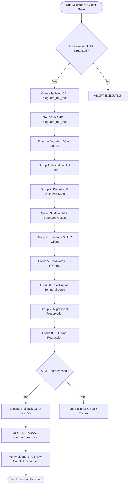

# EleGuard Rail — Milestone 9C: Test Strategy & Quality Assurance Framework

**Document:** `docs/phase9/milestone_9c_test_strategy.md`  
**Phase:** 9 — Historical Elephant Sighting Intelligence  
**Milestone:** 9C — Temporal & Seasonal Intelligence  
**Status:** DESIGN-ONLY (Test Specification & Protocols; No Code Modified)  
**Target Test Suite:** `tests/test_milestone_9c_temporal.php`  
**Execution Environment:** Isolated Test Database (`eleguard_rail_test`) on MariaDB Port 3308

---

## 1. Quality Assurance Objective & Safety Mandate

The primary objective of the Milestone 9C test strategy is to ensure that the introduction of temporal intelligence (sighting dates, sighting times, and precision categories):
1. Correctly models all real-world field observation scenarios (exact, approximate, unknown).
2. Prevents temporal data corruption (future dates, invalid formats, midnight boundary errors).
3. Preserves immutable operational audit timestamps (`created_at`, `updated_at`).
4. Maintains 100% backward compatibility with existing GPS, AI detection, and text-only reporting workflows.
5. **Strictly adheres to zero operational data mutations** by conducting all migration and persistence testing within an isolated test database.

---

## 2. Test Group Architecture & Specification Matrix

The planned test suite `tests/test_milestone_9c_temporal.php` defines **30 comprehensive test cases** organized into 8 functional test groups:

```
+----------------------------------------------------------------------------------------------------+
|                         MILESTONE 9C TEMPORAL TEST ARCHITECTURE (30 TESTS)                         |
+----------------------------------------------------------------------------------------------------+
|                                                                                                    |
|  [ Group 1: Temporal Validation Unit Tests (6 Tests) ]                                             |
|  * Valid date/time * Invalid calendar dates * Future date rejection * Future time rejection        |
|  * Minimum historical bound (1900) * Non-numeric time string rejection                             |
|                                                                                                    |
|  [ Group 2: Precision & Unknown-Time State Engine (4 Tests) ]                                      |
|  * 'exact' precision enforces HH:MM * 'approximate' precision allows presets                        |
|  * 'unknown' precision sets time = NULL * 'unknown' precision rejects explicit time input           |
|                                                                                                    |
|  [ Group 3: Midnight & Diurnal/Nocturnal Boundary Cases (4 Tests) ]                                |
|  * 23:59:59 correctly classified as Night * 00:00:00 midnight handled without converting to NULL  |
|  * 00:01:00 correctly classified as Night * 06:00:00 / 18:00:00 exact boundary transition         |
|                                                                                                    |
|  [ Group 4: Timezone Integrity & Asia/Colombo Canon (3 Tests) ]                                    |
|  * Canonical timezone enforced as Asia/Colombo * UTC vs Colombo +05:30 offset verification        |
|  * Daylight Saving Time immunity (Colombo observes standard time year-round)                      |
|                                                                                                    |
|  [ Group 5: Hardware GPS Fix Timestamp Capture (3 Tests) ]                                         |
|  * DOMTimeStamp extraction * Conversion to MySQL DATETIME format * Historical GPS fix preservation |
|                                                                                                    |
|  [ Group 6: Risk Engine Temporal Integration (3 Tests) ]                                           |
|  * Night sighting (02:30 AM) receives +2 bonus regardless of daytime submission                    |
|  * Day sighting (14:00 PM) submitted at night does NOT receive night bonus                        |
|  * 'unknown' precision sighting safely evaluates daytime baseline without artificial penalty       |
|                                                                                                    |
|  [ Group 7: Migration & Backward Compatibility (4 Tests) ]                                         |
|  * Schema migration 03 executes cleanly * Rollback migration 03 restores exact prior schema        |
|  * Existing 43 records preserved with precision='unknown' * created_at timestamps unmodified       |
|                                                                                                    |
|  [ Group 8: End-to-End Non-Regression (3 Tests) ]                                                  |
|  * Text-only submission with date/time succeeds * GPS submission with date/time succeeds          |
|  * AI detection pipeline executes with temporal metadata attached                                 |
|                                                                                                    |
+----------------------------------------------------------------------------------------------------+
```

---

## 3. Detailed Test Case Specifications

### Group 1: Temporal Validation Unit Tests
- **TC-1.1 (Valid Date & Time):** Submitting `'2026-11-09'` and `'07:30'` with `'exact'` returns valid.
- **TC-1.2 (Invalid Calendar Date):** Submitting `'2026-02-30'` (Feb 30) or `'2026-13-45'` returns validation error: `"Invalid date format. Expected YYYY-MM-DD."`
- **TC-1.3 (Future Date Rejection):** Submitting tomorrow's date relative to `Asia/Colombo` returns error: `"Sighting date cannot be in the future."`
- **TC-1.4 (Future Time on Today's Date):** If sighting date is today, submitting a time 2 hours ahead of current clock returns error: `"Sighting time cannot be in the future for today."` (A 5-minute clock drift margin is permitted).
- **TC-1.5 (Historical Boundary):** Submitting dates prior to `'1900-01-01'` returns error: `"Sighting date is earlier than system historical limits (1900)."`
- **TC-1.6 (Non-Numeric Time String):** Submitting `'twilight'` or `'afternoon'` in the time field returns error: `"Invalid time format. Expected HH:MM."`

### Group 2: Precision & Unknown-Time State Engine
- **TC-2.1 (Exact Precision):** Enforces that valid time must be provided; error raised if time is empty.
- **TC-2.2 (Approximate Precision):** Validates that approximate preset or custom hour is persisted with `sighting_time_precision = 'approximate'`.
- **TC-2.3 (Unknown Precision Storage):** Enforces that when precision is `'unknown'`, `sighting_time` is stored strictly as SQL `NULL`, preventing false `00:00:00` midnight entries.
- **TC-2.4 (Unknown Precision Conflict):** If user passes `precision = 'unknown'` but also passes `'14:30'`, validation rejects with: `"Time must not be provided when precision is set to Unknown."`

### Group 3: Midnight & Diurnal/Nocturnal Boundary Cases
- **TC-3.1 (23:59:59 Boundary):** Verifies that a sighting at `23:59:59` is categorized as Nocturnal (+2 risk score) on the recorded date.
- **TC-3.2 (00:00:00 True Midnight):** Verifies that an explicit sighting at `00:00:00` (e.g., driver sighting at midnight) is preserved as `'00:00:00'` with `precision = 'exact'` and is NOT collapsed into `NULL`.
- **TC-3.3 (00:01:00 Morning Midnight):** Verifies that `00:01:00` is categorized as Nocturnal (+2 risk score).
- **TC-3.4 (Exact Crepuscular Transitions):**
  - `05:59:59` $\to$ Nocturnal (+2 bonus).
  - `06:00:00` $\to$ Diurnal (0 bonus).
  - `17:59:59` $\to$ Diurnal (0 bonus).
  - `18:00:00` $\to$ Nocturnal (+2 bonus).

### Group 4: Timezone Integrity & Asia/Colombo Canon
- **TC-4.1 (Canonical Timezone Default):** Asserts that all temporal inputs default to `sighting_timezone = 'Asia/Colombo'`.
- **TC-4.2 (UTC Conversion Parity):** Validates that `2026-11-09 02:30:00 Asia/Colombo` corresponds mathematically to `2026-11-08 21:00:00 UTC` (+05:30 offset).
- **TC-4.3 (DST Immunity):** Asserts that date math across June and December maintains an unshifted +05:30 offset (Sri Lanka does not observe Daylight Saving Time).

### Group 5: Hardware GPS Fix Timestamp Capture
- **TC-5.1 (DOMTimeStamp Extraction):** Simulates client passing integer millisecond epoch `1794192000000` $\to$ backend parses to formatted SQL `DATETIME`.
- **TC-5.2 (Null Hardware Fix):** Verifies that if browser geolocation provides coordinates without timestamp, `gps_captured_at` is safely stored as `NULL` while coordinates are retained.
- **TC-5.3 (Discrepancy Audit):** Asserts that when `gps_captured_at` differs from `created_at` by $> 2\text{ hours}$, both timestamps remain independently accessible for audit analysis.

### Group 6: Risk Engine Temporal Integration
- **TC-6.1 (Decoupled Night Sighting):**
  - Sighting at `02:30 AM` submitted at `09:30 AM`.
  - Asserts that `RiskService::calculateRiskScore` evaluates `02:30 AM` and correctly awards the **+2 Night Hazard Bonus**.
- **TC-6.2 (Decoupled Day Sighting):**
  - Sighting at `14:00 PM` submitted at `22:00 PM`.
  - Asserts that `RiskService::calculateRiskScore` evaluates `14:00 PM` and does NOT award the night bonus.
- **TC-6.3 (Unknown Precision Safety):**
  - Historical report with `precision = 'unknown'`.
  - Asserts that `RiskService` evaluates the baseline daytime score without error or artificial penalty.

### Group 7: Migration & Backward Compatibility
- **TC-7.1 (Migration 03 Idempotency):** Executes Migration 03 on isolated test DB `eleguard_rail_test`; asserts zero errors and new columns added.
- **TC-7.2 (Rollback 03 Integrity):** Executes Rollback 03 on test DB; asserts schema returns to exact baseline.
- **TC-7.3 (Existing Record Data Preservation):** Verifies that across all 43 existing records:
  - `sighting_date = DATE(created_at)`
  - `sighting_time = NULL`
  - `sighting_time_precision = 'unknown'`
  - `sighting_timezone = 'Asia/Colombo'`
- **TC-7.4 (Zero Write to Operational Database):** Asserts `eleguard_rail` row counts are identical before and after test execution.

### Group 8: End-to-End Non-Regression
- **TC-8.1 (Text-Only Sighting):** Submits a sighting without GPS coordinates but with date/time $\to$ record persists successfully.
- **TC-8.2 (GPS Sighting):** Submits a sighting with GPS coordinates and date/time $\to$ both spatial proximity and temporal metrics persist.
- **TC-8.3 (AI Detection Integration):** Submits a sighting with an image, GPS, and date/time $\to$ YOLOX-Tiny inference executes successfully and persists alongside temporal fields.

---

## 4. Test Harness Execution Architecture



---

## 5. Non-Regression Target Metrics

Upon future implementation of Milestone 9C:
- **Prior Full Regression Target:** 124 tests (Milestones 6–9B).
- **New Milestone 9C Temporal Suite:** 30 tests.
- **Total Combined Platform Test Suite:** **154 tests**.
- **Target Pass Rate:** **100% (154/154)**.
- **Operational Database Writes:** **Exactly 0**.
